<div align="center">


# Intelligent Decision Support System

**Describe a business problem in plain language, upload a table, and get back a verified ML model with explained,
actionable decisions.**

[](<LIVE_LINK>)
[](https://www.python.org/)
[](https://fastapi.tiangolo.com/)
[](https://streamlit.io/)
[](#testing)
[](#testing)
[](LICENSE)

<sub>At submission: 449 tests, 447 offline passing (see <a href="docs/testing.md">docs/testing.md</a>).</sub>

**Live demo:** `<LIVE_LINK>` — hosted on Streamlit Community Cloud (embedded API, public demo mode; see
[Deployment](#streamlit-community-cloud-free))

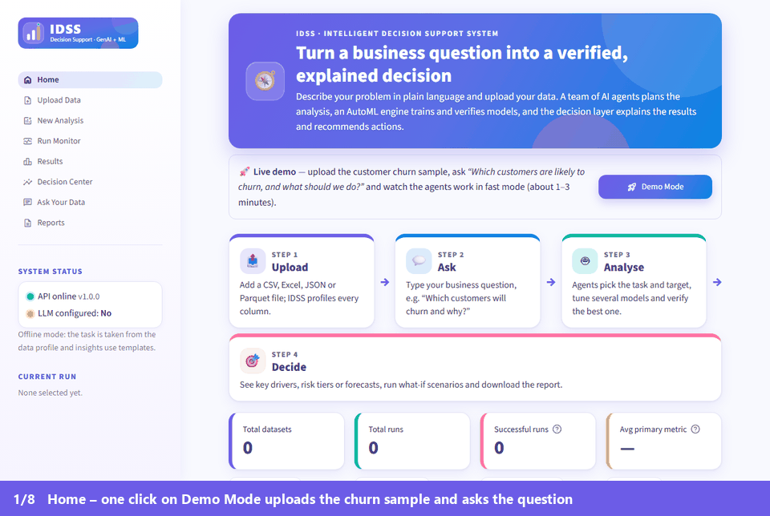

<sub>Demo Mode on the bundled synthetic churn data, offline (no LLM): recorded with
<code>scripts/make_demo_gif.py</code>.</sub>

</div>

---

## Table of contents

- [Overview](#overview)
- [Problem and motivation](#problem-and-motivation)
- [Key features](#key-features) · [Features in detail](#features-in-detail)
- [How it works](#how-it-works) · [Architecture](#architecture)
- [Example walkthrough: customer churn](#example-walkthrough-customer-churn)
- [Screenshots](#screenshots)
- [Evaluation](#evaluation) — [methodology](#methodology), [results](#results), [ablation](#ablation),
  [robustness](#robustness), [figures](#figures)
- [Tech stack](#tech-stack)
- [Quick start](#quick-start) · [Configuration](#configuration) · [API endpoints](#api-endpoints)
- [Security and privacy](#security-and-privacy) · [Deployment](#deployment)
- [Project structure](#project-structure) · [Testing](#testing)
- [Limitations](#limitations) · [Roadmap](#roadmap) · [FAQ](#faq) · [Contributing](#contributing)
- [Documentation](#documentation) · [Team](#team) · [Acknowledgements](#acknowledgements) ·
  [Citation](#citation) · [License](#license)

## Overview

IDSS (*Intelligent Decision Support System Using Generative AI and Machine Learning*) lets a non-expert ask a question
such as *“Which customers are likely to churn, and what should we do to retain them?”* about their own data. A team of
LLM agents turns the question into a validated machine-learning task; a deterministic AutoML engine trains, tunes and
verifies the models; and a decision layer explains the result and recommends what to do — with SHAP drivers, risk
tiers, what-if simulation, forecasts and a PDF report.

The LLM plans and explains; it never writes the training code. Every model comes from a fixed, tested model zoo, the
test split is read exactly once, and the decision brief may only quote numbers that were actually computed. IDSS works
with any OpenAI-compatible endpoint (OpenAI, Groq, Google Gemini, a local Ollama model) and, apart from the free-form
*Ask Your Data* chat, **runs completely offline without one**.

This is a final-year B.Tech project inspired by AutoML-Agent (Trirat et al., ICML 2025) — see
[Acknowledgements](#acknowledgements).

## Problem and motivation

Small and medium businesses collect data — customer records, sales, prices, deliveries — but rarely have a data
scientist to turn it into decisions. The people who own the decisions think in questions (*who will leave? what drives
sales? what if we change the contract?*), not in pipelines, metrics and hyperparameters.

Existing tools cover only part of the way:

| Approach | What it does well | What is missing for a business user |
|---|---|---|
| **AutoML libraries / platforms** | Search and tune models automatically | Need a prepared dataset, a chosen target and metric, and ML knowledge to read the output; stop at a model score |
| **Plain LLM chatbots** | Understand plain language, explain things | No reliable training or evaluation; may invent numbers; code they write is not checked or reproducible |
| **BI dashboards** | Show what happened | Do not predict, explain drivers or simulate what would happen after a change |

IDSS combines the strengths: LLM agents for understanding and explanation, a deterministic and verified AutoML engine
for the numbers, and a decision layer that answers the business question — *who*, *why*, *what if* and *what to do* —
with every number traceable to a computation.

## Key features

|  | Feature | What it does |
|:---:|---|---|
| 🗣️ | **Plain-language requests** | A Requirement Agent turns the question into a typed requirement, repairs it against the actual data and asks clarifying questions when something is missing. |
| 🧹 | **Automatic data handling** | Profiling (types, missing values, leakage and imbalance warnings), cleaning, stratified or chronological 70/20/10 splits, preprocessing and time-series features. |
| ⚙️ | **AutoML with guarantees** | scikit-learn, XGBoost and LightGBM models tuned with Optuna inside a time budget; user constraints (latency, training time, explainability) and decision-threshold tuning. |
| ✅ | **Verification** | Seven rule-based checks (targets, baseline, constraints, test size, single test access, leakage, overfitting) plus an optional LLM review; one automatic re-plan when a check fails. |
| 🎯 | **Decisions, not just predictions** | SHAP drivers per original column, risk tiers with stated cut-offs, counterfactual actions, record and segment what-if simulation, forecasts with intervals, cluster profiles. |
| 📝 | **Grounded insights** | The plain-language decision brief is checked number by number against the computed facts; otherwise a complete template is used. |
| 💬 | **Ask Your Data** | LLM-written pandas code, statically checked and executed in a sandboxed child process with a time limit. |
| 🖥️ | **Web app** | FastAPI backend + Streamlit dashboard (8 pages), resumable runs, SQLite index, PDF and Markdown reports. |
| 📊 | **Reproducible evaluation** | Offline benchmark with the AutoML-Agent metrics (SR, NPS, CS), ablation and robustness studies. |

## Features in detail

Click a feature to expand it.

<details>
<summary><b>Requirement understanding</b></summary>

The Requirement Agent first checks that the question is about the data (an off-topic request ends politely), then
parses it into a typed `UserRequirement`: task type, target column, metrics, constraints, actionable features. A
deterministic repair step fixes what the data contradicts — an unusable target is replaced by the profile's
suggestion, a task type that conflicts with the data loses, metrics of the wrong family are dropped. If something
essential is still missing, the run pauses in `NEEDS_INPUT` with clarifying questions (at most two rounds). Without an
LLM, the requirement is built from the data profile.
</details>

<details>
<summary><b>Data profiling and preparation</b></summary>

The Data Agent loads CSV, Excel, JSON or Parquet, then profiles every column: semantic type (numeric, categorical,
boolean, datetime, ID, text), missing values, distinct values, statistics, and warnings for possible leakage, class
imbalance and ID-like columns. It suggests a target and a task type, cleans the data and splits it 70/20/10 —
stratified for classification, chronological for time series. All decisions are deterministic; the LLM only writes
the plain-English summary from aggregates.
</details>

<details>
<summary><b>AutoML with Optuna</b></summary>

The Model Agent ranks candidates from a fixed model zoo (logistic/ridge regression, random forest, extra trees,
gradient boosting, XGBoost, LightGBM, k-means, Gaussian mixture, …) — the LLM can only *choose* names, never write
code. Each candidate is tuned with Optuna (TPE sampler, median pruner) within a time budget: *fast* = 3 models × 15
trials, *full* = 6 models × 40 trials. Constraints such as “inference under 5 ms” or “must be explainable” become budget
caps, an interpretable candidate and leaderboard violations. The best compliant model by validation score is refitted
on train + validation and scored on the test split exactly once.
</details>

<details>
<summary><b>Decision-threshold tuning</b></summary>

For binary classification the probability cut-off is tuned on the validation split (for F1, accuracy or balanced
accuracy — never precision or recall alone, which would pick a degenerate cut-off). The tuned threshold is stored with
the model and used for every prediction; test metrics are reported both at the tuned threshold and at the default 0.5
so the effect is visible.
</details>

<details>
<summary><b>Verification and re-planning</b></summary>

The Verifier runs seven rule-based checks: metric targets met, beats a trivial baseline (majority class, mean,
seasonal naive or random clusters), user constraints respected, at least 30 test rows, test split used once, no leakage
warnings, and a train–test gap below 0.15 on a 0–1 metric. An optional LLM review adds a verdict, concerns and
recommendations. If a check fails, the run re-plans **once** with a bigger budget and the verifier's recommendations;
if it still fails, the results are shown flagged as *not verified* instead of being hidden.
</details>

<details>
<summary><b>SHAP explanations</b></summary>

Tree models use SHAP's `TreeExplainer`, linear models its `LinearExplainer`, on up to 500 training rows; anything else
falls back to permutation importance. SHAP values are summed back to the **original columns** (one-hot columns → their
source column, date parts → the date column, lags → “target (history)”), so drivers read in business terms. For binary
tasks the direction is oriented to the positive class: ▲ raises the risk, ▼ lowers it.
</details>

<details>
<summary><b>What-if and segment simulation</b></summary>

Change one or more inputs of a typical record (or any record) and see the model's output before and after. The segment
simulator applies changes (`set`, `add` or `pct`) to every record matching structured filters (e.g. `tenure < 12`) and
reports the average effect. Inputs are validated against the profile — unknown categories or values outside the
observed range produce warnings. Filters are structured conditions, never evaluated strings.
</details>

<details>
<summary><b>Counterfactual recommendations</b></summary>

For the riskiest records a greedy counterfactual search looks for the smallest set of changes (at most three, using
values observed in the data) to *actionable* columns that brings the prediction below the decision threshold. The
changes that work most often become recommended actions, each with a segment what-if estimate of its impact, a
confidence level and the evidence numbers behind it. Regression and forecasting get ±10% lever effects; clustering gets
per-segment actions.
</details>

<details>
<summary><b>Risk tiers</b></summary>

Binary classification results are grouped into High, Medium and Low tiers with stated cut-offs: High = at or above
the larger of the tuned threshold and the 70th percentile of predicted probability, Medium = above the threshold but
below the High cut-off, Low = below the threshold. So High stays a focused list (at most about 30% of records), and
each tier lists its own top SHAP drivers.
</details>

<details>
<summary><b>Forecasts</b></summary>

Time-series runs use lag, rolling-window and calendar features computed only from strictly earlier rows, compete
against an always-trained seasonal-naive baseline, and produce a recursive forecast with a ±1.96 × validation-RMSE
interval and a chart.
</details>

<details>
<summary><b>Grounded insights</b></summary>

The Insight Agent writes the decision brief (summary, findings, actions, risks, next steps) from a list of computed
facts only. A grounding check rejects any number in the text that is not in the facts (allowing rounding and
percentages); the brief is regenerated once and otherwise replaced by a complete, equally grounded template.
</details>

<details>
<summary><b>PDF and Markdown reports</b></summary>

Every finished run produces a report as PDF (reportlab) and Markdown from the same block list: question and
requirement, data profile, leaderboard, verification, drivers and charts, risk tiers with their cut-offs,
recommendations, what-if example and the decision brief.
</details>

<details>
<summary><b>Ask Your Data (sandbox)</b></summary>

Ask ad-hoc questions about a run's data. The LLM sees only column names and types and writes a short pandas analysis.
The code passes a static AST guard (allowed imports only, no file or network I/O, no private attributes) and then
runs in a separate, isolated Python process with restricted built-ins, no secrets in its environment, a time limit
and capped output. One automatic repair attempt; the generated code is shown with the answer. Disabled in the
[public demo](#public-demo-mode).
</details>

<details>
<summary><b>Run history and resumability</b></summary>

Each run is a state machine whose full context is saved to `state.json` after every transition, so runs survive
restarts and can be resumed. Runs, datasets and state-change events are indexed in SQLite for the Home page, the run
pickers and the API's list endpoints; a server restart marks runs that were mid-pipeline as failed with a clear
message.
</details>

## How it works

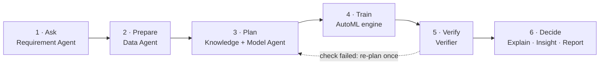

| Step | Component | What happens |
|:---:|---|---|
| 1 | **Requirement Agent** | Checks the question is relevant, parses it into a `UserRequirement` (task, target, metrics, constraints) and repairs it against the data profile. |
| 2 | **Data Agent** | Loads and profiles the file, cleans it, splits it 70/20/10 and fits the preprocessor. Only aggregates — never raw rows — are sent to the LLM. |
| 3 | **Knowledge + Model Agent** | Retrieves best-practice notes (offline TF-IDF RAG) and ranks candidate models from the zoo under the run's budget and constraints. |
| 4 | **AutoML engine** | Tunes every candidate with Optuna, tunes the decision threshold, refits the best compliant model and scores the test split once. |
| 5 | **Verifier** | Runs the seven checks; on a failure the run re-plans once with the verifier's recommendations, then continues flagged as *not verified*. |
| 6 | **Decision layer + Insight Agent** | SHAP explanations, risk tiers, recommendations and what-if; a grounded decision brief; a PDF and Markdown report. |

## Architecture

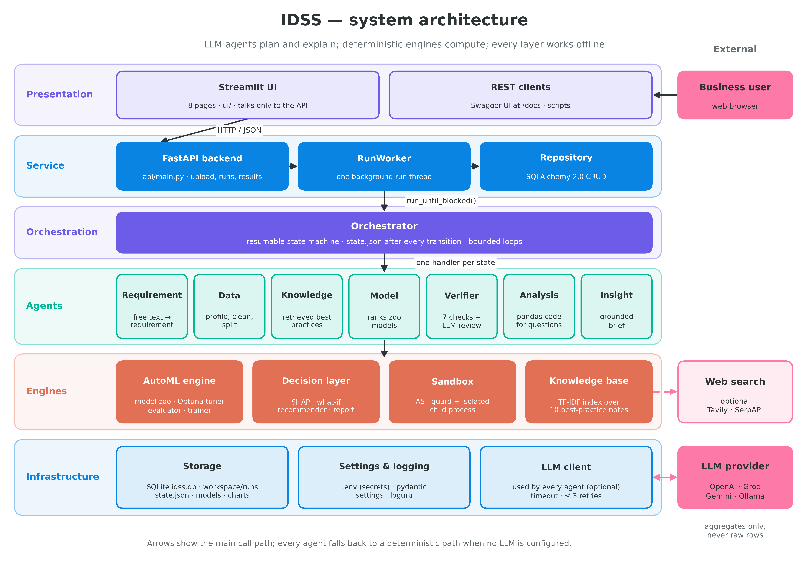

A resumable state machine (the Orchestrator) drives every run. The Streamlit UI talks only to the FastAPI backend,
which runs one training job at a time on a background worker. Every agent has a deterministic fallback, so the whole
pipeline also works without an LLM.

| Component | Responsibility | Key file |
|---|---|---|
| Settings | Typed settings from `.env`; keys are `SecretStr`, never logged | `configs/settings.py` |
| LLM client | The only door to the LLM: OpenAI-compatible, timeout on every call, at most 3 retries with backoff, structured (Pydantic) outputs | `idss/core/llm_client.py` |
| Schemas and prompts | Pydantic models for everything crossing a module boundary; prompt templates | `idss/core/schemas.py`, `idss/core/prompts/` |
| Requirement Agent | Relevance check, parse → `UserRequirement`, deterministic repair, clarifying questions | `idss/agents/requirement_agent.py` |
| Data Agent | Load, profile, clean, split, fit the preprocessor | `idss/agents/data_agent.py`, `idss/ml/profiler.py`, `idss/ml/preprocess.py` |
| Knowledge Agent | Retrieve best practices from the offline TF-IDF index (+ optional web search) | `idss/agents/knowledge_agent.py`, `idss/knowledge/` |
| Model Agent | Rank zoo models; turn constraints into a budget | `idss/agents/model_agent.py` |
| AutoML engine | Model zoo, Optuna tuner, metric registry, trainer (selection, threshold, refit, single test evaluation) | `idss/ml/model_zoo.py`, `idss/ml/tuner.py`, `idss/ml/evaluator.py`, `idss/ml/trainer.py` |
| Verifier | Seven rule-based checks + optional LLM review | `idss/agents/verifier.py` |
| Explainer | SHAP / permutation importance, forecasts, cluster profiles, charts | `idss/ml/explain.py` |
| Decision layer | What-if (record and segment), recommendations, risk tiers, counterfactuals | `idss/decision/what_if.py`, `idss/decision/recommender.py` |
| Insight Agent | Grounded decision brief from computed facts | `idss/agents/insight_agent.py` |
| Report builder | PDF + Markdown report | `idss/decision/report_builder.py` |
| Analysis Agent + sandbox | Ask Your Data: LLM-written pandas code in an isolated process | `idss/agents/analysis_agent.py`, `idss/execution/sandbox.py` |
| Orchestrator | State machine, persistence after every transition, bounded loops, DB mirroring | `idss/agents/manager.py` |
| Storage | Run folders, SQLite models, repository, public-demo retention | `idss/storage/` |
| API | REST endpoints, request/response models, background worker | `api/main.py`, `api/schemas.py`, `api/worker.py` |
| UI | Streamlit pages, HTTP client, charts, theme | `ui/app.py`, `ui/pages/`, `ui/api_client.py` |

<details>
<summary><b>Run state machine</b></summary>

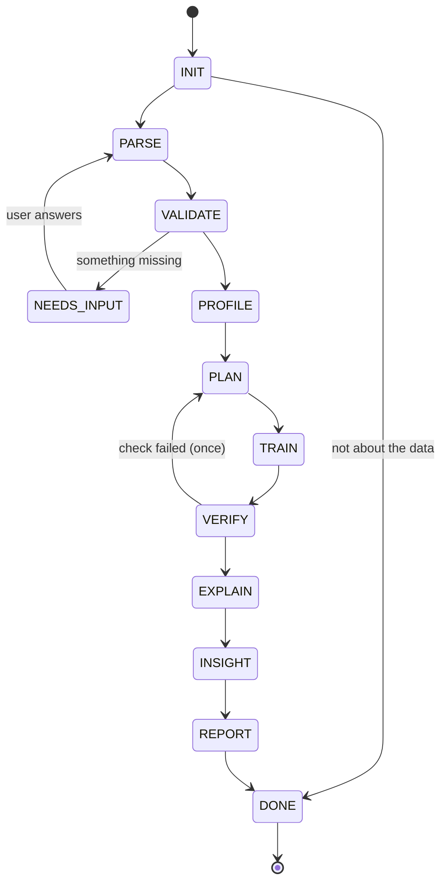

Any handler error moves the run to `FAILED` with a message instead of crashing. More diagrams (sequence, data flow,
ER, use cases, class, deployment) are in [docs/architecture.md](docs/architecture.md) and
[docs/diagrams/](docs/diagrams/).
</details>

## Example walkthrough: customer churn

A single demo run (seed 42) of **Demo Mode** — offline, without an LLM — on the synthetic
`data/samples/customer_churn.csv` (3,000 customers). Every number in this section comes from that run, saved by
`scripts/make_demo_gif.py` in [docs/assets/demo_run.json](docs/assets/demo_run.json) (the run shown in the GIF above).

**1 · Question**

> Which customers are likely to churn, and what should we do to retain them?

**2 · Requirement** — offline, the requirement is built from the data profile (with an LLM it is parsed from the
question) and then repaired against the data. Short form:

```json
{
  "problem": {"task_type": "tabular_classification", "performance_metrics": ["f1"], "constraints": []},
  "datasets": [{"target_column": "churn"}],
  "actionable_features": [],
  "confidence": 1.0
}
```

An empty `actionable_features` list lets the recommender infer the levers from the data (no IDs, dates, demographics,
locations or the target itself).

**3 · Leaderboard** — the fast budget tunes each candidate with Optuna (validation F1, higher is better):

| Rank | Model | Validation F1 | Train time (s) | Inference (ms/row) | Trials |
|---:|---|---:|---:|---:|---:|
| 1 | ★ Logistic regression | 0.646 | 0.48 | 0.019 | 15 |
| 2 | Random forest | 0.637 | 0.20 | 0.073 | 15 |
| 3 | LightGBM | 0.623 | 1.18 | 0.068 | 15 |

The selected model scores **F1 0.623** on the held-out test split at the tuned decision
threshold **0.32**. At the default 0.5 cut-off the same model would score F1 0.558. Verification: **7/7 checks passed**. These match the seed-42 churn run of the evaluation (F1 0.623, threshold 0.32).

**4 · Top drivers** — SHAP values summed per original column (SHAP LinearExplainer on
500 training rows):

| # | Column | Share of importance | Effect | Detail |
|---:|---|---:|---|---|
| 1 | `contract_type` | 33.8% | ◆ depends on the value | Highest for contract_type = 'Month-to-month', lowest for 'Two year'. |
| 2 | `tenure_months` | 19.8% | ▼ lowers churn risk | Higher tenure_months decreases the probability that churn = 'Yes'. |
| 3 | `payment_method` | 12.6% | ◆ depends on the value | Highest for payment_method = 'Electronic check', lowest for 'Credit card'. |
| 4 | `monthly_charges` | 8.9% | ▲ raises churn risk | Higher monthly_charges increases the probability that churn = 'Yes'. |
| 5 | `support_calls` | 8.7% | ▲ raises churn risk | Higher support_calls increases the probability that churn = 'Yes'. |

**5 · Risk tiers** — all 3,000 customers scored; High starts at 0.46 (the larger of the threshold and the
70th percentile), Medium at the threshold 0.32:

| Tier | Predicted probability | Customers | Share | Top drivers |
|---|---|---:|---:|---|
| **High** | 0.46 – 1.00 | 900 | 30.0% | `contract_type`, `tenure_months`, `payment_method` |
| **Medium** | 0.32 – 0.46 | 447 | 14.9% | `contract_type`, `tenure_months`, `payment_method` |
| **Low** | 0.00 – 0.32 | 1,653 | 55.1% | `contract_type`, `tenure_months`, `monthly_charges` |

**6 · Recommendations** (top 3 of 3)

1. **Prioritise the 900 high-risk records (30.0%) for proactive action.** They have a predicted probability of churn = 'Yes' of at least 0.46 (the top 30% of scores); on the test split, 52% of records flagged at the decision threshold of 0.32 were truly 'Yes', and this tier is the most confident part of that group. *Expected impact: 586.1 expected 'Yes' cases in the high-risk tier · confidence: medium.*
2. **Move high-risk records to contract_type = 'Two year'.** This change is part of the minimal change set for 20 of 20 high-risk records tested; applied to all 900 high-risk records it moves the average probability that churn = 'Yes' from 0.651 to 0.193. *Expected impact: -0.458 change in average probability that churn = 'Yes' (high-risk tier) · confidence: high.*
3. **Lower support_calls towards 0 for high-risk records (currently about 1.85 on average).** This change is part of the minimal change set for 13 of 20 high-risk records tested; applied to all 900 high-risk records it moves the average probability that churn = 'Yes' from 0.651 to 0.538. *Expected impact: -0.114 change in average probability that churn = 'Yes' (high-risk tier) · confidence: high.*

**Counterfactual for one high-risk customer** (row 2619): `contract_type` 'Month-to-month' → 'Two year', `support_calls` 8 → 0, `monthly_charges` 96.76 → 18.0 moves the predicted churn probability from 0.985 to 0.161, below the threshold 0.32. Changing only `contract_type` → 'Two year' for the same customer (the report's what-if example) moves it from 0.985 to 0.856 (-13.0%) — one lever is not enough for this customer.

**7 · Report** — the run ends with `report.pdf` and `report.md` (question, requirement, profile, leaderboard,
verification, drivers and charts, risk tiers, recommendations, what-if and the decision brief). The brief opens with:

> Goal: Which customers are likely to churn, and what should we do to retain them? We treated this as a classification problem (predicting a category). The best model (logistic_regression) scored f1 = 0.623 on held-out test data, against 0 for a simple majority class baseline. The strongest drivers are contract_type, tenure_months and payment_method. 900 records (30.0%) are in the high-risk tier.


## Screenshots

<table>
  <tr>
    <td width="50%">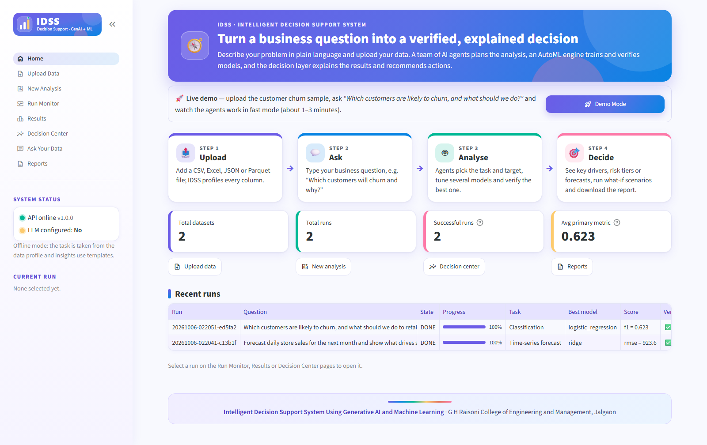<br><sub><b>Home</b> — one-click Demo Mode, workflow and KPIs</sub></td>
    <td width="50%">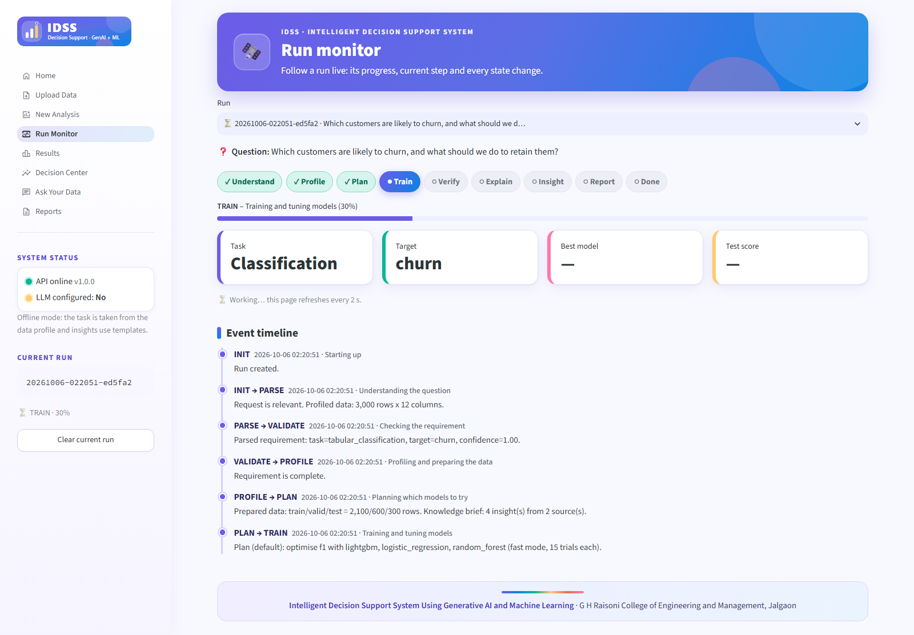<br><sub><b>Run Monitor</b> — live pipeline stages and event timeline</sub></td>
  </tr>
  <tr>
    <td width="50%">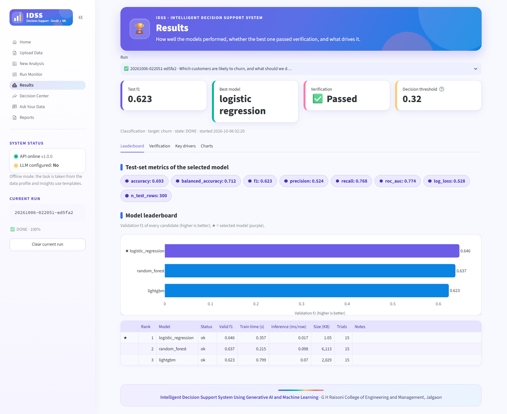<br><sub><b>Results</b> — test metrics, verification and leaderboard</sub></td>
    <td width="50%">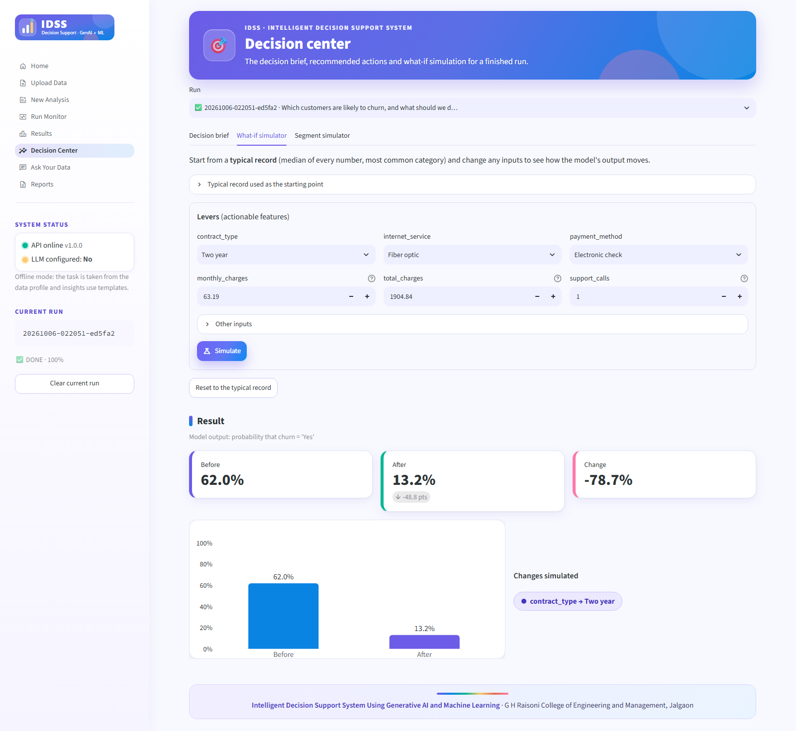<br><sub><b>Decision Center</b> — what-if simulation on a typical record</sub></td>
  </tr>
</table>

<details>
<summary><b>More screenshots</b> (upload, new analysis, decision center, forecast, Ask Your Data, reports)</summary>

| | |
|---|---|
| 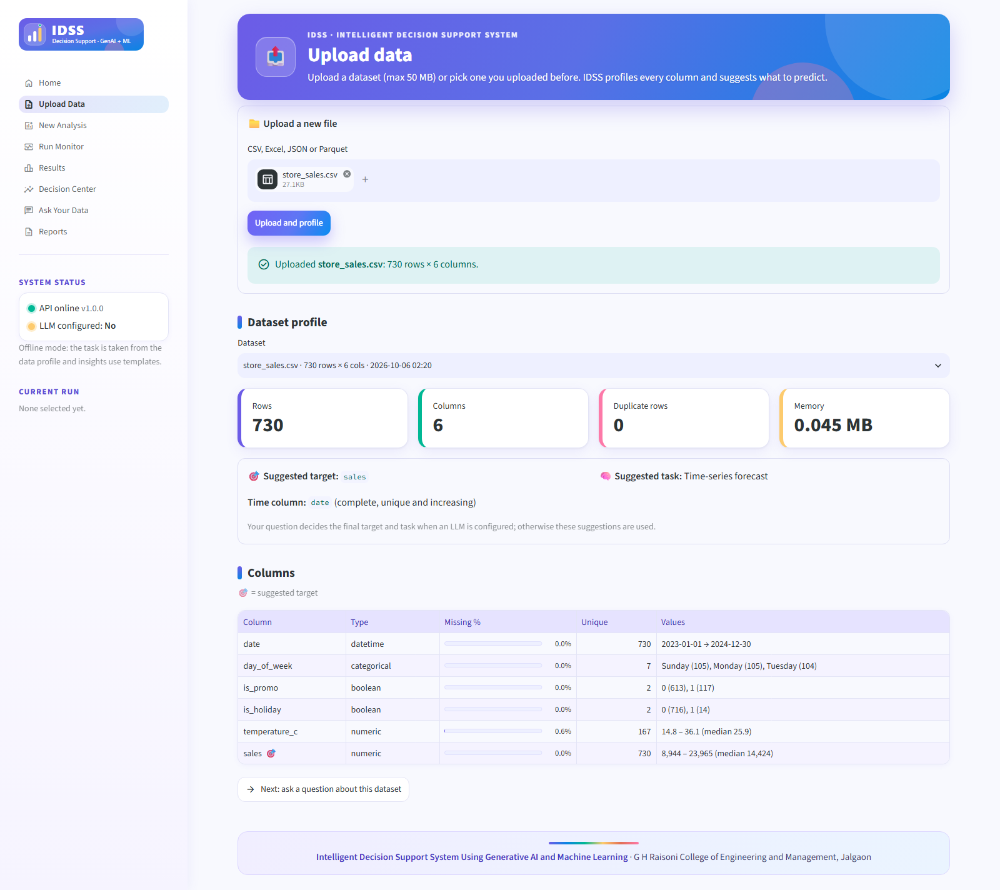<br><sub>Upload Data — column profile and suggested target</sub> | 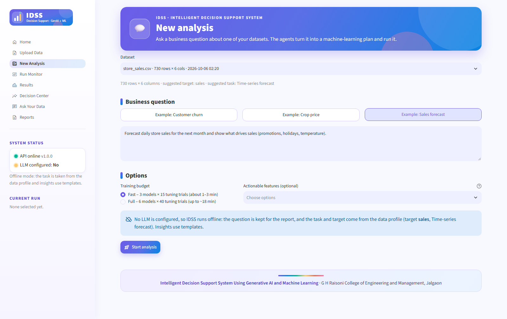<br><sub>New Analysis — question, budget and actionable features</sub> |
| 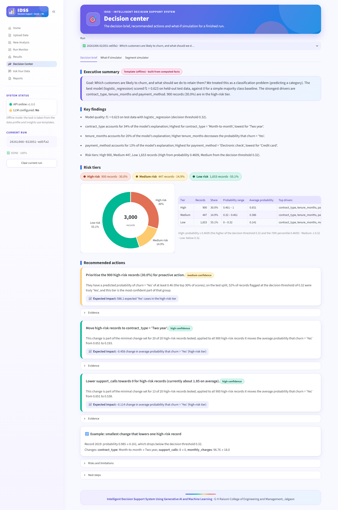<br><sub>Decision Center — brief, risk tiers and recommendations</sub> | 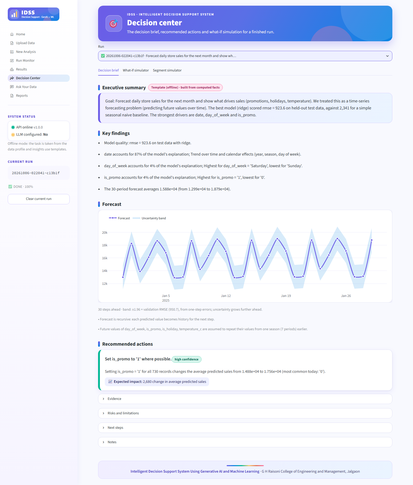<br><sub>Forecast with interval (store sales)</sub> |
| 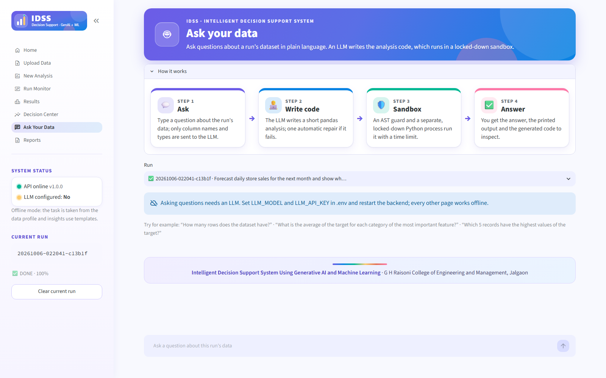<br><sub>Ask Your Data — sandboxed analysis chat</sub> | 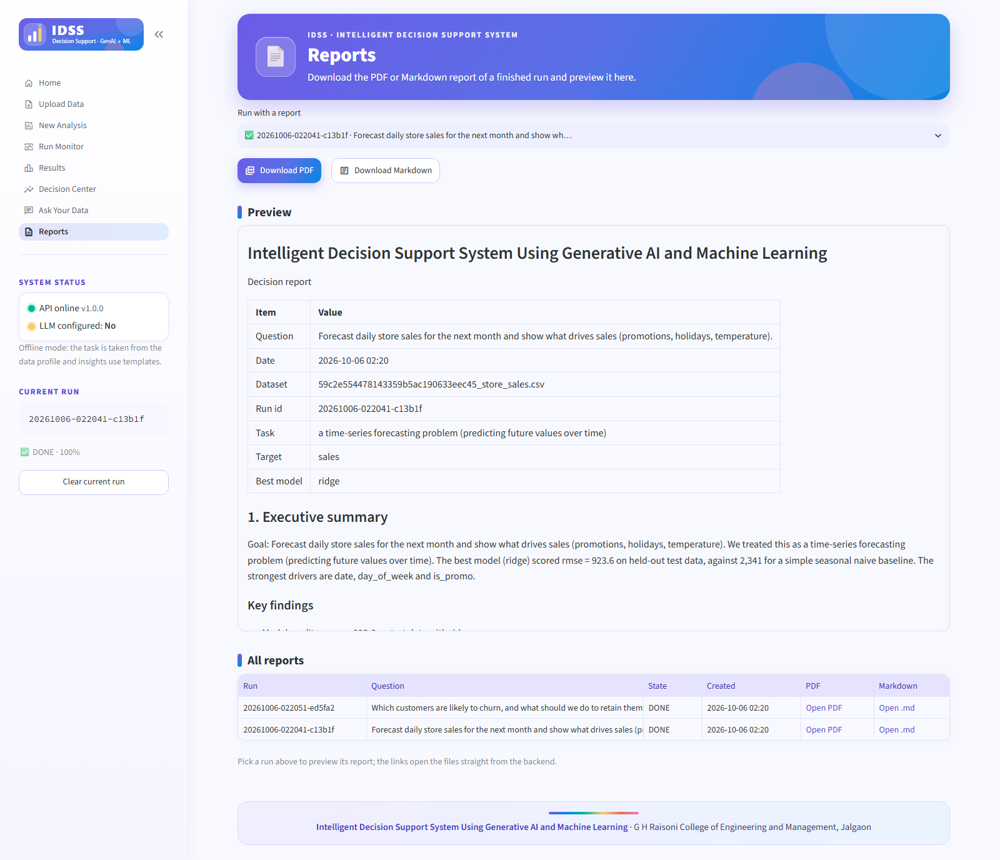<br><sub>Reports — PDF and Markdown downloads</sub> |
</details>

## Evaluation

### Methodology

`scripts/evaluate.py` runs the real Orchestrator offline (no LLM: every agent uses its deterministic fallback), end to
end, on five **synthetic** datasets generated by `scripts/make_samples.py` with fixed seeds — realistic in shape
(missing values, categoricals, imbalance, seasonality, overlapping clusters) but cleaner than real business data. Each
case runs with the fast budget and **3 seeds (42, 43, 44)**; tables show mean ± std on the held-out test split.
Source of every number below: [docs/results/evaluation.json](docs/results/evaluation.json) (full report:
[docs/results/evaluation.md](docs/results/evaluation.md)).

| Dataset | File | Task | Rows | Target | Primary metric | NPS from |
|---|---|---|---:|---|---|---|
| Customer churn | `customer_churn.csv` | binary classification | 3,000 | `churn` | F1 | F1 |
| Crop price | `crop_price.csv` | regression | 2,000 | `price` | RMSE | 1/(1+RMSLE) |
| Store sales | `store_sales.csv` | time-series forecasting | 730 | `sales` | RMSE | 1/(1+RMSLE) |
| Delivery status | `delivery_status.csv` | 3-class classification | 2,500 | `delivery_status` | F1 | F1 |
| Customer segments | `customer_segments.csv` | clustering | 1,600 | `segment` | ARI | ARI |

The metrics follow AutoML-Agent (Trirat et al., 2025):

| Metric | Definition |
|---|---|
| **SR** (success rate) | 1 if the run finishes and reports test performance, else 0 (main benchmark: end to end, with a PDF report; ablation/robustness: trained, tested and verified) |
| **NPS** (normalised performance score) | test score for 0-1 metrics where higher is better (F1; ARI clipped at 0); 1 / (1 + RMSLE) for regression and forecasting; 0 for a failed run |
| **CS** (comprehensive score) | 0.5 · SR + 0.5 · NPS |

Each run is also compared with a trivial baseline scored on the same test split, and checked by the Verifier.

### Results

| Dataset | Task | Best model (per seed) | Test score (mean ± std) | Trivial baseline | Verified | CS |
|---|---|---|---:|---:|:---:|---:|
| Customer churn | binary classification | Logistic regression | F1 0.649 ± 0.028 | 0.000 (majority class) | 3/3 | 0.825 |
| Crop price | regression | LightGBM | RMSE 356.9 ± 26.8 | 2,392.8 (mean) | 3/3 | 0.970 |
| Store sales | time-series forecasting | Ridge | RMSE 923.6 ± 0.0 | 2,340.7 (seasonal naive) | 3/3 | 0.970 |
| Delivery status | 3-class classification | Logistic regression ×2, LightGBM ×1 | F1 0.656 ± 0.024 | 0.393 (majority class) | 2/3 | 0.828 |
| Customer segments | clustering | Gaussian mixture | ARI 0.816 ± 0.045 | 0.004 (random clusters) | 3/3 | 0.908 |
| **Overall** |  |  |  |  | **14/15** | **0.900 ± 0.005** |

Paper-style metrics: **SR = 1.000 · NPS = 0.800 ± 0.011 · CS = 0.900 ± 0.005**.

<details>
<summary><b>SR, NPS and CS per dataset</b></summary>

| Dataset | SR | NPS | CS | Runs |
|---|---:|---:|---:|---:|
| Customer churn | 1.000 | 0.649 ± 0.028 | 0.825 ± 0.014 | 3 |
| Crop price | 1.000 | 0.939 ± 0.004 | 0.970 ± 0.002 | 3 |
| Store sales | 1.000 | 0.941 ± 0.000 | 0.970 ± 0.000 | 3 |
| Delivery status | 1.000 | 0.656 ± 0.024 | 0.828 ± 0.012 | 3 |
| Customer segments | 1.000 | 0.816 ± 0.045 | 0.908 ± 0.022 | 3 |
| **Overall** | 1.000 | 0.800 ± 0.011 | 0.900 ± 0.005 | 15 |
</details>

<details>
<summary><b>Efficiency</b> (search + training time, inference speed)</summary>

| Dataset | Search + training time (s) | Inference (ms per row) |
|---|---:|---:|
| Customer churn | 19.8 ± 2.5 | 0.029 ± 0.004 |
| Crop price | 7.0 ± 0.5 | 0.061 ± 0.007 |
| Store sales | 4.3 ± 1.1 | 0.201 ± 0.015 |
| Delivery status | 72.2 ± 74.2 | 0.044 ± 0.023 |
| Customer segments | 2.7 ± 0.4 | 0.016 ± 0.004 |
</details>

### Ablation

Each component switched off in turn (same datasets and seeds):

| Configuration | NPS | CS | Verified | Search time per run (s) |
|---|---:|---:|:---:|---:|
| Full system | 0.800 | 0.900 | 14/15 | 21.2 |
| − threshold tuning | 0.782 | 0.891 | 13/15 | 26.3 |
| − hyperparameter tuning | 0.743 | 0.871 | 15/15 | 1.9 |
| − verification re-planning | 0.800 | 0.900 | 14/15 | 12.8 |
| Single-model baseline | 0.707 | 0.854 | 6/15 | 0.7 |

- **Threshold tuning** only matters for binary classification: keeping the 0.5 cut-off changes churn F1 by -13.4%.
- **Hyperparameter tuning** lifts CS from 0.871 to 0.900; the biggest gain is on customer segments (35.6% ARI lost without it).
- **A single default model** (LightGBM or k-means) drops CS to 0.854 and passes verification in only 6 of 15 runs — the model search is what makes results verifiable.
- **Verification re-planning** was triggered in 1 of 15 full-system runs, so its CS equals the full system's: it is a safety net for runs that fail a check, and a failure that persists is reported as *not verified* instead of being hidden.

<details>
<summary><b>Change in test score per dataset</b> (vs. the full system)</summary>

| Configuration | Customer churn | Crop price | Store sales | Delivery status | Customer segments |
|---|---:|---:|---:|---:|---:|
| − threshold tuning | -13.4% | = (reused) | = (reused) | = (reused) | = (reused) |
| − hyperparameter tuning | -0.1% | -5.7% | +0.9% | +2.0% | -35.6% |
| − verification re-planning | +0.0% | +0.0% | +0.0% | +0.0% | +0.0% |
| Single-model baseline | -19.3% | -3.0% | -40.6% | -1.1% | -37.6% |

Positive = better than the full system (for RMSE, lower error counts as better). “= (reused)”: the switch does not apply to that task, so the full-system runs are reused.
</details>

### Robustness

The full system on perturbed copies of the data: **+10% missing cells** (missing completely at random, outside the
target, IDs and time index) and **+5 random noise columns**.

| Dataset | Metric | Clean | +10% missing (change) | +5 noise columns (change) | Verified (missing · noise) |
|---|---|---:|---:|---:|:---:|
| Customer churn | F1 | 0.649 ± 0.028 | 0.623 ± 0.029 (-4.0%) | 0.644 ± 0.036 (-0.9%) | 3/3 · 3/3 |
| Crop price | RMSE | 356.9 ± 26.8 | 562.9 ± 96.0 (-57.1%) | 349.5 ± 22.6 (+2.0%) | 3/3 · 3/3 |
| Store sales | RMSE | 923.6 ± 0.0 | 1,132.9 ± 97.3 (-22.7%) | 938.5 ± 15.2 (-1.6%) | 3/3 · 3/3 |
| Delivery status | F1 | 0.656 ± 0.024 | 0.613 ± 0.011 (-6.5%) | 0.659 ± 0.024 (+0.5%) | 2/3 · 3/3 |
| Customer segments | ARI | 0.816 ± 0.045 | 0.729 ± 0.042 (-10.6%) | 0.833 ± 0.053 (+2.2%) | 3/3 · 3/3 |

Missing values hurt most (largest NPS drop 0.087, customer segments), while random noise columns barely matter (largest NPS drop 0.005): the tuned models largely ignore uninformative features. Positive change = better than on clean data (for RMSE, lower error counts as better).

### Figures

<p align="center">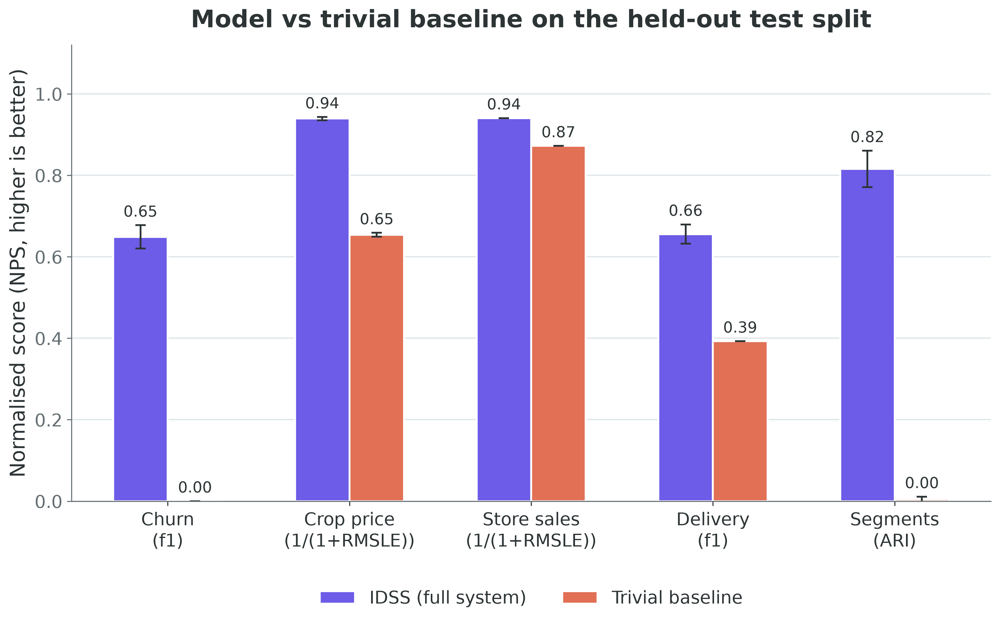</p>

<details>
<summary><b>More figures</b> (paper metrics, ablation, robustness, efficiency)</summary>

<p align="center">
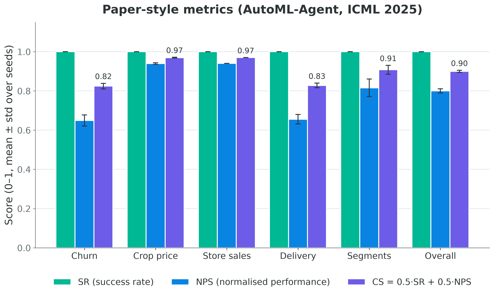<br>
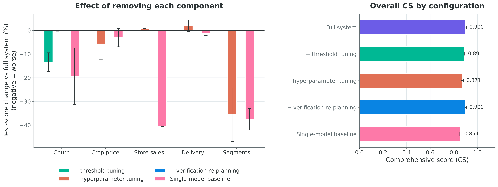<br>
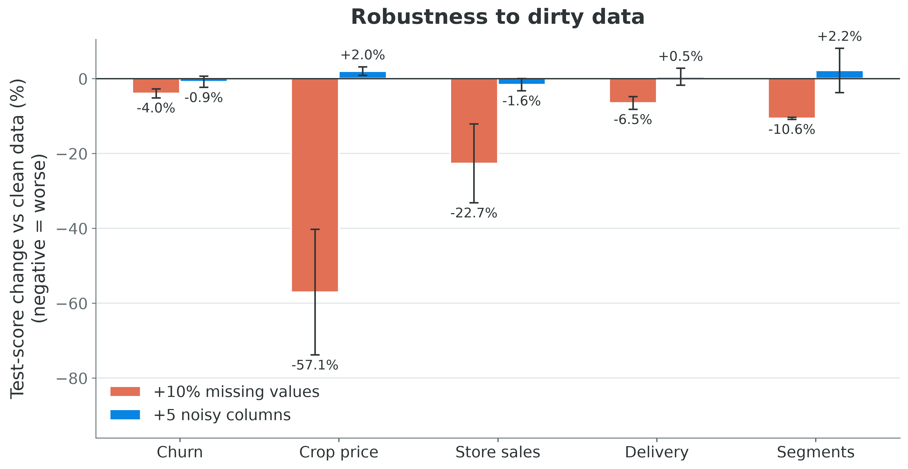<br>
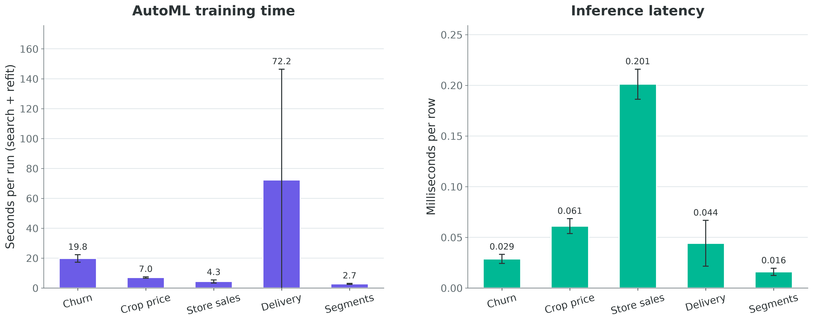
</p>
</details>

## Tech stack

| Layer | Tools | Why |
|---|---|---|
| Language | Python 3.12 | One language for agents, ML, API and UI; modern typing |
| LLM access | OpenAI Python SDK (OpenAI-compatible endpoints) | One client for OpenAI, Groq, Gemini and local Ollama models |
| Data contracts | Pydantic v2, pydantic-settings | Validated LLM outputs, API bodies and settings; secrets as `SecretStr` |
| Data | pandas, NumPy, PyArrow, openpyxl | CSV, Excel, JSON and Parquet in memory |
| Machine learning | scikit-learn, XGBoost, LightGBM | Strong, well-tested tabular models; one fixed zoo |
| Tuning | Optuna | TPE search with pruning inside a time budget |
| Explainability | SHAP | Per-feature contributions, summed back to original columns |
| Retrieval | scikit-learn TF-IDF | Offline RAG over the local best-practice notes, no embedding API needed |
| Backend | FastAPI, Uvicorn, python-multipart | Typed REST API with automatic OpenAPI docs and streamed uploads |
| Persistence | SQLAlchemy 2.0, SQLite | Zero-setup database for datasets, runs and events |
| Frontend | Streamlit, Plotly, requests | Fast data-app UI with interactive charts; talks only to the API |
| Reports | reportlab, matplotlib | PDF reports and charts without external tools |
| Logging | loguru | One configured logger for the library code |
| Quality | pytest, pytest-cov, ruff, Playwright | Offline tests, coverage, linting, UI screenshots and the demo GIF (`requirements-dev.txt`) |

## Quick start

**Requirements:** Python 3.12 and Git. An LLM API key is optional — without one IDSS runs offline (the task and
target come from the data profile and insights use templates).

### Windows (PowerShell)

```powershell
git clone https://github.com/<your-account>/<this-repo>.git idss
cd idss
python -m venv .venv
.venv\Scripts\python.exe -m pip install -r requirements.txt
Copy-Item .env.example .env          # optional: set LLM_PROVIDER, LLM_MODEL, LLM_API_KEY
powershell -ExecutionPolicy Bypass -File scripts\run_all.ps1
```

`run_all.ps1` starts the API (`http://localhost:8000`, interactive docs at `/docs`) in a new window and the UI
(`http://localhost:8501`) in the current one. To start them separately: `scripts\run_api.ps1` and `scripts\run_ui.ps1`.
`requirements.txt` holds only what the app needs; for the tests and linting install `requirements-dev.txt` instead.

### Linux / macOS

```bash
git clone https://github.com/<your-account>/<this-repo>.git idss
cd idss
python3.12 -m venv .venv
source .venv/bin/activate
pip install -r requirements.txt
cp .env.example .env                 # optional: set LLM_PROVIDER, LLM_MODEL, LLM_API_KEY

# terminal 1 – API on http://localhost:8000 (docs: /docs)
python -m uvicorn api.main:app --host 127.0.0.1 --port 8000

# terminal 2 – UI on http://localhost:8501 (run from the project root so .streamlit/config.toml is used)
python -m streamlit run ui/app.py --server.address localhost
```

Or in one process, like the hosted demo: `IDSS_EMBEDDED_API=1 python -m streamlit run ui/app.py --server.address
localhost` (the UI starts the API itself; see [Streamlit Community Cloud](#streamlit-community-cloud-free)).

### First run

Open `http://localhost:8501` and press **Demo Mode** on the Home page: it uploads the bundled
`data/samples/customer_churn.csv`, asks *“Which customers are likely to churn, and what should we do to retain
them?”* and opens the Run Monitor. Or upload your own CSV, Excel, JSON or Parquet file on **Upload Data** and ask a
question on **New Analysis**.

## Configuration

Settings are read from `.env` (copy [.env.example](.env.example); `.env` is git-ignored) or from environment
variables, which take precedence.

| Variable | Default | Meaning |
|---|---|---|
| `LLM_PROVIDER` | `openai` | `openai`, `groq`, `gemini` or `ollama` |
| `LLM_MODEL` | empty | Model name from your provider's list; empty = offline mode |
| `LLM_API_KEY` | empty | API key (leave empty for Ollama) |
| `LLM_BASE_URL` | provider default | Only for a custom OpenAI-compatible endpoint |
| `LLM_TIMEOUT` | `60` | Seconds before an LLM call is abandoned (retried at most 3 times) |
| `LOG_LEVEL` | `INFO` | `DEBUG`, `INFO`, `WARNING`, `ERROR` or `CRITICAL` |
| `TAVILY_API_KEY`, `SERPAPI_KEY` | empty | Optional web search for the knowledge agent; empty = local notes only |
| `IDSS_PUBLIC_DEMO` | `0` | `1` for a shared, hosted demo (see below); in embedded mode also read from Streamlit secrets |
| `IDSS_API_URL` | `http://localhost:8000` | Shell variable for the UI (not read from `.env`): where the API is |
| `IDSS_EMBEDDED_API` | `0` | Shell variable or Streamlit secret for the UI (not read from `.env`): `1` = the UI starts the API itself on `127.0.0.1:8000`, in one process |

### Public demo mode

For a hosted instance that strangers can use, set `IDSS_PUBLIC_DEMO=1` for the API. Then:

- **Ask Your Data is disabled** (it executes LLM-generated code on the server); the endpoint returns 403;
- uploads are limited to **10 MB**;
- runs use the **fast budget only**, including the re-plan after a failed verification;
- SHAP explains at most **200 rows** (instead of 500), to keep memory low on a small cloud machine;
- at API startup, **runs older than 24 hours are deleted**, together with uploads that no remaining run uses;
- the UI shows a **“Public demo – do not upload private data”** banner on every page.

The UI learns all of this from `GET /health`, so only the API needs the variable. It is off by default.

## API endpoints

The backend is a FastAPI app; interactive docs are at `http://localhost:8000/docs`. Full request/response examples:
[docs/api_reference.md](docs/api_reference.md).

| Method | Path | Purpose |
|---|---|---|
| GET | `/health` | Liveness, LLM configured yes/no, public demo flag, upload limit, version |
| POST | `/datasets` | Upload a dataset (CSV, XLSX, JSON, Parquet) and get its profile summary |
| GET | `/datasets` | List uploaded datasets |
| GET | `/datasets/{dataset_id}/profile` | Full column-by-column profile |
| POST | `/runs` | Start an analysis run (returns at once; poll for progress) |
| GET | `/runs` | List runs (filter by dataset or state) |
| GET | `/runs/{run_id}` | State, progress, events, metrics, verification, pending questions |
| POST | `/runs/{run_id}/answer` | Answer clarifying questions (run in `NEEDS_INPUT`) |
| GET | `/runs/{run_id}/leaderboard` | Every trained candidate with scores and cost |
| GET | `/runs/{run_id}/explanations` | Key drivers (SHAP), local examples, clusters / forecast, chart URLs |
| GET | `/runs/{run_id}/recommendations` | Actions, risk tiers, counterfactual and what-if examples |
| GET | `/runs/{run_id}/insight` | Plain-language decision brief |
| POST | `/runs/{run_id}/what-if` | Simulate changes for one record or a segment |
| POST | `/runs/{run_id}/ask` | Ask a question about the data (needs an LLM; off in the public demo) |
| GET | `/runs/{run_id}/report.pdf` | PDF report |
| GET | `/runs/{run_id}/report.md` | Markdown report |
| GET | `/runs/{run_id}/charts/{name}` | One chart PNG of the run |

Every error is JSON `{"error": <code>, "detail": <message>}` — for example `409 busy` (another run is training),
`409 not_ready` (result not computed yet) or `403 public_demo`.

## Security and privacy

- **No raw rows to the LLM.** Prompts carry column names, types, aggregate statistics, metrics and computed facts —
  never data rows, file paths or keys. Ask Your Data sends only column names and types.
- **Grounding check.** The decision brief may only contain numbers that appear in the computed facts; otherwise it is
  regenerated once and then replaced by a template.
- **Sandboxed code.** LLM-written analysis code must pass a static AST guard (import allowlist, no file/network I/O, no
  dangerous built-ins or private attributes) and then runs in a separate `python -I` process with restricted
  built-ins, guarded imports, a temporary working folder, no secrets in its environment, a time limit and capped
  output.
- **Path-traversal protection.** Upload names are sanitised and stored under a random id; run ids and chart names
  must match strict patterns, and every resolved file path must stay inside the run's own folder. What-if filters are
  structured conditions, never evaluated strings.
- **Secrets.** Keys live only in `.env` (git-ignored) and are `SecretStr` in the settings; `/health` reports only
  whether an LLM is configured; API responses never contain keys or server paths.
- **Local by default.** API and UI bind to localhost; CORS allows only the UI; uploads, runs and the database stay in
  `workspace/` (git-ignored).
- **Bounded behaviour.** Every LLM call has a timeout and at most 3 retries, loops are capped (clarifications,
  re-plans, steps), and one training run executes at a time.
- **Public demo mode.** For shared hosting: no code execution, small uploads, fast budget only, automatic deletion of
  old runs and a warning banner — see [Public demo mode](#public-demo-mode).

## Deployment

### Local

Run IDSS on your own machine as in [Quick start](#quick-start) (Windows, Linux or macOS). Useful options:

| Need | How |
|---|---|
| Other ports (Windows) | `scripts\run_all.ps1 -ApiPort 8100 -UiPort 8600`, or `run_api.ps1 -Port …` / `run_ui.ps1 -Port … -ApiUrl …` |
| Other ports (Linux/macOS) | `uvicorn … --port <api>`; `IDSS_API_URL=http://localhost:<api> python -m streamlit run ui/app.py --server.port <ui>` |
| Offline only | Leave `LLM_MODEL` / `LLM_API_KEY` empty |
| A shared machine | Set `IDSS_PUBLIC_DEMO=1` for the API |
| One process (no separate API) | `$env:IDSS_EMBEDDED_API = "1"`, then `scripts\run_ui.ps1` — the UI starts the API itself |

The servers bind to `localhost` on purpose (`scripts\run_ui.ps1` passes `--server.address localhost`; the API listens
on `127.0.0.1`); there are no user accounts, so do not expose them to a network as they are.

### Streamlit Community Cloud (free)

**The live demo (`<LIVE_LINK>`) is hosted on Streamlit Community Cloud**, running IDSS in **embedded API mode** with
**public demo mode** on (`IDSS_EMBEDDED_API=1`, `IDSS_PUBLIC_DEMO=1`): one process, fast budget only, Ask Your Data
off, uploads up to 10 MB, and a "do not upload private data" banner on every page.

Community Cloud runs **one** Streamlit app straight from a public GitHub repository. IDSS fits that with its
**embedded API mode**: with `IDSS_EMBEDDED_API=1` the first page view starts the FastAPI backend on `127.0.0.1:8000`
in a background thread of the same process (once per process; the page waits until `/health` answers, at most 60 s),
and the UI then talks to it over HTTP exactly as it does locally. The backend is never reachable from outside.

To host your own copy:

1. Push the repository to GitHub (public).
2. On [share.streamlit.io](https://share.streamlit.io) choose **Create app → Deploy a public app from GitHub**:
   your repository and branch, main file path **`ui/app.py`**.
3. Under **Advanced settings** pick **Python 3.12** and paste the secrets (TOML; quote the values):

   ```toml
   IDSS_EMBEDDED_API = "1"
   IDSS_PUBLIC_DEMO = "1"
   # Optional – without these the demo runs offline (task from the data profile, template insights):
   # LLM_PROVIDER = "groq"
   # LLM_MODEL = "<model name>"
   # LLM_API_KEY = "<key>"
   ```

   Streamlit also exports root-level secrets as environment variables, which is how the backend's settings see them.
4. Deploy. Community Cloud installs `requirements.txt` (the runtime packages only; test tools live in
   `requirements-dev.txt`) and `packages.txt` (`libgomp1`, the OpenMP runtime LightGBM needs). `.streamlit/config.toml`
   sets the theme but no server address or port, so the cloud can choose its own.
5. Open the app, run **Demo Mode**, and replace `<LIVE_LINK>` in this README (the badge and the live-demo line at the
   top, this section and the roadmap) with the app's URL.

The disk is ephemeral: `workspace/` folders are created at startup, and a restart (or waking the app after it slept)
clears all runs, which suits a public demo. Public demo mode keeps memory low (fast budget only, SHAP on at most 200
rows). On the Reports page the per-run links are hidden in embedded mode — the built-in backend is not reachable from a
visitor's browser — and the download buttons are used instead.

## Project structure

<details>
<summary><b>Folder tree</b></summary>

```
├── api/                 FastAPI backend: routes, request/response models, background run worker
├── configs/             Typed settings from .env (pydantic-settings)
├── idss/
│   ├── agents/          Requirement, Data, Knowledge, Model, Analysis, Insight agents, Verifier, Orchestrator
│   ├── core/            LLM client (timeouts, capped retries), logger, schemas, prompt templates
│   ├── ml/              Loader, profiler, preprocessing, model zoo, Optuna tuner, trainer, evaluator, SHAP
│   ├── decision/        What-if simulation, recommendations, PDF/Markdown report builder
│   ├── knowledge/       Offline TF-IDF retrieval over data/knowledge (+ optional web search)
│   ├── execution/       Sandbox for LLM-written analysis code
│   └── storage/         Run directories, SQLite database, repository, public-demo retention
├── ui/                  Streamlit dashboard (8 pages), API client, charts, theme, embedded API mode
├── data/
│   ├── samples/         Five synthetic sample datasets (scripts/make_samples.py)
│   └── knowledge/       Best-practice notes indexed for retrieval-augmented planning
├── scripts/             Run scripts, evaluation, diagrams, screenshots, demo GIF, report/poster/slide builders
├── tests/               Offline pytest suite (fake LLM, temporary workspace)
├── docs/                Architecture, user manual, API reference, testing, results, diagrams, report, assets
└── workspace/           Run outputs, logs, uploads and the database (git-ignored)
```
</details>

## Testing

```bash
python -m pip install -r requirements-dev.txt                    # once: runtime + pytest, pytest-cov, ruff, Playwright
python -m pytest -q                                              # offline suite (no network, no real LLM)
python -m pytest -q --cov=idss --cov=api --cov=ui --cov=configs  # with coverage
python -m pytest -m live                                         # real LLM smoke tests (needs .env; costs tokens)
python -m ruff check .                                           # lint
```

Latest run: **506 passed, 2 deselected** (live LLM tests), with
**93% line coverage** (6,758 statements) over `idss`, `api`, `ui` and `configs`. At submission:
449 tests, 447 offline passing ([docs/testing.md](docs/testing.md)). Every LLM call is replaced by a fake client, web
search is disabled and the workspace is redirected to a temporary folder, so the suite never touches the network or
your data.

## Limitations

- **Tabular data only:** one table per run (up to 50 MB) for classification, regression, clustering and single-series
  forecasting; no images, text-heavy data, multi-table joins or panel forecasting.
- **Synthetic benchmark:** the evaluation datasets are synthetic and cleaner than real business data; results are not
  a claim about real-world performance, and they are not directly comparable with the AutoML-Agent paper.
- **The LLM path is not benchmarked:** the evaluation exercises the deterministic fallbacks; LLM parsing and briefs
  are covered by unit tests with a fake LLM and a few live tests.
- **Correlation, not causation:** SHAP values, what-if results and recommendations describe the *model's* response,
  not causal effects of real interventions.
- **Simple models of the world:** a fixed model zoo (no deep learning or stacking), selection on one validation split,
  greedy counterfactuals that ignore the cost of a change, fixed verification thresholds.
- **Single user, single machine:** one run trains at a time, no authentication, no model monitoring; the sandbox is
  a process-level guard, not a container.

Full list: [docs/limitations_future_work.md](docs/limitations_future_work.md).

## Roadmap

- [x] Public demo on Streamlit Community Cloud (`<LIVE_LINK>`)
- [ ] Real-data case studies (public benchmark datasets, a partner organisation) and a user study
- [ ] Benchmark the LLM path across providers: parsing accuracy, question usefulness, brief faithfulness, cost
- [ ] Stronger AutoML: cross-validation for small data, ensembling, more time-series models, conformal intervals
- [ ] Causal and prescriptive decisions: uplift modelling, cost-aware actions, feasible counterfactuals
- [ ] Multi-user deployment: authentication, job queue, container image, managed database
- [ ] Model operations: prediction endpoint, drift monitoring, scheduled retraining
- [ ] Richer knowledge base with domain packs and embedding retrieval; reports in regional languages

## FAQ

<details>
<summary><b>Do I need an LLM API key?</b></summary>

No. Without a key IDSS runs offline: the task and target come from the data profile, models are ranked by a fixed
default order, verification uses its rule-based checks and the brief comes from a grounded template. Only *Ask Your
Data* needs an LLM.
</details>

<details>
<summary><b>Which LLM providers are supported?</b></summary>

Any OpenAI-compatible endpoint. `LLM_PROVIDER` has presets for OpenAI, Groq, Google Gemini and Ollama (local); set
`LLM_BASE_URL` for anything else.
</details>

<details>
<summary><b>Is my data sent to the LLM?</b></summary>

No raw rows. Prompts contain column names, types, aggregate statistics, metrics and computed facts only. Everything
else — uploads, models, reports, the database — stays in your local `workspace/` folder.
</details>

<details>
<summary><b>What kind of data and questions does it handle?</b></summary>

One table (CSV, Excel, JSON or Parquet) per run, for classification (“who will churn?”), regression (“what drives the
price?”), clustering (“which customer segments exist?”) and single-series forecasting (“how much will we sell next
month?”).
</details>

<details>
<summary><b>How long does a run take?</b></summary>

It depends on the data and the machine. In the evaluation, the fast-budget search took 21.2 s per run on
average (see [Efficiency](#results)); the whole Demo Mode run, including explanations and the PDF report, finishes in
a few minutes on a laptop. The full budget searches more models and trials and takes longer.
</details>

<details>
<summary><b>Can I trust the recommendations?</b></summary>

They are as good as the model: every recommendation shows its evidence numbers and confidence, the model must pass
the verifier's checks (or is clearly flagged), and the brief cannot invent numbers. But they describe how the model
responds to changes, not proven causal effects — test important actions before rolling them out.
</details>

<details>
<summary><b>Why does the evaluation use synthetic data?</b></summary>

Synthetic datasets with known generating processes make the benchmark reproducible and free of licensing or privacy
issues, and let us check that IDSS finds the true drivers. Real-data case studies are on the [roadmap](#roadmap).
</details>

<details>
<summary><b>Can I host it for other people?</b></summary>

For a public demo, yes — set `IDSS_PUBLIC_DEMO=1` (see [Public demo mode](#public-demo-mode) and
[Streamlit Community Cloud](#streamlit-community-cloud-free)). For real multi-user use it still needs authentication and a job
queue (see [Limitations](#limitations)).
</details>

## Contributing

This is an academic project, but issues and pull requests are welcome.

1. Fork the repository and create a branch from `master`.
2. Set up the environment ([Quick start](#quick-start)) and make your change.
3. Follow the coding rules: Python 3.12 with type hints, Pydantic v2 for data crossing modules, every LLM call through
   `idss/core/llm_client.py`, logging via `idss/core/logger.py`, `pathlib` for paths, no secrets in code.
4. Add or update tests (offline only — mock the LLM) and run `python -m pytest -q` and `python -m ruff check .`.
5. Open a pull request that explains what changed and why.

Please do not commit `.env`, anything in `workspace/`, or code from the AutoML-Agent reference implementation.

## Documentation

| Document | Contents |
|---|---|
| [User manual](docs/user_manual.md) | Installation, configuration, every page of the UI, troubleshooting |
| [API reference](docs/api_reference.md) | Every endpoint with examples and error codes |
| [Architecture](docs/architecture.md) | Modules, state machine, design decisions, security and privacy |
| [Testing](docs/testing.md) | Test inventory, coverage, what is tested |
| [Evaluation](docs/results/evaluation.md) | Benchmark, ablation and robustness results with charts |
| [Limitations and future work](docs/limitations_future_work.md) | Known limitations and next steps |
| [Project report](docs/report/) | Full report content (Markdown chapters; Word/PDF in `docs/report/final/`) |

## Team

| Member | Role | Main contributions | Links |
|---|---|---|---|
| **Raj Vishwas Patil** | GenAI / Agents Lead | • LLM client (timeouts, capped retries, structured outputs) and prompt templates<br>• Requirement, Knowledge, Model and Insight agents | LinkedIn: `<LINKEDIN_URL>`<br>GitHub: `<GITHUB_URL>` |
| **Bhavesh Vinod Patil** | ML Engine | • Data module, model zoo, Optuna tuner and trainer<br>• Verifier, SHAP explanations, recommender and the evaluation study | LinkedIn: `<LINKEDIN_URL>`<br>GitHub: `<GITHUB_URL>` |
| **Chaitany Rajesh Naval** | Backend / API / DB | • Settings, logging, run-state persistence and the code sandbox<br>• FastAPI backend, background worker and SQLite database | LinkedIn: `<LINKEDIN_URL>`<br>GitHub: `<GITHUB_URL>` |
| **Varun Darshan Chaudhari** | UI / Testing / Docs | • Test harness, synthetic samples and the report builder<br>• Streamlit UI and theme, documentation | LinkedIn: `<LINKEDIN_URL>`<br>GitHub: `<GITHUB_URL>` |

**Project guide:** Dr. Arjun Jadhaw<br>
**Institution:** Department of Data Science, G H Raisoni College of Engineering & Management, Jalgaon

## Acknowledgements

IDSS is inspired by **AutoML-Agent: A Multi-Agent LLM Framework for Full-Pipeline AutoML** (Trirat, Jeong and Hwang,
ICML 2025). We adopted its multi-agent decomposition, retrieval-augmented planning, multi-stage verification and its
evaluation metrics (SR, NPS, CS). The reference implementation was used for reading only; no code was copied, and it
is **not included** in this repository.

```bibtex
@inproceedings{AutoML_Agent,
  title={Auto{ML}-Agent: A Multi-Agent {LLM} Framework for Full-Pipeline Auto{ML}},
  author={Trirat, Patara and Jeong, Wonyong and Hwang, Sung Ju},
  booktitle={Forty-second International Conference on Machine Learning},
  year={2025},
  url={https://openreview.net/forum?id=p1UBWkOvZm}
}
```

We thank our guide, Dr. Arjun Jadhaw, and the Department of Data Science for their support, and the authors of the
open-source libraries listed in the [tech stack](#tech-stack).

## Citation

If you use IDSS in your work, please cite it. GitHub shows a **“Cite this repository”** button generated from
[CITATION.cff](CITATION.cff); the equivalent BibTeX is:

```bibtex
@software{IDSS,
  title  = {{IDSS}: Intelligent Decision Support System Using Generative {AI} and Machine Learning},
  author = {Patil, Raj Vishwas and Patil, Bhavesh Vinod and Naval, Chaitany Rajesh and Patil, Varun Darshan},
  year   = {2026},
  version = {1.0.0},
  license = {MIT},
  note   = {Final-year B.Tech project, G H Raisoni College of Engineering \& Management, Jalgaon}
}
```

## License

The IDSS source code is released under the [MIT License](LICENSE) © 2026 Raj Vishwas Patil, Bhavesh Vinod Patil,
Chaitany Rajesh Naval and Varun Darshan Patil.

- `reference/` (the AutoML-Agent code, licensed **CC BY-NC 4.0**) is **not part of this repository** and is not
  redistributed; it was only read for ideas during development.
- The sample datasets in `data/samples/` are synthetic, generated by `scripts/make_samples.py`.
- Third-party libraries keep their own licenses (see `requirements.txt`).
