# IDSS architecture

**Intelligent Decision Support System Using Generative AI and Machine Learning (IDSS)** takes a business question in
plain language plus a table of data, and returns a trained and verified model together with explained, actionable
decisions: key drivers, recommendations, risk tiers or a forecast, what-if simulations, a decision brief and a PDF
report.

The guiding rule: **the LLM plans and explains, deterministic code computes.** LLM agents interpret the request,
rank models from a fixed zoo, review results and write the brief; every number comes from tested code (profiling,
AutoML, SHAP, simulation), and every agent has a deterministic fallback, so the whole pipeline also runs offline.

The PNG diagrams in [`docs/diagrams/`](diagrams/) are drawn by `scripts/make_diagrams.py` (matplotlib only); the
Mermaid sources below describe the same diagrams and render on GitHub. Four further diagrams for the project report —
DFD Level 0 (`dfd_level0.png`), class (`class_diagram.png`), activity (`activity_diagram.png`) and component /
deployment (`deployment_diagram.png`) — exist as PNG only.

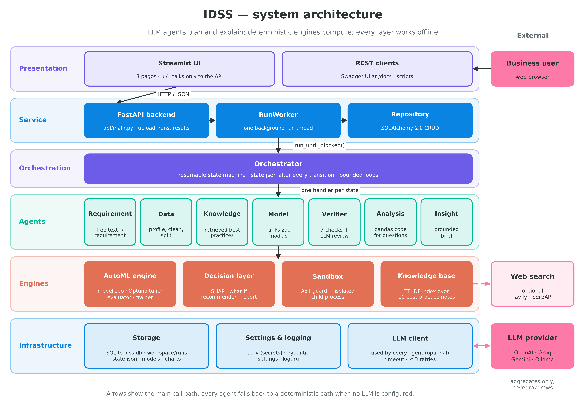

## 1. Overview

| Layer | Components | Code |
|---|---|---|
| Presentation | Streamlit UI (8 pages); talks only to the API over HTTP | `ui/` |
| Service | FastAPI backend, one background run thread, repository | `api/`, `idss/storage/` |
| Orchestration | Resumable state machine, one handler per state | `idss/agents/manager.py` |
| Agents | Requirement, Data, Knowledge, Model, Verifier, Analysis, Insight | `idss/agents/` |
| Engines | AutoML engine, decision layer, offline knowledge base, sandbox | `idss/ml/`, `idss/decision/`, `idss/knowledge/`, `idss/execution/` |
| Infrastructure | LLM client, plan contract, prompt sanitising, SQLite + run workspace, settings, logging | `idss/core/`, `idss/storage/`, `configs/` |

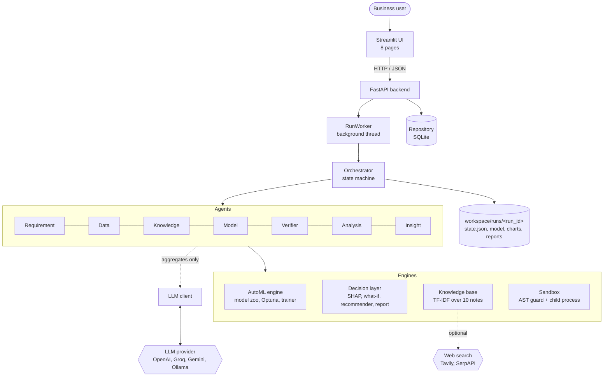

## 2. Module responsibilities

| Module | Responsibility |
|---|---|
| `configs/settings.py` | Typed settings from `.env` (`get_settings()`); keys are `SecretStr`, never logged |
| `idss/core/llm_client.py` | The only door to the LLM: OpenAI-compatible client, timeout on every call, ≤ 3 retries with exponential backoff, structured (Pydantic) outputs |
| `idss/core/schemas.py` | Pydantic v2 models for everything that crosses a module boundary |
| `idss/core/plan_contract.py` | v1.1: `AnalysisPlan`, the only planner output that can drive execution: strict, frozen, extra keys forbidden; task, metric and models from closed lists built from the metric registry and the model zoo; bounded budget, constraints and actionable features; `parse_plan()` gives one reason per problem |
| `idss/core/sanitize.py` | v1.1: prompt-safe dataset text (hidden characters removed, tag delimiters neutralised, lengths capped), `<data>…</data>` blocks and the data rule every system prompt states; prompt-injection detector for headers and cells |
| `idss/core/prompts/` | Prompt templates (`## system` / `## user`, `$var` placeholders) |
| `idss/agents/requirement_agent.py` | Relevance check, parse free text → `UserRequirement`, deterministic repair against the data, sufficiency check → clarifying questions |
| `idss/agents/data_agent.py` | Load, profile, clean, split 70/20/10, fit the preprocessor; only aggregates go to the LLM |
| `idss/agents/knowledge_agent.py` | Retrieve best practices from the offline index and condense them into a `KnowledgeBrief` |
| `idss/agents/model_agent.py` | Rank models from the zoo only; parse constraints (latency, training time, explainability) into a budget; hands over a `PlanProposal`, never an executable plan |
| `idss/execution/plan_validator.py` | v1.1: checks the proposed plan against the data and the settings' hard limits without the LLM; returns a sealed `ValidatedPlan` or `PlanRejected` with reasons, and builds a fallback plan from a fresh data profile (never from the LLM's text) |
| `idss/ml/` | AutoML engine: `model_zoo` (the only trainable models), `tuner` (Optuna TPE + median pruner), `evaluator` (metric registry, complexity), `trainer` (search, selection, threshold tuning, refit, single test evaluation), `explain` (SHAP / permutation, forecasts, cluster profiles) |
| `idss/agents/verifier.py` | Seven rule-based checks decide pass/fail; optional LLM review adds concerns and recommendations |
| `idss/decision/` | `what_if` (record and segment simulation), `recommender` (actionable levers, risk tiers, counterfactuals), `report_builder` (PDF + Markdown), `facts` (v1.1: facts registry, every number with a key and a source) |
| `idss/agents/insight_agent.py` | Decision brief from computed facts only: since v1.1 the LLM writes `{{key}}` placeholders and code fills in the values; a typed digit or unknown key is rejected, then the grounding check runs as a second layer |
| `idss/agents/analysis_agent.py` + `idss/execution/` | Ad-hoc questions: LLM-written pandas code, statically checked and run in an isolated child process |
| `idss/agents/manager.py` | Orchestrator: state machine, persistence after every transition, bounded loops, DB mirroring |
| `idss/storage/` | Run ids and folders, SQLAlchemy models, repository |
| `api/` | REST API, request/response models, background worker |
| `ui/` | Streamlit pages, HTTP client, shared components |

## 3. Orchestrator state machine

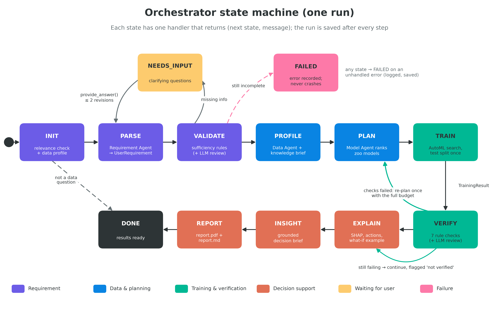

```mermaid
stateDiagram-v2
    [*] --> INIT
    INIT --> PARSE: relevant request
    INIT --> DONE: not a data question
    PARSE --> VALIDATE
    VALIDATE --> NEEDS_INPUT: information missing
    NEEDS_INPUT --> PARSE: provide_answer() (max 2 revisions)
    VALIDATE --> FAILED: still incomplete after 2 revisions
    VALIDATE --> PROFILE: complete
    PROFILE --> PLAN: profile + knowledge brief
    PLAN --> TRAIN: ValidatedPlan (sealed)
    TRAIN --> VERIFY: TrainingResult
    VERIFY --> PLAN: checks failed (re-plan once, full budget)
    VERIFY --> EXPLAIN: passed, or still failing (flagged)
    EXPLAIN --> INSIGHT
    INSIGHT --> REPORT
    REPORT --> DONE
    DONE --> [*]
    FAILED --> [*]
    note right of FAILED: any handler exception ends here; the run never crashes the caller
```

Every handler returns `(next_state, message)`. After each transition the whole `RunContext` is written atomically
to `workspace/runs/<run_id>/state.json` and mirrored into SQLite, so a run can be resumed (`resume(run_id)`) or
inspected while it works. Loops are bounded: two clarification rounds, one re-plan, 50 steps per call.

Since v1.1, PLAN hands the Model Agent's proposal to the independent plan validator. A rejected proposal is replaced
by a fallback plan built from a fresh profile of the data (the reasons are shown on the Run Monitor); if the fallback
fails too, the run moves to `FAILED`. The transition into TRAIN is refused unless the plan was sealed by the validator
in the same process; a plan read back from `state.json` or changed after sealing is validated again first.

## 4. One run, end to end

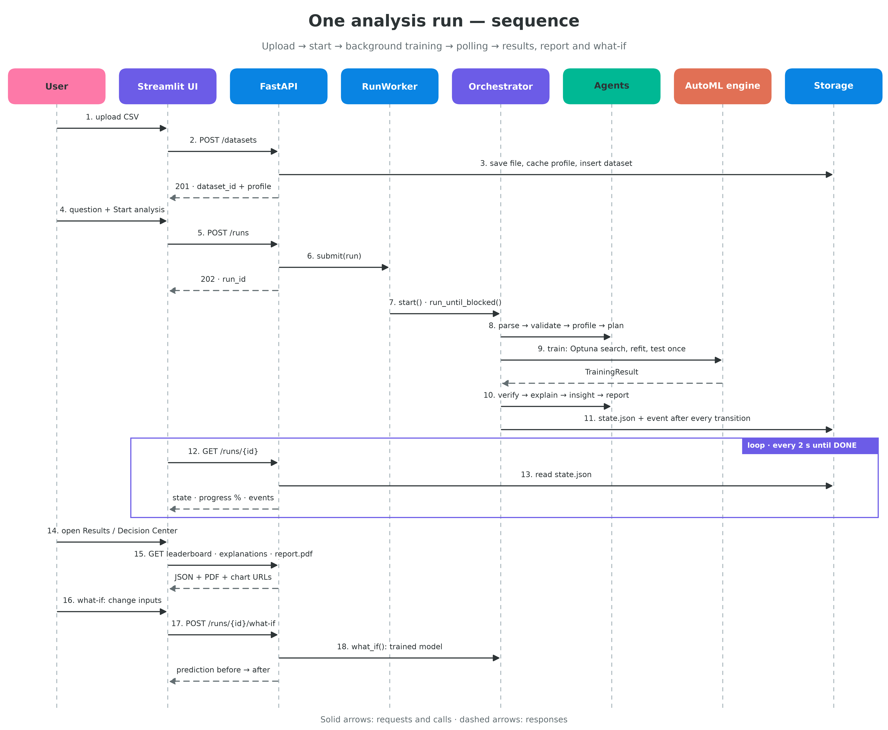

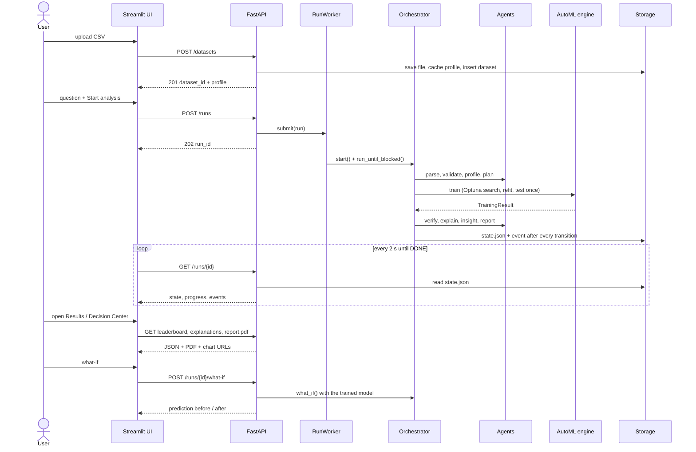

## 5. Data flow

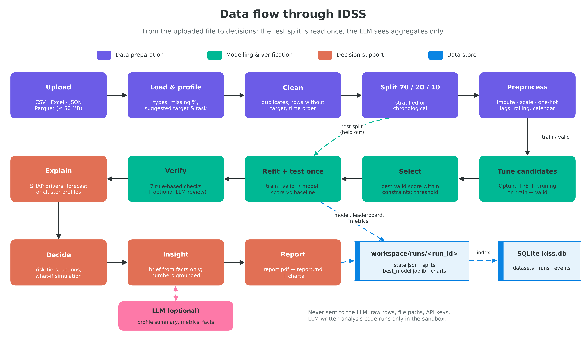

```mermaid
flowchart LR
    up[Upload<br/>CSV, Excel, JSON, Parquet] --> prof[Load and profile] --> clean[Clean] --> split[Split 70/20/10]
    split --> prep[Preprocess<br/>impute, scale, one-hot, lags]
    prep -- train / valid --> tune[Tune candidates<br/>Optuna on train to valid]
    tune --> select[Select best<br/>constraints, threshold]
    select --> refit[Refit on train+valid<br/>test split read once]
    split -. held-out test .-> refit
    refit --> verify[Verify<br/>7 checks vs baseline]
    verify --> explain[Explain<br/>SHAP, forecast, clusters]
    explain --> decide[Decide<br/>tiers, actions, what-if]
    decide --> insight[Insight<br/>facts only]
    insight --> report[Report<br/>PDF + Markdown]
    refit -.-> runs[(workspace/runs/&lt;run_id&gt;)]
    report -.-> runs
    runs -.-> db[(SQLite idss.db)]
    insight <-. aggregates only .-> llm{{LLM, optional}}
```

The test split is wrapped in a `Holdout` object that logs every read; the verifier fails a run whose log is not
exactly `["final_evaluation"]`. SHAP and charts use the training rows and the predictions saved during that single
test evaluation, so nothing re-reads the test split.

## 6. Database

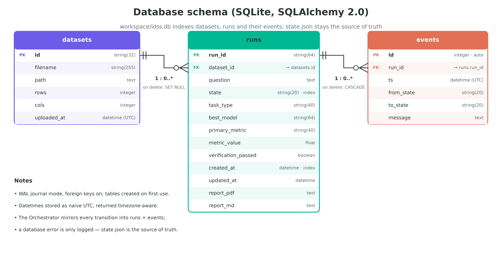

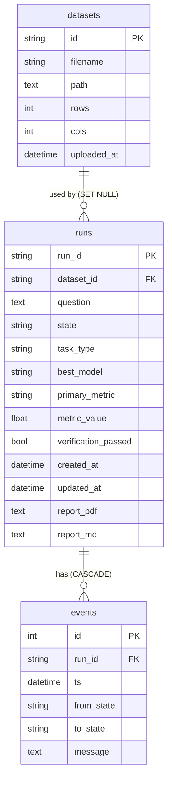

SQLite (`workspace/idss.db`, WAL, foreign keys on) is an index for the list endpoints. Each run's `state.json` is
the source of truth: a database error is logged and never stops a run.

## 7. Use cases

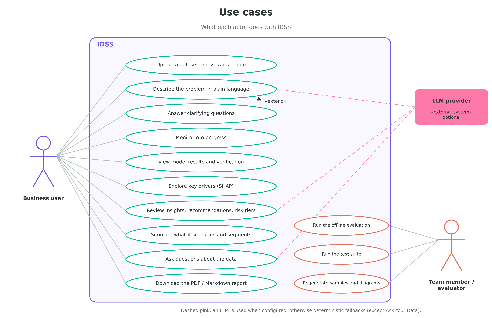

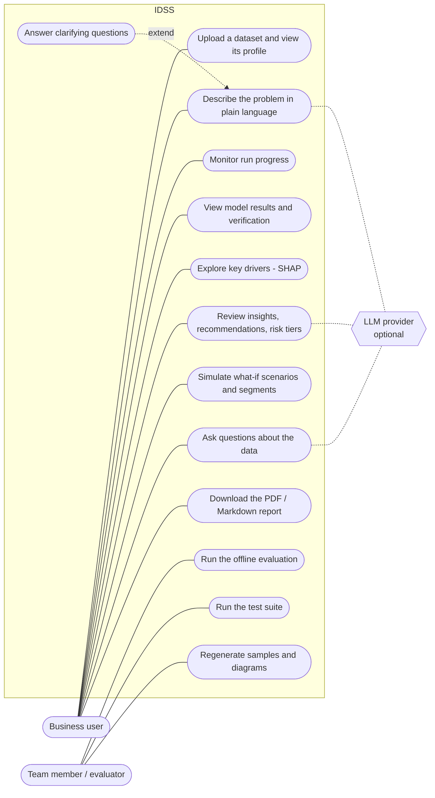

## 8. Project plan

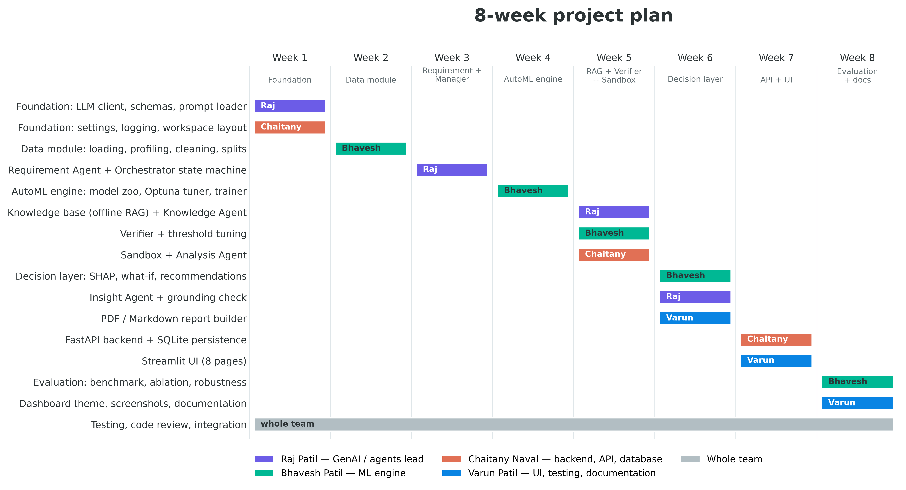

| Week | Milestone | Lead(s) |
|---|---|---|
| W1 | Foundation: LLM client, schemas, prompts; settings, logging; test harness | Raj Vishwas Patil, Chaitany Rajesh Naval, Varun Darshan Patil |
| W2 | Data module | Bhavesh Vinod Patil |
| W3 | Requirement Agent + Orchestrator | Raj Vishwas Patil |
| W4 | AutoML engine + Model Agent | Bhavesh Vinod Patil |
| W5 | Knowledge base; Verifier + threshold tuning; sandbox + Analysis Agent | Raj Vishwas Patil, Bhavesh Vinod Patil, Chaitany Rajesh Naval |
| W6 | Decision layer; Insight Agent; PDF / Markdown reports | Bhavesh Vinod Patil, Raj Vishwas Patil, Varun Darshan Patil |
| W7 | FastAPI backend + persistence; Streamlit UI | Chaitany Rajesh Naval, Varun Darshan Patil |
| W8 | Evaluation; dashboard theme, screenshots, documentation | Bhavesh Vinod Patil, Varun Darshan Patil |

Testing, code review and integration ran through all eight weeks (whole team). The Gantt chart is drawn from
`MEMBERS` / `TIMELINE` in `scripts/make_diagrams.py`; the project is described by week number only.

## 9. Design decisions compared with AutoML-Agent

IDSS is inspired by AutoML-Agent (Trirat, Jeong and Hwang, ICML 2025), a multi-agent LLM framework for full-pipeline
AutoML. The reference implementation was read for ideas only; no code was copied.

### Kept

| Idea | In AutoML-Agent | In IDSS |
|---|---|---|
| **Multi-agent decomposition** | A manager coordinating prompt, data, model and operation agents | An Orchestrator coordinating Requirement, Data, Knowledge, Model, Verifier, Analysis and Insight agents, each with one job and typed (Pydantic) inputs and outputs |
| **Structured requirement parsing** | The prompt agent turns the request into a JSON specification | `RequirementAgent.parse` → `UserRequirement`, repaired against the actual data (target, task type, metrics) |
| **Retrieval-augmented planning** | Plans are informed by retrieved knowledge | The Model Agent ranks candidates with a `KnowledgeBrief` retrieved from best-practice notes |
| **Multi-stage verification** | The request, the execution and the implementation are verified | (1) request: relevance and sufficiency checks with clarifying questions; (2) execution: the test split is audited to be read exactly once, trial errors are contained; (3) results: seven rule-based checks plus an optional LLM review, and one re-plan with a bigger budget when a check fails |
| **Same evaluation metrics** | SR, NPS (1/(1+error) for error metrics), CS = 0.5·SR + 0.5·NPS | Reproduced offline in `scripts/evaluate.py` (see [results](results/evaluation.md)); for clustering IDSS uses the chance-corrected adjusted Rand index instead of the paper's Rand index, which rewards over-splitting (RI is still reported) |

### Changed

| Decision | Why |
|---|---|
| **Deterministic AutoML engine instead of LLM-written training code.** The LLM only ranks names from a fixed model zoo (scikit-learn, XGBoost, LightGBM, k-means, …); tested code trains, tunes (Optuna), selects and evaluates. | Every run that starts can finish (no broken generated scripts), results are reproducible with a seed, the test split provably stays untouched, and the system works without an LLM. |
| **Offline RAG.** A TF-IDF index over 10 curated notes (`data/knowledge/`), cached and rebuilt when the notes change; web search only if a key is set. | No network dependency, no data leaving the machine, deterministic retrieval, easy to audit and extend. |
| **Sandbox for the one place LLM code runs.** *Ask Your Data* executes LLM-written pandas code only after an AST check (import allow-list, no file / network / system access, no private attributes) in an isolated child process with restricted built-ins, a timeout and no secrets. | LLM-generated code is untrusted input. |
| **Decision layer.** SHAP drivers summed back to original columns, record and segment what-if simulation, risk tiers with stated cut-offs, counterfactual actions, a decision brief whose numbers are checked against computed facts, PDF / Markdown reports. | AutoML-Agent stops at a deployable model; IDSS is for decision makers who need to know *what to do*, not only *how accurate* the model is. |
| **Persistent, resumable runs, an API and a UI.** State machine with `state.json` after every transition, SQLite index, FastAPI backend with one background worker, Streamlit front end. | Non-experts use it from a browser; runs survive restarts and can wait for user answers. |
| **Budgets and constraints.** Fast / full presets; latency, training-time and explainability constraints parsed from text and enforced in selection. | Predictable runtime on a laptop; user constraints are checked, not just mentioned. |

## 10. Security and privacy

- **Data stays local.** API and UI bind to localhost; uploads, runs and the database live in `workspace/`
  (ignored by Git).
- **Minimal LLM exposure.** Prompts carry column names, types, aggregate statistics, metrics and computed facts —
  never raw rows, file paths or keys. The Insight Agent's grounding check rejects any number that is not in the facts.
- **Secrets.** Keys only in `.env` (ignored by Git, `SecretStr` in settings); `/health` reports only whether an LLM
  is configured; the sandbox child process gets an environment without secrets.
- **Untrusted code.** LLM-written analysis code passes a static AST guard and then runs in a separate process
  (`python -I`, restricted built-ins, guarded imports, temporary directory, timeout, output capped at 20 KB).
- **Input validation.** Pydantic validates every request; uploads are limited to 50 MB (checked before and while
  reading), file names are sanitised, run ids and chart names are pattern-checked and resolved paths must stay inside
  the run's folder; what-if filters are structured conditions, never evaluated strings.
- **Robust failure.** Every LLM call has a timeout and at most 3 retries; every agent has a deterministic fallback;
  a failing state handler moves the run to `FAILED` with a message instead of crashing; errors are returned as
  `{error, detail}` without stack traces.
- **Bounded loops.** At most two clarification rounds, one re-plan and 50 steps per call; one training run at a time.

### 10.1 Security and trust (v1.1)

v1.1 treats two things as untrusted input: the LLM's output and the uploaded data. Three boundaries keep them from
driving execution or putting numbers in front of a decision maker.

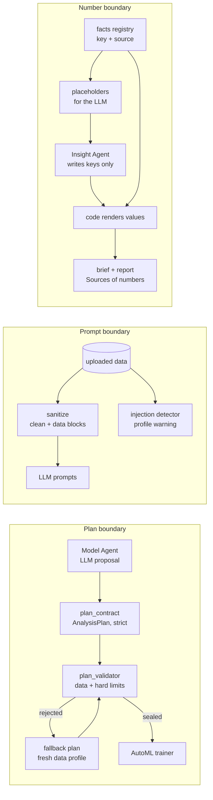

- **Plan contract** (`idss/core/plan_contract.py`). The only planner output that can drive execution is an
  `AnalysisPlan`: a strict, frozen Pydantic model with extra keys forbidden. Task type, primary metric and candidate
  models are closed lists generated from the metric registry and the model zoo and checked per task (1–6 models, no
  duplicates, no baselines); constraints, budget mode, actionable features (≤ 20) and the time column are bounded.
  `parse_plan()` returns one sentence per problem.
- **Independent validation** (`idss/execution/plan_validator.py`). Without asking the LLM, the validator checks the
  plan against the data and the settings: the target exists and suits the task (not an ID, text, date, empty or
  constant column), the time column is a date, actionable features exist and are not IDs, the metric is defined, at
  least one usable feature remains, and the budget and training-time constraint stay inside hard limits; row and file
  limits are fatal. The public demo turns a full budget into fast. A rejected plan is replaced by a fallback plan built
  from a fresh profile of the data, and the requirement is aligned to it; TRAIN only accepts a plan sealed in the same
  process (fingerprinted, re-validated after a restart).
- **Prompt-injection defence** (`idss/core/sanitize.py`). Every dataset-derived string that reaches a prompt (column
  names, categories, file names, knowledge snippets, sandbox errors) is cleaned — control, zero-width and bidi
  characters removed, `<…>` delimiters turned into `‹…›`, lengths capped — and placed inside `<data>…</data>`; every
  system prompt states that such text is data, never instructions. A detector (NFKC-normalised) flags instruction-like
  text in headers and cells ("ignore previous instructions", role tags, chat-template tokens, …) as a profile warning,
  shown on the Upload page and in the report under "Security checks". Raw rows are still never sent.
- **Number provenance** (`idss/decision/facts.py`). A facts registry gives every computed number a key (for example
  `metrics.test.f1`, `risk_tiers.high.count`, `drivers[0].share`) and a source (`metrics.json`, `leaderboard.json`, a
  section of `state.json`, …). The Insight Agent's LLM sees numbers only as `{{key}}` placeholders and may not type a
  digit; code renders the values, the grounding check runs as a second layer, and a failing draft is regenerated once
  and then replaced by the template. The report prints every number through the registry and ends with a
  "Sources of numbers" appendix (number → key → source).
