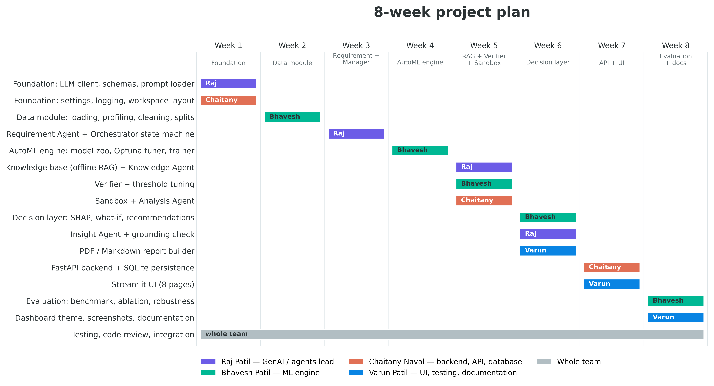

# Chapter 3: Project Planning and Management

This chapter examines whether the project was feasible and which risks threatened it, and presents the eight-week
schedule, the allocation of work among the four members and an estimate of effort and cost based on the real size of
the code.

## 3.1 Feasibility Study and Risk Analysis

### 3.1.1 Feasibility Study

**Technical feasibility.** Every computational part rests on mature open-source libraries — pandas, scikit-learn
[2], XGBoost [3], LightGBM [4], Optuna [7], SHAP [10], FastAPI,
Streamlit, SQLAlchemy and reportlab — so the work was integration rather than invention. One OpenAI-compatible client
reaches OpenAI, Groq, Google Gemini or a local Ollama model, and every agent has a fallback, so no provider is required.
Tabular datasets of a few thousand rows train in seconds to minutes on a laptop CPU within the *fast* budget (3 models ×
15 Optuna trials, at most 180 s in total); no GPU is needed.

**Economic feasibility.** All software is free and open source and the hardware is the team's own laptops. The only
possible running cost is the optional LLM API, and prompts carry aggregates only, which keeps them short.

**Operational feasibility.** The users are business users who cannot program. The system therefore offers a browser
interface, plain-language questions with examples, a one-click Demo Mode, stage-by-stage progress, clarifying questions
instead of error messages and results explained in words. Runs are saved after every step, so a restart loses no work.

**Schedule feasibility.** The architecture splits into eight layers that each depend only on the layers below, which
allowed one layer per week. Each week's scope was kept small enough to be implemented *and* tested; features that did
not fit were declared out of scope. Table 3.1 summarises the study.

**Table 3.1:** Feasibility summary

| Aspect | Question | Assessment | Basis |
|---|---|---|---|
| Technical | Can the team build and run it? | Feasible | Mature libraries; provider-independent LLM client; laptop-scale workloads |
| Economic | Can it be built without a budget? | Feasible | Open-source software; own laptops; LLM optional |
| Operational | Can non-experts use it? | Feasible | Browser UI, plain language, clarifying questions, Demo Mode |
| Schedule | Does it fit eight weeks? | Feasible with strict scope | One tested layer per week; explicit out-of-scope list |

### 3.1.2 Risk Analysis

We identified the risks below at the start of the project and reviewed them weekly. Probability (P) and impact (I) are
rated Low, Medium or High; the mitigations are implemented in the final system (Table 3.2).

**Table 3.2:** Risk analysis

| ID | Risk | P | I | Mitigation implemented |
|---|---|---|---|---|
| R1 | LLM unavailable, slow or not configured | High | High | Timeout on every call (60 s default), at most 3 retries with backoff, deterministic fallback in every agent; the pipeline runs offline |
| R2 | Hallucinated numbers in the decision brief | Medium | High | Brief built from computed facts only; grounding check rejects unsupported numbers; one regeneration, then a grounded template |
| R3 | Unsafe LLM-written code | Medium | High | Code runs only in the sandbox: AST guard, isolated child process, restricted built-ins, 20 s timeout, no secrets |
| R4 | Data leakage or reuse of the test split | Medium | High | Splits fixed before training; tuning sees only train and validation; audited single test read; leakage warning at correlation ≥ 0.98 |
| R5 | LLM usage limits, rate limits or cost | Medium | Medium | Aggregates only in prompts; capped retries; LLM optional; tests use a fake LLM |
| R6 | Malformed JSON from the LLM | High | Medium | Pydantic validation with the error fed back for a retry; fallback after the retry cap |
| R7 | Requirement misunderstood | Medium | High | Deterministic repair of target, task type and metrics against the data; repairs shown; clarifying questions |
| R8 | Training too slow on a laptop | Medium | Medium | Budgets with per-model and total time limits; median pruning; one training at a time |
| R9 | Over-fitting or a model no better than trivial | Medium | High | Baseline on the same test split; train–test gap check (< 0.15); one re-plan; failures flagged "not verified" |
| R10 | Endless agent loops | Low | High | At most 2 clarification rounds, 1 re-plan and 50 steps per call; errors end in FAILED |
| R11 | Raw data or keys leaking; path traversal | Low | High | Profile-only prompts; keys only in `.env`; validated uploads, ids and paths; localhost only |
| R12 | Scope creep in eight weeks | Medium | High | One layer per week; out-of-scope list; every increment closed with tests and a commit |

## 3.2 Project Scheduling

The project was scheduled as eight one-week increments, with testing, review and integration running throughout.
Figure 3.1 shows the Gantt chart and Table 3.3 the milestones and the evidence that closed each week.

**Figure 3.1:** Eight-week project plan (Gantt chart)

**Table 3.3:** Project schedule and milestones

| Week | Milestone | Key tasks | Closing evidence |
|---|---|---|---|
| W1 | Foundation | Settings, logging, LLM client, schemas, prompt loader, test harness | Foundation tests; commits `146b1cf`, `417219c` |
| W2 | Data module | Loader, profiler, cleaning, 70/20/10 splits, preprocessing; sample datasets | Data tests; commit `cd2b765` |
| W3 | Requirement Agent + Orchestrator | Relevance, parsing, repair, clarifying questions; resumable state machine | Live LLM demo; commit `53ce937` |
| W4 | AutoML engine | Model zoo, Optuna tuner, evaluator, trainer, Model Agent | Step 4 benchmark; commit `9f8d017` |
| W5 | RAG + Verifier + Sandbox | Knowledge index and agent; threshold tuning; seven checks; sandbox | Updated benchmark; commit `eea311a` |
| W6 | Decision layer | SHAP, what-if, recommender, grounded insight, PDF / Markdown report | Two offline end-to-end runs; commit `aa24eed` |
| W7 | FastAPI + Streamlit UI | 17-endpoint API, worker, SQLite; eight UI pages | API and UI tests; commits `29007c0`, `7f13403` |
| W8 | Evaluation + documentation | Benchmark, ablation, robustness; diagrams, manuals; theme, screenshots | `evaluation.md`; commits `a3aefd2`, `3965778` |

## 3.3 Effort Allocation and Cost Estimation

### 3.3.1 Effort Allocation

Each member led one area of the system (Table 3.4); testing, review and integration were shared. Table 3.5 gives the
**planned** split of work per member and week. It was derived from the roles of Table 3.4 and the weekly milestones of
Table 3.3, with an equal share for every member: one person-week per member per week, so 8 person-weeks per member and
32 person-weeks in total.

**Table 3.4:** Team roles

| Member | Role | Main areas |
|---|---|---|
| Raj Vishwas Patil | GenAI / Agents Lead | LLM client, prompts, Requirement, Knowledge, Model and Insight agents |
| Bhavesh Vinod Patil | ML Engine | Data module, model zoo, tuner, trainer, Verifier, explanations, recommender, evaluation |
| Chaitany Rajesh Naval | Backend / API / DB | Settings, logging, state persistence, sandbox, FastAPI, worker, SQLite |
| Varun Darshan Patil | UI / Testing / Docs | Test harness, samples, report builder, Streamlit UI, theme, documentation |

**Table 3.5:** Planned effort allocation per member per week (one person-week per cell)

| Week | Raj Vishwas Patil | Bhavesh Vinod Patil | Chaitany Rajesh Naval | Varun Darshan Patil |
|---|---|---|---|---|
| W1 | LLM client, schemas, prompt loader | Library selection for data and ML | Settings, logging, workspace layout | pytest harness and fixtures |
| W2 | Data Agent summary prompt and fallback | Loader, profiler, splits, preprocessing | Run ids and run folders | Sample datasets, data tests |
| W3 | Requirement Agent and prompts | Task metrics, target / task suggestions | State machine persistence, resume | State-machine tests, demo script |
| W4 | Model Agent and constraint parsing | Model zoo, tuner, evaluator, trainer | TRAIN state integration, artefacts | AutoML tests, benchmark report |
| W5 | Knowledge notes, index, Knowledge Agent | Verifier, threshold tuning, baselines | Sandbox, Analysis Agent | Retrieval, verifier and sandbox tests |
| W6 | Insight Agent and grounding check | SHAP, what-if, recommender | EXPLAIN / INSIGHT / REPORT states | PDF / Markdown report builder |
| W7 | Ask Your Data and LLM-optional API paths | Result endpoints (explanations, what-if) | FastAPI app, worker, SQLite repository | Streamlit UI, API client, page tests |
| W8 | Evaluation review, report writing | Evaluation script and studies | Lint / coverage set-up, run scripts, API docs | Theme, screenshots, user manual, diagrams |
| **Total** | **8 person-weeks** | **8 person-weeks** | **8 person-weeks** | **8 person-weeks** |

Four members working for eight weeks gives 32 person-weeks, about 7.4 person-months at 4.33 weeks per month — in round
figures, 4 members × about 2 months ≈ 8 person-months of actual effort.

### 3.3.2 Size of the Software

We wrote `scripts/count_loc.py`, which reads every Python file with Python's tokenizer and counts a line as code when
it holds at least one token that is not a comment or a docstring; the read-only reference folder and the virtual
environment are excluded (Table 3.6).

**Table 3.6:** Source lines of code (Python)

| Package | Files | Physical lines | Code lines |
|---|---:|---:|---:|
| `idss/` (agents, ML engine, decision layer, knowledge, sandbox, storage) | 40 | 7,463 | 5,751 |
| `api/` (FastAPI backend) | 4 | 803 | 573 |
| `ui/` (Streamlit interface) | 15 | 2,278 | 1,719 |
| `configs/` (settings) | 2 | 87 | 61 |
| `scripts/` (evaluation, samples, diagrams, demos) | 8 | 3,180 | 2,579 |
| **Delivered code (without tests)** | **69** | **13,811** | **10,683** |
| `tests/` (reported separately) | 15 | 3,938 | 2,983 |

The application (`idss`, `api`, `ui`, `configs`) has 8,104 code lines; with the scripts the delivered code is
**10.683 KLOC**.

### 3.3.3 Cost Estimation with Basic COCOMO

We used basic COCOMO [16] in **organic mode** (a small team, familiar kind of software, flexible requirements):

> *E* = 2.4 · (KLOC)1.05 person-months, *D* = 2.5 · *E*0.38 months, *P* = *E* / *D* persons.

For KLOC = 10.683: *E* = 2.4 × 10.6831.05 = **28.86 person-months**, *D* = 2.5 × 28.860.38 =
**8.97 months** and *P* = 28.86 / 8.97 = **3.22 persons**. Table 3.7 compares the estimates with the actual effort.

**Table 3.7:** Basic COCOMO (organic) estimate and actual effort

| Quantity | Application only (8.104 KLOC) | Delivered code (10.683 KLOC) | Actual project |
|---|---:|---:|---:|
| Effort *E* (person-months) | 21.59 | 28.86 | ≈ 8 (4 members × ~2 months; 32 person-weeks = 7.4) |
| Duration *D* (months) | 8.04 | 8.97 | ≈ 1.8 (8 weeks) |
| Average staff *P* (persons) | 2.69 | 3.22 | 4 |

**Why the actual effort is lower than the estimate.** COCOMO estimates 28.86 person-months for the delivered code,
while the actual effort was about 8 person-months (4 members × about 2 months), roughly 3.6 times less. We report this
difference instead of adjusting the estimate. Basic COCOMO assumes traditional development in which every line is
designed, written and debugged by hand; it was calibrated on industrial projects of the late 1970s [16] and assumes a
full industrial lifecycle with formal reviews, documentation and maintenance that a fixed-scope student project does
not have. Our project differed in two ways. First, it reuses mature open-source libraries heavily: training, tuning,
SHAP, the web server, the UI, the database and PDF generation are not our code. Second, we used an AI coding assistant
(Claude Code) to help generate and refactor code, which shortened the time from a design decision to working, tested
code; the design, integration, testing and evaluation were still carried out and verified by the team. The COCOMO figure
is therefore best read as the effort the same code would need if it were written entirely by hand, and as confirmation
that the scope was ambitious for eight weeks.

### 3.3.4 Actual Cost

**Table 3.8:** Actual cost

| Resource | Use | Cost |
|---|---|---|
| Python and open-source libraries (pandas, scikit-learn, XGBoost, LightGBM, Optuna, SHAP, FastAPI, Streamlit, SQLAlchemy, reportlab, matplotlib, pytest, ruff, Playwright) | Development, testing, evaluation | ₹0 (open-source licences) |
| Git, SQLite | Version control, database | ₹0 (open-source licences) |
| Team laptops (Windows) | Development and evaluation | ₹0 (already owned) |
| LLM API (OpenAI-compatible) | Optional language tasks | Within the provider's free tier; the tests and the evaluation use no LLM |

The software licence cost of the project is therefore ₹0, and LLM usage stayed within the free tier of the provider.

## 3.4 Summary

The project was technically, economically, operationally and schedule-wise feasible with a strict scope. Twelve risks —
including LLM unavailability, hallucinated numbers, unsafe code, data leakage and usage limits — were identified and
mitigated in the final system. The work was scheduled as eight weekly increments and divided among four members by area.
Basic COCOMO on the real code size (10.683 KLOC) estimates 28.86 person-months, about 3.6 times the roughly 8
person-months actually spent, because COCOMO assumes manual development while we reused open-source libraries and used an
AI coding assistant; the licence cost was ₹0 and LLM usage stayed within the free tier.
