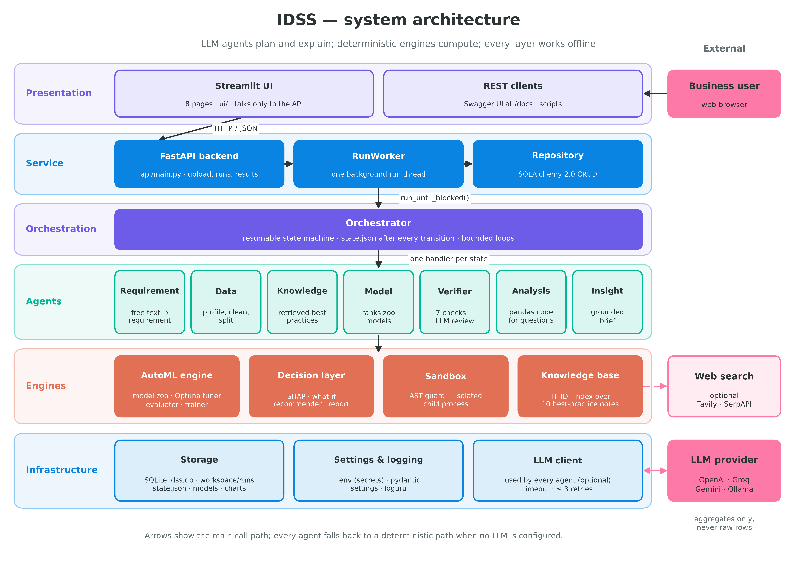
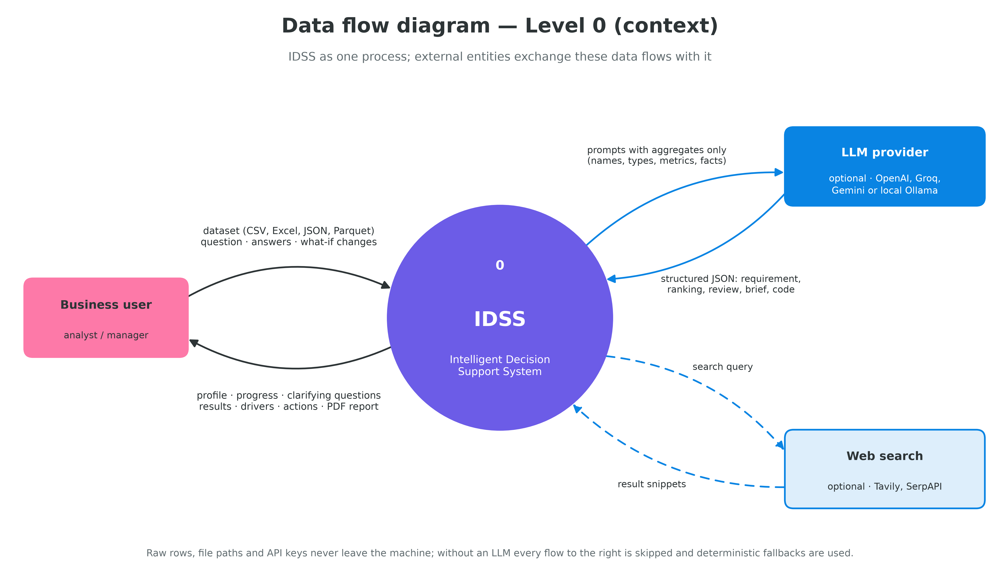
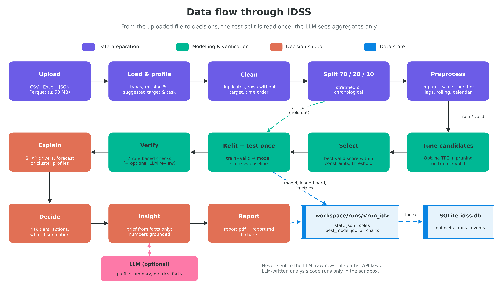
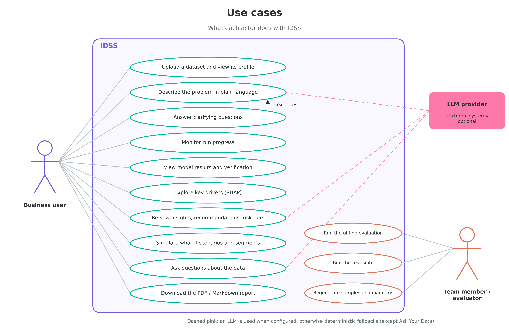
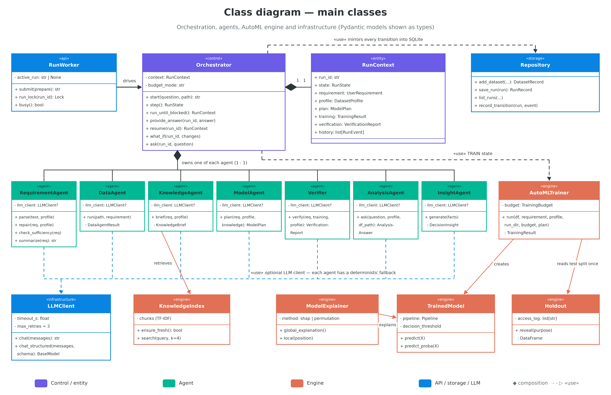
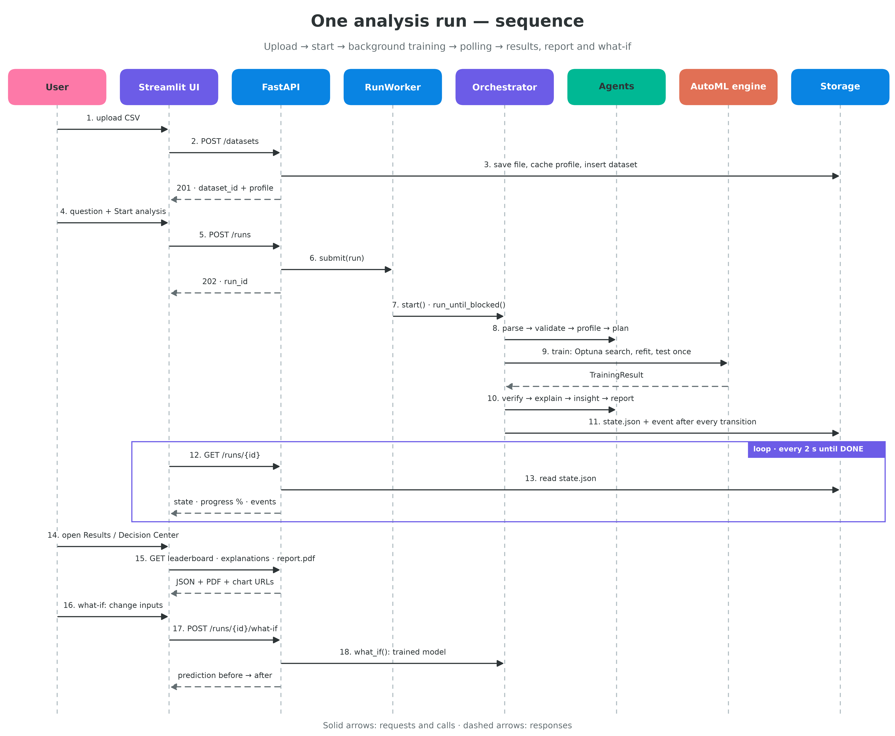
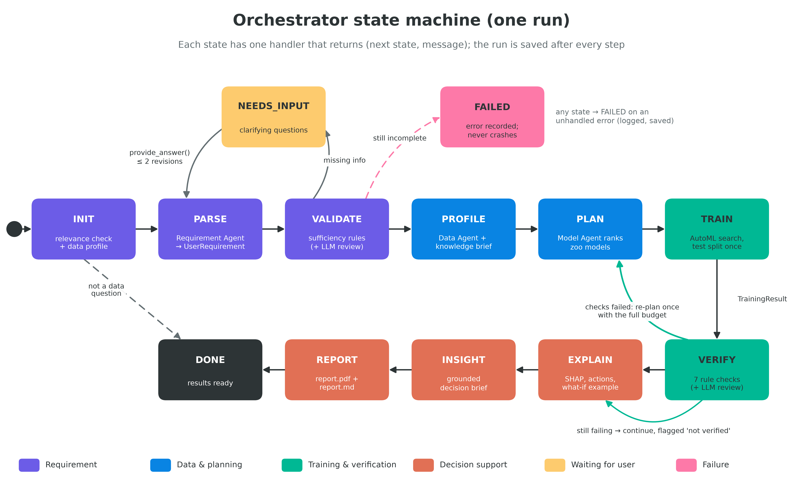
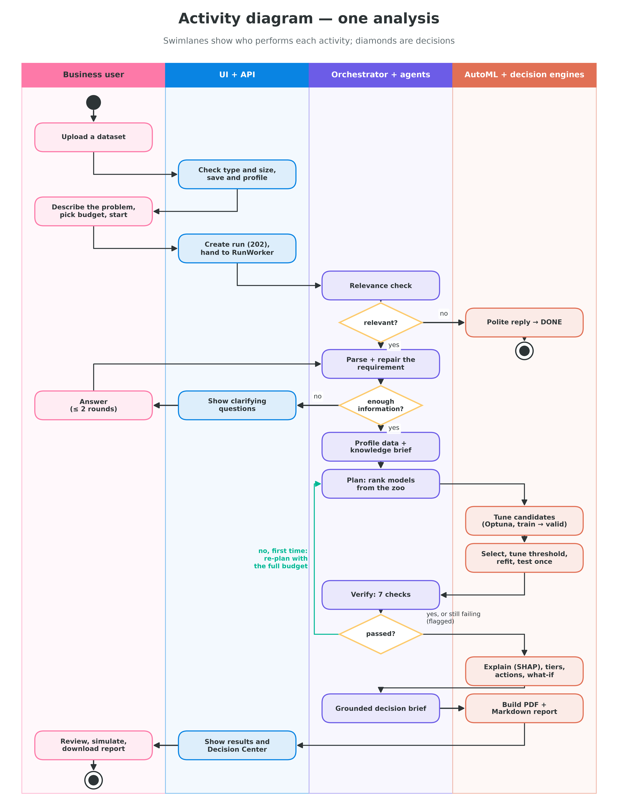
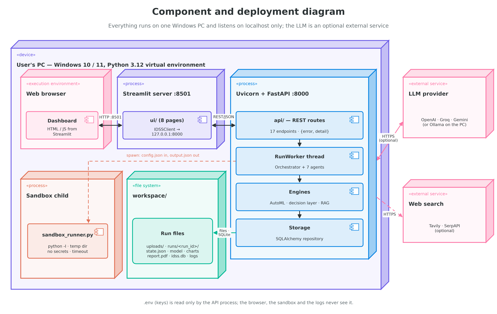
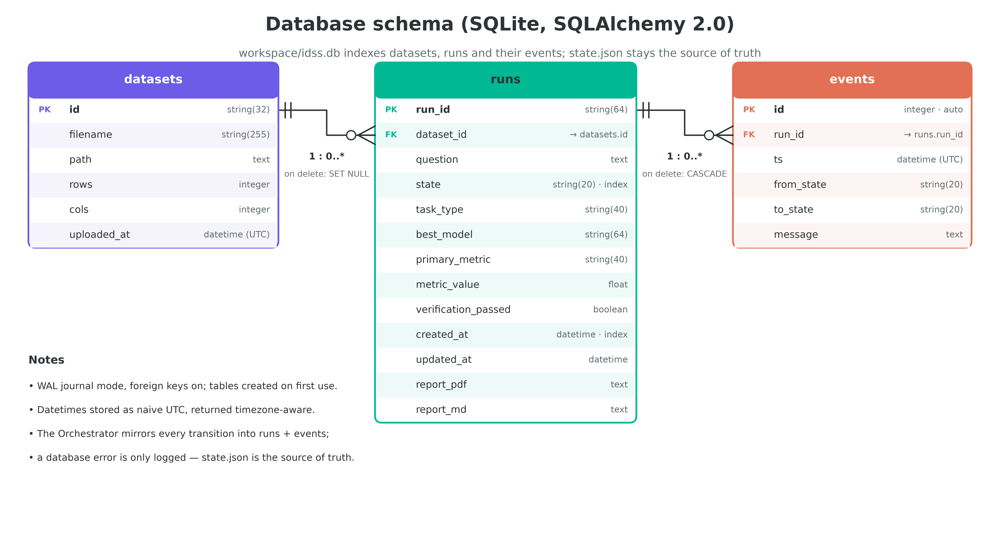

# Chapter 4: System Analysis and Design

This chapter specifies what IDSS must do — functional, non-functional, data, hardware and software requirements,
summarised as an SRS — and how it is designed: the architecture, the data flow diagrams, the UML diagrams and the
database.

## 4.1 Requirement Collection and Identification

### 4.1.1 Requirement Collection

Requirements came from four sources: (1) the project brief discussed with our guide — a system in which a user states a
business problem in plain language and receives a validated model with explained, actionable decisions; (2) the
literature, especially AutoML-Agent [9] (Chapter 2); (3) five representative business scenarios — customer
churn, crop price, daily store sales, delivery delays and customer segments — for which we generated synthetic datasets
and walked through each question from the user's side; and (4) the risks of LLM-based systems (Section 3.1.2), which
became non-functional requirements. The stakeholders are the **business user**, who needs answers without programming;
the **team member or evaluator**, who runs tests, the evaluation and the tooling; the **guide and examiners**, who need
evidence that results are correct and honestly verified; and the **LLM provider**, an optional external system that
receives aggregates only.

### 4.1.2 Functional Requirements

**Table 4.1:** Functional requirements

| ID | The system shall … | Implemented in |
|---|---|---|
| FR-01 | accept CSV, Excel, JSON or Parquet files of at most 50 MB, store them under a sanitised name and list them | `api/main.py`, `data_loader.py` |
| FR-02 | profile each dataset: types, missing values, distinct counts, suggested target and task, leakage and imbalance warnings | `profiler.py` |
| FR-03 | check whether a question can be answered from data and reply politely, without training, when it cannot | Requirement Agent |
| FR-04 | convert the question into a structured requirement and repair it against the data profile | Requirement Agent |
| FR-05 | ask clarifying questions when information is missing (at most two rounds) and continue with the answers | Requirement Agent, Orchestrator |
| FR-06 | clean the data and split it 70/20/10 (stratified, or chronological for time series) | `preprocess.py`, Data Agent |
| FR-07 | retrieve best-practice knowledge and plan models only from a fixed zoo, honouring latency, training-time and explainability constraints | Knowledge and Model agents |
| FR-08 | tune candidates within the budget, select on the validation split, tune the decision threshold (binary), refit and evaluate once on the test split with a baseline | `tuner.py`, `trainer.py` |
| FR-09 | verify results with rule-based checks, re-plan once on failure and flag results that still fail | Verifier, Orchestrator |
| FR-10 | explain the model globally and per record in the original column names | `explain.py` |
| FR-11 | simulate what-if changes for a record and for a filtered segment, validated against the profile | `what_if.py` |
| FR-12 | produce risk tiers and counterfactual actions, lever effects, forecasts with an interval or segment profiles | `recommender.py`, `explain.py` |
| FR-13 | write a decision brief whose numbers all appear in the computed facts | Insight Agent |
| FR-14 | generate downloadable PDF and Markdown reports with charts | `report_builder.py` |
| FR-15 | answer ad-hoc data questions with LLM-written code run in a sandbox (LLM required) | Analysis Agent, sandbox |
| FR-16 | show run progress (state, percentage, events) and resume runs after a restart | Orchestrator, Run Monitor |
| FR-17 | store datasets, runs and events in a database and list and filter runs | `idss/storage/` |
| FR-18 | expose every function through a REST API with a uniform error format | `api/` |
| FR-19 | complete the whole pipeline without an LLM | Every agent's fallback |
| FR-20 | offer a one-click demonstration on a sample dataset | Home page (Demo Mode) |

### 4.1.3 Non-functional Requirements

**Table 4.2:** Non-functional requirements

| ID | Category | Requirement |
|---|---|---|
| NFR-01 | Performance | Fast budget: ≤ 3 models × 15 trials, ≤ 60 s per model, ≤ 180 s in total; the UI refreshes progress every 2 s |
| NFR-02 | Reliability | Every LLM call has a timeout and ≤ 3 retries with backoff; a failing step ends the run in FAILED, never crashes it |
| NFR-03 | Bounded behaviour | ≤ 2 clarification rounds, 1 re-plan and 50 steps per call; one training run at a time |
| NFR-04 | Degradation | Every agent has a deterministic fallback; the system works without an LLM |
| NFR-05 | Privacy | Prompts carry names, types, aggregates, metrics and facts only — never raw rows, paths or keys; localhost only |
| NFR-06 | Security | Keys only in `.env`; LLM code only in the sandbox; uploads, ids and paths validated |
| NFR-07 | Validity | Test split read exactly once; baselines on the same split; reproducible with a seed |
| NFR-08 | Transparency | Recommendations carry evidence; repairs, checks and tier cut-offs are shown |
| NFR-09 | Usability | A non-programmer completes an analysis in the browser; clear empty states and backend-down messages |
| NFR-10 | Durability | Run state saved atomically after every transition; a database error never stops a run |
| NFR-11 | Maintainability | Type hints, Pydantic v2 schemas at module boundaries, modular packages, linting, one logger |
| NFR-12 | Testability | An automated test suite that runs offline without network calls |
| NFR-13 | Portability | Windows 10 / 11, Python 3.12; any OpenAI-compatible provider or local Ollama |

### 4.1.4 Data and Behavioural Requirements

**Table 4.3:** Data requirements

| Item | Requirement |
|---|---|
| Structure and format | One table with a header row; `.csv` (delimiter and encoding detected), `.xlsx`, `.json` (incl. JSON lines), `.parquet` |
| Size | ≤ 50 MB; at least 10 rows to split; the Verifier requires ≥ 30 test rows (10% of the data) |
| Target | A numeric, categorical or boolean column with more than one value; identifiers, dates and free text cannot be targets |
| Time series | A date column and a numeric target; chronological split; features from earlier rows only |
| Clustering | No target; an optional ground-truth column is used only for scoring |

The behaviour of a run is the state machine of Section 4.5.4: INIT → PARSE → VALIDATE → PROFILE → PLAN → TRAIN → VERIFY
→ EXPLAIN → INSIGHT → REPORT → DONE, with NEEDS_INPUT while waiting for an answer and FAILED on an error.

### 4.1.5 Software Requirements Specification (Summary)

- **Purpose and users.** IDSS turns a plain-language question and a data table into a verified model, explanations,
  actions, what-if simulations and a report, for business users (web interface) and technical users (REST API, scripts).
- **Functions and qualities.** FR-01 to FR-20 (Table 4.1) and NFR-01 to NFR-13 (Table 4.2).
- **Environment.** One Windows 10 / 11 machine with Python 3.12 and a web browser; optionally an OpenAI-compatible LLM
  endpoint or a local Ollama server.
- **Interfaces.** Eight Streamlit pages; a REST API with 17 endpoints on `localhost:8000`; the OpenAI-compatible
  chat-completions API; files and an SQLite database under `workspace/`.
- **Constraints and assumptions.** The LLM never writes training code; secrets only in `.env`; retries capped at 3; data
  fits in memory; one user runs one training at a time.

## 4.2 Hardware and Software Requirements

Table 4.4 gives the minimum hardware for running IDSS and, for comparison, the machine on which it was developed and
evaluated (details in Table 5.2). More CPU cores shorten tuning; no GPU is used.

**Table 4.4:** Hardware requirements

| Component | Minimum requirement | Development machine (used) |
|---|---|---|
| Processor | 64-bit multi-core CPU (4 cores) | Intel Core i7-11800H, 8 cores / 16 logical processors, 2.30 GHz |
| Memory | 8 GB RAM | 16 GB RAM |
| Storage | About 5 GB free: the virtual environment takes about 1.2 GB, plus datasets and run folders | 1 TB NVMe SSD |
| GPU | Not required | NVIDIA GeForce RTX 3050 Ti Laptop GPU (present, not used by IDSS) |
| Network | Only for package installation, an external LLM or web search | Same |
| Operating system | Windows 10 / 11, 64-bit | Windows 11 Home Single Language, 64-bit |

**Table 4.5:** Software requirements

| Software | Version | Purpose |
|---|---|---|
| Windows | 10 / 11 | Operating system (the Python code is portable) |
| Python | 3.12 | Runtime |
| pandas, NumPy, PyArrow, openpyxl | 3.0.6, 2.5.3, 25.0.1, 3.1.5 | Data handling |
| scikit-learn, XGBoost, LightGBM | 1.9.1, 3.4.1, 4.7.0 | Models |
| Optuna, SHAP | 5.0.0, 0.52.0 | Tuning, explanations |
| Pydantic, pydantic-settings | 2.13.5, 2.15.0 | Schemas, settings |
| openai | 3.24.0 | Client for any OpenAI-compatible LLM |
| FastAPI, Uvicorn | 0.142.2, 0.54.0 | REST API |
| Streamlit, Plotly, requests | 1.65.0, 7.1.0, 2.34.2 | User interface |
| SQLAlchemy (SQLite) | 2.1.3 | Persistence |
| reportlab, matplotlib, loguru | 5.0.1, 3.11.2, 0.7.3 | Reports, charts, logging |
| Web browser | Current version | Access to `http://localhost:8501` |

## 4.3 System Architecture

Figure 4.1 shows the layered architecture (Table 4.6). **LLM agents plan and explain, deterministic engines compute**,
and every layer also works without an LLM. A request flows downwards: the UI calls the API; the API hands the run to the
RunWorker thread, which drives the Orchestrator; the Orchestrator calls one agent per state; agents use the engines for
all computation and, when configured, the LLM client for language tasks. The architecture keeps the multi-agent
decomposition, structured requirements, retrieval-augmented planning and multi-stage verification of AutoML-Agent
[9], replaces LLM-written training code with a deterministic engine and adds the decision layer, sandbox,
persistence, API and UI (Tables 2.2 and 2.3).

**Figure 4.1:** System architecture of IDSS

**Table 4.6:** Architectural layers

| Layer | Components | Code |
|---|---|---|
| Presentation | Streamlit UI (8 pages), talks only to the API | `ui/` |
| Service | FastAPI backend, RunWorker thread, repository | `api/`, `idss/storage/` |
| Orchestration | Resumable state machine, one handler per state | `idss/agents/manager.py` |
| Agents | Requirement, Data, Knowledge, Model, Verifier, Analysis, Insight | `idss/agents/` |
| Engines | AutoML engine, decision layer, knowledge base, sandbox | `idss/ml/`, `idss/decision/`, `idss/knowledge/`, `idss/execution/` |
| Infrastructure | LLM client, SQLite and run workspace, settings, logging | `idss/core/`, `idss/storage/`, `configs/` |

## 4.4 Data Flow Diagrams

**Level 0.** Figure 4.2 shows IDSS as one process and its external entities. The business user sends a dataset, a
question, answers and what-if changes, and receives the profile, progress, clarifying questions, results, actions and
the report. The optional LLM provider receives prompts with aggregates only and returns structured JSON; the optional web
search service receives queries and returns snippets. Without an LLM, these flows are skipped.

**Figure 4.2:** Data flow diagram, Level 0 (context diagram)

**Level 1.** Figure 4.3 decomposes the process. The file is loaded and profiled, cleaned, split 70/20/10 and
preprocessed. Candidate models are tuned on the train and validation splits, the best compliant one is selected (with
its decision threshold), refitted on train + validation and scored **once** on the held-out test split with a baseline,
then verified and explained. Finally the system derives decisions, writes the grounded insight and builds the report.
The run folder stores state, splits, model, charts and reports; SQLite indexes datasets, runs and events.

**Figure 4.3:** Data flow diagram, Level 1

## 4.5 UML Diagrams

### 4.5.1 Use Case Diagram

The business user uploads and profiles data, describes the problem (extended by answering clarifying questions),
monitors runs, views results and verification, explores drivers, reviews recommendations and risk tiers, simulates
what-if scenarios, asks questions about the data and downloads reports. A team member runs the evaluation and the tests
and regenerates samples and diagrams. The LLM provider is an optional external system (Figure 4.4).

**Figure 4.4:** Use case diagram

### 4.5.2 Class Diagram

The **Orchestrator** owns one instance of each agent and the current **RunContext**, which holds the whole state of a
run and is saved as `state.json`; it mirrors every transition into the **Repository** and is driven by the API's
**RunWorker**. Every agent holds an optional **LLMClient**. The **KnowledgeAgent** queries the **KnowledgeIndex**; in
the TRAIN state the **AutoMLTrainer** creates a **TrainedModel** and reads the test split through the **Holdout**,
whose access log proves a single read; the **ModelExplainer** explains a TrainedModel (Figure 4.5).

**Figure 4.5:** Class diagram of the main classes

### 4.5.3 Sequence Diagram

The user uploads a CSV; the API saves it, caches its profile and returns the dataset id. The user starts an analysis;
the API hands the run to the RunWorker and returns `202` at once. The Orchestrator runs the agents, the AutoML engine
and the decision steps, saving `state.json` and an event after every transition, while the UI polls `GET /runs/{id}`
every two seconds. Finally the user opens results and reports and runs a what-if with the trained model (Figure 4.6).

**Figure 4.6:** Sequence diagram of one analysis run

### 4.5.4 State Chart Diagram

Each state has one handler that returns the next state. INIT checks relevance (an irrelevant request ends in DONE with
a polite reply); PARSE and VALIDATE build and check the requirement, waiting in NEEDS_INPUT for answers (at most two
rounds); PROFILE, PLAN, TRAIN and VERIFY build and check the model; a failed check returns once to PLAN with the full
budget, after which the run continues flagged *not verified*; EXPLAIN, INSIGHT and REPORT produce the decision support.
Any unhandled error moves the run to FAILED (Figure 4.7).

**Figure 4.7:** State chart diagram of a run

### 4.5.5 Activity Diagram

Figure 4.8 shows one analysis in four swimlanes — business user, UI and API, Orchestrator and agents, engines — with the
three decision points of the workflow: is the request relevant, is enough information available, and did verification
pass.

**Figure 4.8:** Activity diagram of one analysis

### 4.5.6 Component and Deployment Diagram

Everything runs on one Windows PC. The browser shows the dashboard served by the Streamlit process (port 8501), whose
pages call the Uvicorn + FastAPI process (port 8000) over `127.0.0.1`. Inside the API process, the routes hand work to
the RunWorker thread (Orchestrator, agents, engines) and the storage component reads and writes `workspace/`. *Ask Your
Data* spawns a separate sandbox process. The LLM provider and web search are optional external services, and `.env` is
read only by the API process (Figure 4.9).

**Figure 4.9:** Component and deployment diagram

## 4.6 Database Design

Each run's `state.json` is the source of truth; an SQLite database (`workspace/idss.db`, write-ahead logging, foreign
keys on) indexes datasets, runs and events for fast listing (Figure 4.10, Table 4.7). A dataset is used by many runs (on
delete: set null) and a run has many events (on delete: cascade). The Orchestrator writes the run and its newest event
in one transaction after every transition; a database error is only logged.

**Figure 4.10:** Entity–relationship diagram of the database

**Table 4.7:** Database tables

| Table | Key columns | Purpose |
|---|---|---|
| `datasets` | `id` (PK), `filename`, `path`, `rows`, `cols`, `uploaded_at` | One row per uploaded file |
| `runs` | `run_id` (PK), `dataset_id` (FK), `question`, `state`, `task_type`, `best_model`, `primary_metric`, `metric_value`, `verification_passed`, timestamps, report paths | Summary of each run |
| `events` | `id` (PK), `run_id` (FK), `ts`, `from_state`, `to_state`, `message` | One row per state transition |

## 4.7 Summary

This chapter specified twenty functional and thirteen non-functional requirements, the data, hardware and software
requirements and an SRS summary, and presented the design: a six-layer architecture, Level 0 and Level 1 data flow
diagrams, six UML views and the database schema.
