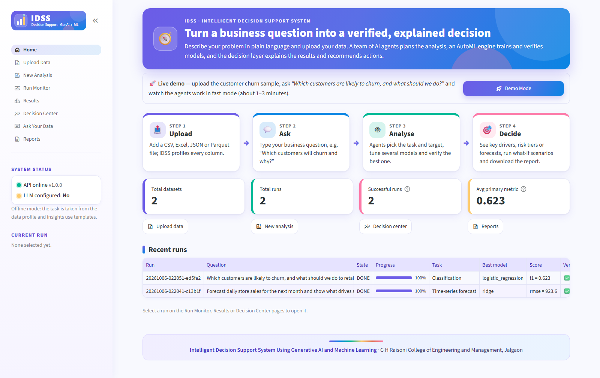
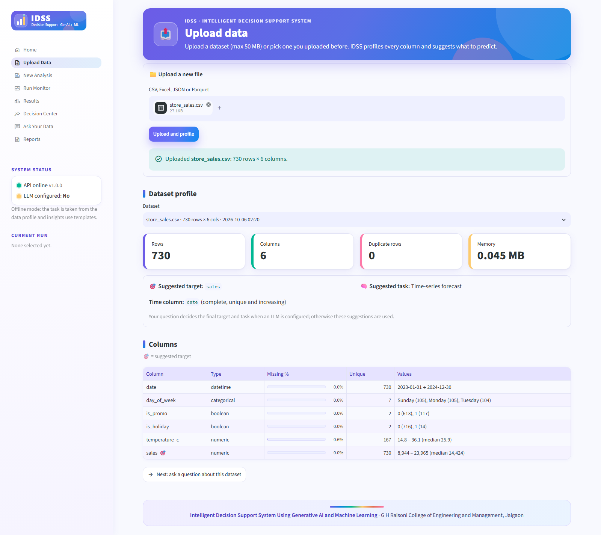
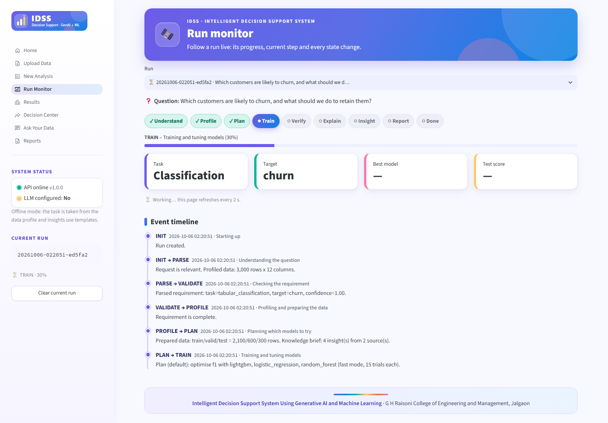
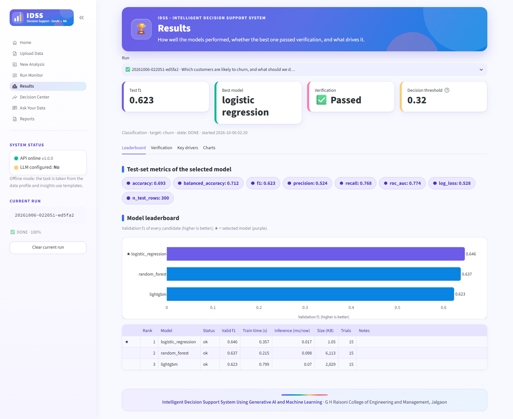
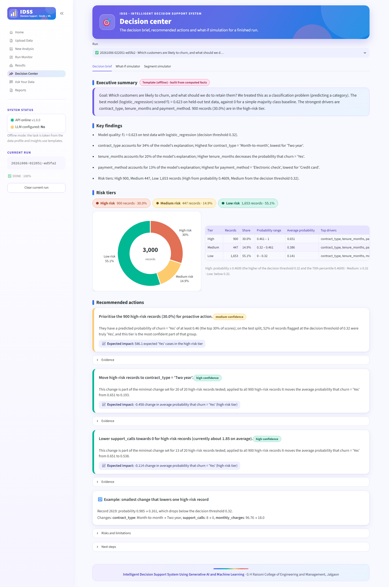
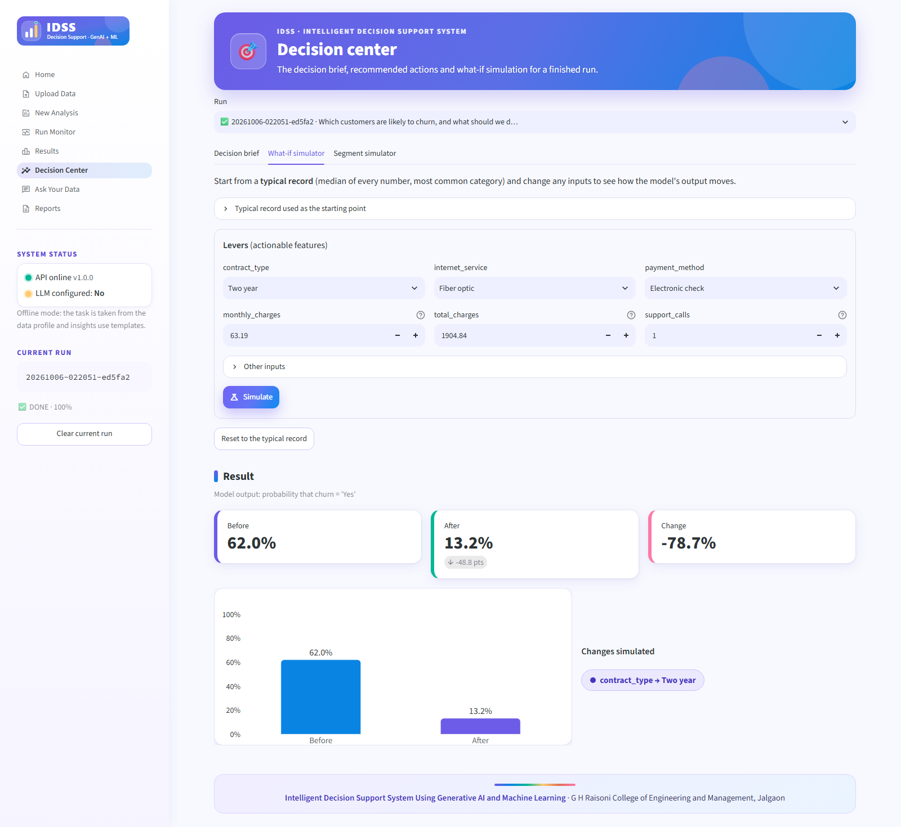
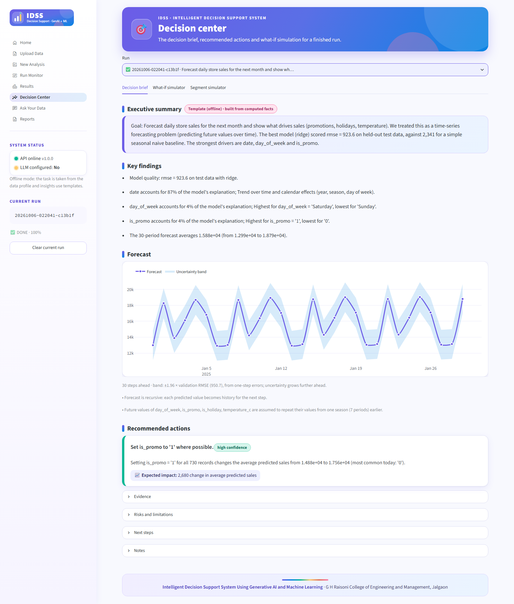

# Chapter 5: Coding and Implementation

This chapter describes how the design was implemented: the main algorithms as pseudo-code (Section 5.1), the
development environment (Section 5.2), the modules with their owners (Section 5.3), short extracts of the real code
(Section 5.4) and the user interface (Section 5.5).

## 5.1 Algorithms / Steps

Names in `code font` are the real functions and constants in the repository.

**Algorithm 5.1:** Orchestrator state machine (`Orchestrator.step`, `run_until_blocked`)

```text
procedure RUN_UNTIL_BLOCKED(ctx)                       // MAX_STEPS = 50
    repeat MAX_STEPS times
        if ctx.state ∈ {DONE, FAILED, NEEDS_INPUT} then return ctx
        STEP(ctx)
    TRANSITION(ctx, FAILED, "stopped after MAX_STEPS steps (possible loop)")

procedure STEP(ctx)
    try   (next, message) ← HANDLERS[ctx.state](ctx)   // one handler per state
    catch error e: record e; next ← FAILED              // never crash the caller
    TRANSITION(ctx, next, message)

procedure TRANSITION(ctx, next, message)
    append event(from, to, message, time) to ctx.history; ctx.state ← next
    write state.json.tmp, then atomically replace state.json   // ≤ 3 retries on Windows locks
    try record run + event in SQLite (one transaction) catch → log only
```

**Algorithm 5.2:** Requirement parsing and repair (`RequirementAgent.parse`, `repair`, `check_sufficiency`)

```text
R ← LLM structured output for question q and format_profile(P)   // names, types, % missing only
    (no LLM: R ← requirement_from_profile(q, P))
if R.target is not a usable column of P (numeric / categorical / boolean, > 1 value)
    then note the reason; R.target ← P.suggested_target
if task type implied by P for R.target ≠ R.task_type then note; R.task_type ← implied type
remove metrics of the wrong family; if none left then R.metrics ← TASK_METRICS[task]
missing ← rules (goal unclear? no target for a supervised task? confidence < 0.4?) ∪ LLM review
if missing ≠ ∅ then ask ≤ 3 clarifying questions → NEEDS_INPUT (at most 2 rounds per run)
```

**Algorithm 5.3:** AutoML search, selection and single test evaluation (`AutoMLTrainer.run`, `tuner.tune`)

```text
(train, valid, test) ← SPLIT(D, 70/20/10); wrap test in Holdout; fit preprocessing on train
for each candidate m in the plan (≤ budget.max_candidates) do
    if total time is used up then mark m "skipped"; continue
    study ← Optuna(TPE sampler(seed), median pruner)
    for each trial (≤ n_trials, ≤ timeout per model) do
        θ ← sample(m.search_space)
        if |train| ≥ 2000 then score on half the rows first; prune if below the median
        score ← metric(fit(m, θ, train), valid)          // errors → trial pruned, search continues
    refit best θ on train; tune threshold if binary (Algorithm 5.4); record valid score, time, size
mark constraint violations; best ← best valid score without violations
model ← Pipeline(preprocessing, best) refitted on train ∪ valid
score model and a trivial baseline on Holdout.reveal("final_evaluation")   // the only test read
```

**Algorithm 5.4:** Decision-threshold tuning (`evaluator.tune_threshold`)

```text
(t*, s*) ← (0.5, M(y_valid, p ≥ 0.5))
for t in 0.05, 0.06, …, 0.95 do                         // 91 cut-offs, validation split only
    s ← M(y_valid, p ≥ t); if s > s* then (t*, s*) ← (t, s)   // ties keep 0.5
return t*                                                // M ∈ {F1, accuracy, balanced accuracy}
```

**Algorithm 5.5:** Verification and re-planning (`Verifier.verify`, `Orchestrator._handle_verify`)

```text
checks ← metric targets met · beats the baseline · no constraint violated · ≥ 30 test rows ·
         test accesses = ["final_evaluation"] · no leakage warning · train − test gap < 0.15
if all pass then next ← EXPLAIN
else if not yet re-planned then next ← PLAN with the full budget and the checks' recommendations
else next ← EXPLAIN, results flagged "not verified"      // never FAILED for this reason
```

**Algorithm 5.6:** Greedy counterfactual search (`recommender.counterfactual`)

```text
p ← f(x); Δ ← []
repeat at most 3 times while p ≥ t
    try every (column a ∈ actionable \ Δ, observed value v ≠ x[a]) in one batch
    take the option with the lowest probability p′; stop if p′ ≥ p
    x[a] ← v; Δ ← Δ ∪ {a}; p ← p′
if p < t then undo every change in Δ that is not needed to stay below t   // minimal set
return Δ, probability before and after, success = (p < t)
```

**Algorithm 5.7:** Grounded insight generation (`InsightAgent.generate`, `unsupported_numbers`)

```text
if no LLM then return TEMPLATE(facts)                    // complete and itself grounded
allowed ← every number in the facts (also inside strings)
for attempt = 1, 2 do
    draft ← LLM(facts, feedback)
    bad ← numbers in draft not in {0..10, 100} and not matching a fact (±1%, rounding, ×100 for %)
    if bad = ∅ then return draft
    feedback ← "numbers not in the facts: " + bad
return TEMPLATE(facts) with the failed grounding result
```

**Algorithm 5.8:** Sandboxed execution of LLM-written code (`sandbox.check_code`, `run_code`)

```text
reject code > 20 000 characters or with a syntax error
for each AST node: import outside {pandas, numpy, math, statistics, datetime, json, re},
    blocked name (open, eval, exec, __import__, getattr, os, sys, …), private attribute,
    I/O attribute (read_*, to_csv, …) or other blocked attribute (query, load, …) → problem
if problems then return "Blocked by the sandbox" (nothing runs)
run "python -I sandbox_runner.py" in a temporary folder with restricted built-ins,
    a guarded __import__ and an environment without secrets; kill after the timeout (20 s)
return stdout (≤ 20 KB) and result (≤ 200 rows)
```

## 5.2 Software and Hardware for Development

The runtime libraries are those of Table 4.5. Table 5.1 lists the additional development tools and Table 5.2 the
hardware.

**Table 5.1:** Development tools

| Tool | Version | Use |
|---|---|---|
| Python `venv` + pip | Python 3.12.0 | Isolated environment with pinned dependencies (`requirements.txt`) |
| pytest, pytest-cov, httpx2 | 9.1.1, 7.1.0, 2.13.1 | Automated tests, coverage, API test client |
| ruff | 0.16.10 | Linting |
| Playwright (Chromium) | 1.63.0 | Automated UI screenshots |
| Git | — | Version control, one commit per increment |
| PowerShell | Windows PowerShell | Start scripts (`run_api.ps1`, `run_ui.ps1`, `run_all.ps1`) |
| Claude Code | — | AI coding assistant for code generation and refactoring |

An AI coding assistant (Claude Code) was used to help generate and refactor code; all design decisions, integration,
testing and evaluation were carried out and verified by the team.

**Table 5.2:** Development hardware

| Item | Specification |
|---|---|
| Development machine | ASUS TUF Gaming F15 (FX506HE) laptop, used for development, testing, the evaluation and this report |
| Processor | 11th Gen Intel Core i7-11800H, 2.30 GHz, 8 cores / 16 logical processors |
| Memory | 16 GB RAM |
| Storage | 1 TB NVMe SSD (WD PC SN560) |
| GPU | NVIDIA GeForce RTX 3050 Ti Laptop GPU (4 GB) — not used by IDSS, which trains on the CPU |
| Operating system | Windows 11 Home Single Language, 64-bit |
| Network | Only for package installation and optional LLM calls |

The evaluation of Chapter 7 ran on this machine (`scripts/evaluate.py` records Windows 11 and 16 logical CPUs). The
minimum hardware for running IDSS is given in Table 4.4.

## 5.3 Modules in Project

**Table 5.3:** Modules and responsibilities

| No. | Module | Main files | Member responsible |
|---|---|---|---|
| 1 | Foundation | `configs/settings.py`, `idss/core/` | Raj Vishwas Patil, Chaitany Rajesh Naval |
| 2 | Data module | `idss/ml/data_loader.py`, `profiler.py`, `preprocess.py`, `agents/data_agent.py` | Bhavesh Vinod Patil |
| 3 | Requirement Agent and Orchestrator | `agents/requirement_agent.py`, `agents/manager.py` | Raj Vishwas Patil, Chaitany Rajesh Naval |
| 4 | AutoML engine and Model Agent | `idss/ml/model_zoo.py`, `tuner.py`, `evaluator.py`, `trainer.py`, `agents/model_agent.py` | Bhavesh Vinod Patil, Raj Vishwas Patil |
| 5 | Knowledge base | `idss/knowledge/`, `data/knowledge/`, `agents/knowledge_agent.py` | Raj Vishwas Patil |
| 6 | Verifier | `agents/verifier.py` | Bhavesh Vinod Patil |
| 7 | Sandbox and Analysis Agent | `idss/execution/`, `agents/analysis_agent.py` | Chaitany Rajesh Naval |
| 8 | Decision layer | `idss/ml/explain.py`, `idss/decision/what_if.py`, `recommender.py` | Bhavesh Vinod Patil |
| 9 | Insight Agent and reports | `agents/insight_agent.py`, `idss/decision/report_builder.py` | Raj Vishwas Patil, Varun Darshan Patil |
| 10 | Storage and REST API | `idss/storage/`, `api/` | Chaitany Rajesh Naval |
| 11 | Streamlit UI | `ui/` | Varun Darshan Patil |
| 12 | Evaluation and tooling | `scripts/` | Bhavesh Vinod Patil, Varun Darshan Patil |

The member column follows the roles of Table 3.4 and the planned allocation of Table 3.5; testing, review and
integration of every module were shared by the whole team.

**1. Foundation.** Typed settings from `.env` (keys as secret strings, never logged); one logger (loguru, rotating at
10 MB); the only LLM client — OpenAI-compatible, 60 s default timeout, at most 3 retries with exponential backoff, and
`chat_structured()`, which validates replies against a Pydantic model and feeds errors back for a retry; the shared
Pydantic schemas; and eleven prompt templates with `## system` / `## user` sections.

**2. Data module.** Loads CSV (delimiter and encoding detection), Excel, JSON / JSON lines and Parquet; profiles
semantic types (numeric, categorical, boolean, datetime, id, text), missing values, the suggested target and task, and
warns about leakage (correlation with the target ≥ 0.98) and imbalance; cleans the data, splits it 70/20/10 and fits a
preprocessor (imputation, scaling, one-hot encoding capped at 20 categories). The Data Agent asks the LLM only for a
summary of aggregates. *Output:* profile, Parquet splits and `preprocessor.joblib`.

**3. Requirement Agent and Orchestrator.** Relevance, parsing, repair and clarifying questions (Algorithm 5.2), and the
13-state `RunState` machine (Algorithm 5.1) with `start`, `step`, `run_until_blocked`, `provide_answer`, `resume`,
`abort`, `ask` and `what_if`. *Output:* `RunContext` in `workspace/runs/<run_id>/state.json`, mirrored to SQLite.

**4. AutoML engine and Model Agent.** The model zoo (Table 5.4) is the only source of trainable models; each candidate
has a `build()` function and an Optuna search space, and class weighting switches on when the minority class is below
20%. Time-series features use only earlier rows. The evaluator holds 19 metrics with their family and direction and
measures training time, inference time per row and model size. The Model Agent lets the LLM rank zoo names only
(unknown names dropped, requested models first, defaults filling the rest) and parses constraints such as "inference
under 5 ms" into the plan. Budgets: *fast* 3 models × 15 trials (60 s each, 180 s total); *full* 6 × 40 (180 s each,
1,080 s total). *Output:* `TrainingResult`, `best_model.joblib`, leaderboard, metrics and test predictions.

**Table 5.4:** Model zoo and baselines

| Task | Candidate models | Baseline (test split) |
|---|---|---|
| Classification | logistic regression, random forest, extra trees, XGBoost, LightGBM, histogram gradient boosting | Majority class |
| Regression | ridge, random forest, extra trees, XGBoost, LightGBM, histogram gradient boosting | Mean of the target |
| Time-series forecasting | LightGBM, XGBoost, ridge on lag / rolling / calendar features | Seasonal naive |
| Clustering | k-means, Gaussian mixture (several EM starts), agglomerative | Random assignment |

**5. Knowledge base.** Ten notes in `data/knowledge/` (churn retention, class imbalance, clustering, explainability,
feature leakage, model selection by data size, pricing and demand, regression, tabular classification, time series) are
chunked (≈ 500 characters, 80 overlap), indexed with TF-IDF, cached and rebuilt when their content changes; retrieval
returns 4 passages, at most 2 per note, which the Knowledge Agent condenses into a brief.

**6. Verifier.** Seven independent checks (Algorithm 5.5) with a fixed recommendation for each failure; an optional LLM
review adds concerns but never changes the pass / fail decision.

**7. Sandbox and Analysis Agent.** The static guard and child-process runner of Algorithm 5.8; the Analysis Agent sends
only column names and types to the LLM and asks it to repair failing code once.

**8. Decision layer.** `ModelExplainer` uses SHAP (tree or linear explainer, ≤ 500 training rows) or permutation
importance and maps values back to original columns; it also builds cluster profiles and a recursive forecast with a
±1.96 × validation-RMSE band. `what_if.py` simulates records and segments with validated changes (value, set, add, pct)
and structured filters, never evaluated strings. `recommender.py` infers actionable columns, builds risk tiers (High ≥
max(threshold, 70th percentile), Medium ≥ threshold, Low below), runs counterfactuals (Algorithm 5.6) on the 20 riskiest
records and computes ±10% lever effects for regression; every recommendation carries its evidence.

**9. Insight Agent and reports.** `build_facts()` is the only LLM input; the grounding check (Algorithm 5.7) guards the
brief, with `template_insight()` as fallback. `report_builder.py` renders one block list as `report.pdf` (reportlab) and
`report.md`.

**10. Storage and REST API.** SQLAlchemy models and a repository over SQLite; a FastAPI application with 17 endpoints
(Table 5.5), errors as `{error, detail}`, `409 not_ready` for results not yet computed, and one background RunWorker
that answers `409 busy` to a second training request. Runs left unfinished by a previous process are marked FAILED at
start-up.

**Table 5.5:** REST API endpoints

| Method | Path | Purpose |
|---|---|---|
| GET | `/health` | Status, LLM configured (yes / no), version |
| POST, GET | `/datasets` | Upload a file (≤ 50 MB) with its profile; list datasets |
| GET | `/datasets/{id}/profile` | Profile of one dataset |
| POST, GET | `/runs` | Start a run (`202` + run id); list runs |
| GET | `/runs/{id}` | State, progress, events, metrics, verification, questions |
| POST | `/runs/{id}/answer` | Answer clarifying questions |
| GET | `/runs/{id}/leaderboard`, `/explanations`, `/recommendations`, `/insight` | Results of a finished run |
| POST | `/runs/{id}/what-if` | Record or segment simulation |
| POST | `/runs/{id}/ask` | Ask Your Data (`503` without an LLM) |
| GET | `/runs/{id}/report.pdf`, `/report.md`, `/charts/{name}` | Reports and charts (names and paths checked) |

**11. Streamlit UI.** `ui/app.py` registers eight pages; `IDSSClient` is the UI's only route to the backend and turns
connection errors into "Backend not running – start scripts/run_api.ps1"; shared components provide the page shell,
KPI cards, zebra tables, risk-tier chips, the pipeline stepper and Plotly charts. The Run Monitor polls every 2 s.

**12. Evaluation and tooling.** `make_samples.py` (the five datasets), `evaluate.py` (Chapter 7), `benchmark_step4.py`,
the demo scripts, `make_diagrams.py` (the diagrams in this report), `make_screenshots.py` (Section 5.5) and
`count_loc.py` (Section 3.3.2).

## 5.4 Important Code Extracts

The extracts below are copied from the repository (docstrings partly omitted). They enforce the main design rules.

**Listing 5.1:** One step of the state machine — failures end the run cleanly (`idss/agents/manager.py`)

```python
    def step(self, run_id: str | None = None) -> RunState:
        ctx = self._get(run_id)
        if ctx.state in BLOCKED_STATES:
            return ctx.state
        state = ctx.state
        try:
            next_state, message = self._handlers[state](ctx)
        except Exception as exc:  # any failure ends the run cleanly instead of crashing the caller
            logger.exception("Run {} failed in state {}.", ctx.run_id, state)
            message = f"{state} failed: {type(exc).__name__}: {exc}"
            ctx.errors.append(message)
            ctx.message = f"Sorry, the run stopped during the {state.lower()} stage: {exc}"
            next_state = RunState.FAILED
        self._transition(ctx, next_state, message)
        return next_state
```

**Listing 5.2:** The audited test split (`idss/ml/trainer.py`)

```python
class Holdout:
    """The test split. Reading it is logged so tests and the Verifier can prove it was used only once."""

    def __init__(self, frame: pd.DataFrame) -> None:
        self._frame = frame
        self.access_log: list[str] = []

    def __len__(self) -> int:
        return len(self._frame)

    def reveal(self, purpose: str) -> pd.DataFrame:
        self.access_log.append(purpose)
        logger.info("Test split accessed for: {}.", purpose)
        return self._frame
```

**Listing 5.3:** Decision-threshold search (`idss/ml/evaluator.py`, inside `tune_threshold`)

```python
    default_score = score(DEFAULT_THRESHOLD)
    best_threshold, best_score = DEFAULT_THRESHOLD, default_score
    for threshold in THRESHOLD_GRID:
        value = score(float(threshold))
        if value is not None and (best_score is None or value > best_score + 1e-12):
            best_threshold, best_score = float(threshold), value
    return best_threshold, best_score, default_score
```

**Listing 5.4:** Static guard of the sandbox (`idss/execution/sandbox.py`, inside `check_code`)

```python
    for node in ast.walk(tree):
        if isinstance(node, ast.Import):
            problems += [f"import of '{a.name}' is not allowed" for a in node.names if not module_allowed(a.name)]
        elif isinstance(node, ast.ImportFrom):
            module = node.module or ""
            if node.level or not module_allowed(module):
                problems.append(f"import from '{module or '.'}' is not allowed")
            problems += [f"importing '{a.name}' is not allowed" for a in node.names if _blocked_member(a.name)]
        elif isinstance(node, ast.Name) and (node.id in BLOCKED_NAMES or node.id.startswith("__")):
            problems.append(f"use of '{node.id}' is not allowed")
        elif isinstance(node, ast.Attribute) and _blocked_member(node.attr):
            problems.append(f"attribute '.{node.attr}' is not allowed")
    return list(dict.fromkeys(problems))
```

**Listing 5.5:** Grounding check of the decision brief (`idss/agents/insight_agent.py`)

```python
def unsupported_numbers(text: str, allowed: list[float]) -> list[str]:
    """Numbers in `text` that do not match any fact (±1%, rounding, or as a percentage of a fraction)."""
    problems = []
    for token in _NUMBER.findall(text):
        value, is_percent = _parse_number(token)
        if value in EXEMPT_NUMBERS or _supported(value, token, is_percent, allowed):
            continue
        problems.append(token)
    return list(dict.fromkeys(problems))
```

## 5.5 User Interface

The screenshots were captured automatically by `scripts/make_screenshots.py` (Playwright) from the running system in
offline mode, after a sales-forecast run on `store_sales.csv` and a churn run started with Demo Mode. Every page shares
a sidebar with the API and LLM status and the current run. The New Analysis, Ask Your Data and Reports pages are
captured in `docs/screenshots/` as well.



**Figure 5.1:** Home page: overview, Demo Mode, four-step flow, KPI strip and recent runs



**Figure 5.2:** Upload Data page: profile of `store_sales.csv` with types, missing values and suggested target and task



**Figure 5.3:** Run Monitor: pipeline stages, progress and event timeline of the churn run while it trains



**Figure 5.4:** Results page: test metrics with leaderboard, verification, key-driver and chart tabs



**Figure 5.5:** Decision Center: executive summary, key findings, risk tiers and recommended actions for the churn run



**Figure 5.6:** What-if simulator: a typical customer with `contract_type` changed to "Two year", prediction before and
after



**Figure 5.7:** Decision Center for the store-sales run: forecast with its uncertainty band

## 5.6 Summary

Eight algorithms capture the core logic: the state machine, requirement repair, the AutoML loop, threshold tuning,
verification with re-planning, counterfactual search, the grounding check and the sandbox guard. Twelve modules
implement them, each with a responsible member; short code extracts show how single use of the test split, contained
failures, grounded numbers and sandboxed code are enforced; and the screenshots show the interface page by page.
