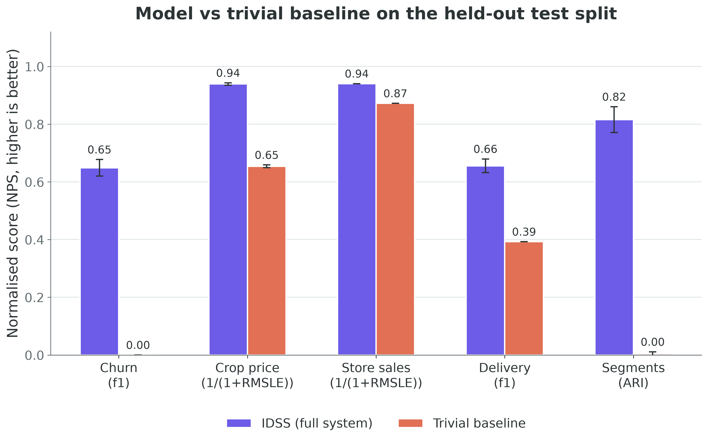
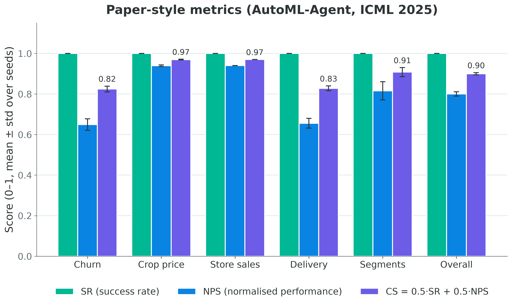
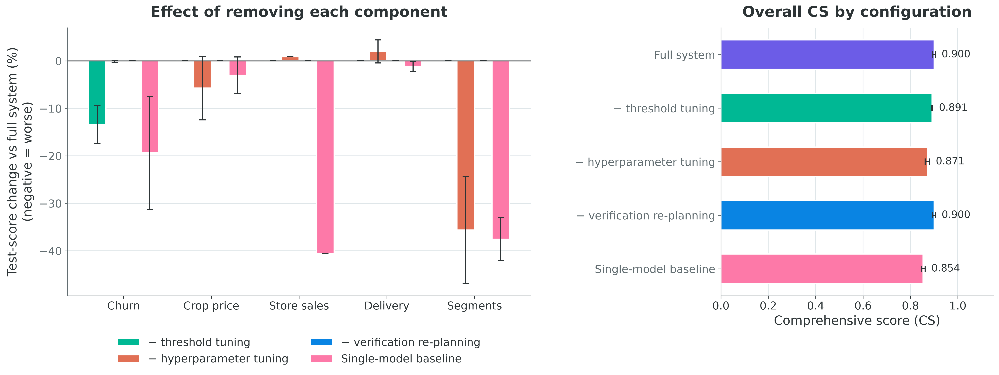
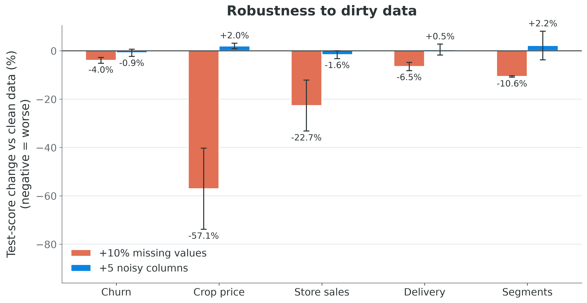
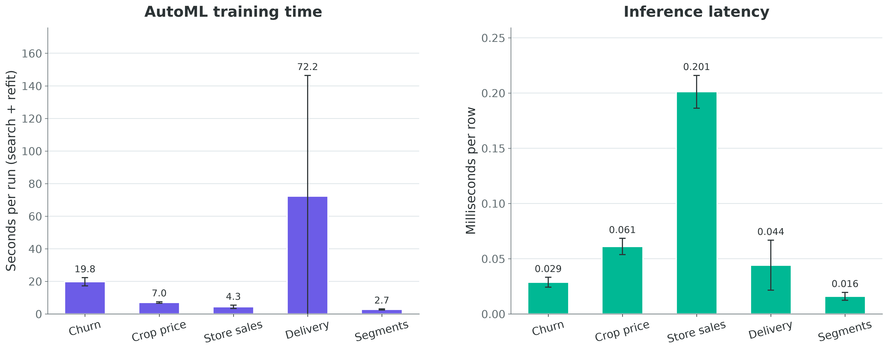

# Chapter 7: Results and Discussion

All numbers in this chapter come from the offline evaluation script `scripts/evaluate.py` (full output in
`docs/results/evaluation.md` and `evaluation.json`) and from the Step 4 / Step 5 benchmark
(`docs/results/step4_benchmark.md`).

## 7.1 Experimental Setup

**Datasets.** We generated five datasets ourselves with `scripts/make_samples.py` from fixed random seeds (Table 7.1).
**All five are synthetic**: they describe no real people or companies and their generating processes are known. They
were designed to be realistic in shape — missing values, categorical columns, class imbalance, seasonality, overlapping
clusters — and to cover the four task families.

**Table 7.1:** Evaluation datasets (synthetic, seeded)

| Dataset | File | Rows | Columns | Task | Target | Notes |
|---|---|---:|---:|---|---|---|
| Churn | `customer_churn.csv` | 3,000 | 12 | Binary classification | `churn` | 985 "Yes" (32.8%) |
| Crop price | `crop_price.csv` | 2,000 | 11 | Regression | `price` | 106 missing cells |
| Store sales | `store_sales.csv` | 730 | 6 | Forecasting | `sales` | Daily, two years |
| Delivery | `delivery_status.csv` | 2,500 | 12 | 3-class classification | `delivery_status` | 1,375 / 750 / 375 |
| Segments | `customer_segments.csv` | 1,600 | 8 | Clustering | `segment` (scoring only) | Four groups |

**Protocol.** Three seeds (42, 43, 44); every number is the mean ± sample standard deviation. The seed controls the
split (chronological for time series), Optuna's sampler, the models and the perturbations. The **fast** budget was used
(3 models × 15 trials, 60 s per model, 180 s total; one re-plan with the full budget after a failed verification). The
real Orchestrator ran in **offline mode**: requirements came from the data profile, and Segments was given an explicit
clustering requirement whose `segment` column is used only for scoring. Models were selected on the validation split
and the test split (10%) was read once. **Environment:** Python 3.12.0, Windows 11, 16 logical CPUs, scikit-learn 1.9.1,
XGBoost 3.4.1, LightGBM 4.7.0, Optuna 5.0.0, SHAP 0.52.0. The evaluation took 1,081.5 s, plus two short Segments re-runs
(Section 7.7).

**Metrics.** F1 for classification (binary F1 of the positive class; weighted F1 for Delivery), RMSE for regression and
forecasting, and the adjusted Rand index (ARI) for clustering. Each model is compared with a trivial baseline on the
same test split: the majority class, the mean, the seasonal naive forecast or a random cluster assignment.

## 7.2 Main Benchmark

**Table 7.2:** Main benchmark (full system, clean data, mean ± std over 3 seeds)

| Dataset | Best model (seeds) | Metric | Test score | Baseline | Improvement | Train time (s) | Inference (ms/row) | Verified |
|---|---|---|---:|---:|---:|---:|---:|---:|
| Churn | logistic regression (3/3) | F1 ↑ | 0.649 ± 0.028 | 0.000 | n/a¹ | 19.8 ± 2.5 | 0.0286 ± 0.0045 | 3/3 |
| Crop price | LightGBM (3/3) | RMSE ↓ | 356.9 ± 26.81 | 2,392.8 ± 45.77 | +85.1% ± 0.8 | 7.0 ± 0.5 | 0.0610 ± 0.0073 | 3/3 |
| Store sales | ridge (3/3) | RMSE ↓ | 923.6 ± 0.000 | 2,340.7 ± 0.000 | +60.5% ± 0.0 | 4.3 ± 1.1 | 0.2011 ± 0.0148 | 3/3 |
| Delivery | logistic regression (2/3) | F1 ↑ | 0.656 ± 0.024 | 0.393 ± 0.000 | +67.0% ± 6.1 | 72.2 ± 74.2 | 0.0440 ± 0.0226 | 2/3 |
| Segments | Gaussian mixture (3/3) | ARI ↑ | 0.816 ± 0.045 | 0.004 ± 0.007 | n/a¹ | 2.7 ± 0.4 | 0.0159 ± 0.0036 | 3/3 |

↑ higher is better, ↓ lower is better. *Train time* covers the whole search plus the final refit; *inference* is the
median time of the fitted pipeline on up to 500 test rows. ¹ The baseline is at chance level (below 0.05), so a relative
improvement is undefined: the majority class never predicts churn (F1 = 0) and random clusters have an ARI of about 0.

The full system **beat the baseline on all five datasets**, reducing RMSE by 85.1% on crop price and 60.5% on store
sales. Simple models were often selected — logistic regression on churn and delivery, ridge on store sales — which
suggests that these synthetic datasets are close to linear (Figure 7.1).

**Figure 7.1:** Model versus trivial baseline on the held-out test split (normalised score)

## 7.3 Paper-style Metrics: SR, NPS and CS

Following AutoML-Agent [9]:

> **SR** = runs that complete the whole pipeline (trained, tested, verified, explained, PDF report) ÷ all runs;
> **NPS** = the test score for 0–1 metrics (F1; ARI clipped at 0), or 1 / (1 + RMSLE) for regression and forecasting,
> and 0 for a failed run; **CS** = 0.5 · SR + 0.5 · NPS.

RMSLE = √( (1/*n*) Σ (log(1 + *ŷ*) − log(1 + *y*))² ) is scale-free; 1 / (1 + RMSE) would depend on the units of the
target and be close to 0 for prices or daily sales. The overall value is the mean over datasets per seed, then over seeds.

**Table 7.3:** SR, NPS and CS (mean ± std over 3 seeds)

| Dataset | NPS from | SR | NPS | CS |
|---|---|---:|---:|---:|
| Churn | F1 | 1.000 ± 0.000 | 0.649 ± 0.028 | 0.825 ± 0.014 |
| Crop price | 1 / (1 + RMSLE) | 1.000 ± 0.000 | 0.939 ± 0.004 | 0.970 ± 0.002 |
| Store sales | 1 / (1 + RMSLE) | 1.000 ± 0.000 | 0.941 ± 0.000 | 0.970 ± 0.000 |
| Delivery | F1 | 1.000 ± 0.000 | 0.656 ± 0.024 | 0.828 ± 0.012 |
| Segments | ARI | 1.000 ± 0.000 | 0.816 ± 0.045 | 0.908 ± 0.022 |
| **Overall** | | **1.000 ± 0.000** | **0.800 ± 0.011** | **0.900 ± 0.005** |

**Figure 7.2:** Paper-style metrics (SR, NPS, CS) per dataset

All 15 runs completed end to end (SR = 1.00). Because IDSS runs tested code instead of LLM-written scripts, every run
that starts also finishes, so SR measures robustness rather than code quality, and NPS carries the differences. **These
numbers cannot be compared with the AutoML-Agent paper's tables**: datasets, budgets and success criteria differ.

## 7.4 Ablation Study

One component was removed at a time: **− threshold tuning** (cut-off fixed at 0.5), **− hyperparameter tuning** (library
defaults), **− verification re-planning** (first attempt is final) and a **single-model baseline** (one default LightGBM,
or k-means for clustering, with none of the above). Ablation runs stop after verification. Table 7.4 shows the test score
and, in brackets, the change against the full system on the same seed (positive = better).

**Table 7.4:** Ablation study (mean ± std over 3 seeds)

| Variant | Churn (F1) | Crop price (RMSE) | Store sales (RMSE) | Delivery (F1) | Segments (ARI) | NPS | CS | Train time (s) |
|---|---:|---:|---:|---:|---:|---:|---:|---:|
| **Full system** | 0.649 ± 0.028 | 356.9 ± 26.81 | 923.6 ± 0.000 | 0.656 ± 0.024 | 0.816 ± 0.045 | 0.800 ± 0.011 | **0.900 ± 0.005** | 21.2 ± 39.0 |
| − threshold tuning | 0.561 ± 0.006 (−13.4%) | same² | same² | same² | same² | 0.782 ± 0.005 | 0.891 ± 0.003 | 26.3 ± 43.5 |
| − hyperparameter tuning | 0.648 ± 0.027 (−0.1%) | 378.5 ± 52.63 (−5.7%) | 915.7 ± 0.000 (+0.9%) | 0.669 ± 0.021 (+2.0%) | 0.523 ± 0.078 (−35.6%) | 0.743 ± 0.018 | 0.871 ± 0.009 | 1.9 ± 1.5 |
| − verification re-planning | 0.649 ± 0.028 (+0.0%) | 356.9 ± 26.81 (+0.0%) | 923.6 ± 0.000 (+0.0%) | 0.656 ± 0.024 (+0.0%) | 0.816 ± 0.045 (+0.0%) | 0.800 ± 0.011 | 0.900 ± 0.005 | 12.8 ± 11.0 |
| Single-model baseline | 0.521 ± 0.057 (−19.3%) | 368.4 ± 41.67 (−3.0%) | 1,298.8 ± 0.000 (−40.6%) | 0.648 ± 0.020 (−1.1%) | 0.508 ± 0.012 (−37.6%) | 0.707 ± 0.016 | 0.854 ± 0.008 | 0.7 ± 0.4 |

SR was 1.000 for every variant. ² Threshold tuning applies only to binary classification; the other datasets reuse the
full-system runs.

**Figure 7.3:** Ablation study: change of the test score per component and overall CS

- **Threshold tuning** matters only for binary classification, but there it matters a lot: −13.4% F1 on churn without
  it (Section 7.6).
- **Hyperparameter tuning** raises CS from 0.871 to 0.900. Without it, Segments loses 35.6% (tuning finds the right
  number of clusters), while Delivery gains 2.0%; where defaults scored higher on the test split, tuning had still chosen
  the best model on the validation split, a difference within selection noise on near-linear data.
- **Verification re-planning** was triggered in 1 of 15 clean full-system runs and did not change the score. Across all
  configurations it ran three times and the second attempt never passed; the system then reports *not verified*
  (Section 7.9).
- **The single default model** reaches CS = 0.854 against 0.900 and passes verification in only 6 of 15 runs (full
  system: 14 of 15), with the largest losses on store sales (−40.6%), segments (−37.6%) and churn (−19.3%).

## 7.5 Robustness

The full system was re-run on corrupted copies of each dataset: **+10% missing values** (cells blanked at random in all
columns except the target, identifiers and the time index) and **+5 noisy columns** (three numeric, one integer, one
categorical).

**Table 7.5:** Robustness (mean ± std over 3 seeds; change vs clean data, negative = worse)

| Dataset | Metric | Clean | +10% missing | Change | +5 noisy columns | Change | Verified (missing / noise) |
|---|---|---:|---:|---:|---:|---:|---:|
| Churn | F1 ↑ | 0.649 ± 0.028 | 0.623 ± 0.029 | −4.0% ± 1.2 | 0.644 ± 0.036 | −0.9% ± 1.5 | 3/3 / 3/3 |
| Crop price | RMSE ↓ | 356.9 ± 26.81 | 562.9 ± 95.98 | −57.1% ± 16.8 | 349.5 ± 22.56 | +2.0% ± 1.1 | 3/3 / 3/3 |
| Store sales | RMSE ↓ | 923.6 ± 0.000 | 1,132.9 ± 97.31 | −22.7% ± 10.5 | 938.5 ± 15.17 | −1.6% ± 1.6 | 3/3 / 3/3 |
| Delivery | F1 ↑ | 0.656 ± 0.024 | 0.613 ± 0.011 | −6.5% ± 1.7 | 0.659 ± 0.024 | +0.5% ± 2.3 | 2/3 / 3/3 |
| Segments | ARI ↑ | 0.816 ± 0.045 | 0.729 ± 0.042 | −10.6% ± 0.3 | 0.833 ± 0.053 | +2.2% ± 5.9 | 3/3 / 3/3 |

**Figure 7.4:** Robustness: change of the test score with 10% extra missing values and with 5 noisy columns

Noise columns changed every score by at most 2.2%: irrelevant features did not mislead the models. Missing values hurt
more: 6 of the 10 perturbed settings stayed within 5% of the clean score, and the largest losses were crop price (RMSE
+57.1%) and store sales (+22.7%), plausibly because the simple imputation cannot recover the blanked information.
Verification still passed in 29 of the 30 perturbed runs.

## 7.6 Impact of Threshold Tuning on Churn

Churners are the minority (32.8%), so a 0.5 cut-off is conservative and misses many of them. Over the three seeds,
threshold tuning raises churn F1 from 0.561 ± 0.006 (cut-off 0.5) to 0.649 ± 0.028, a change of −13.4% when it is
removed (Table 7.4). Table 7.6 shows the effect in more detail for a single demo run (seed 42): the selected logistic
regression on the seed-42 split (Step 5 benchmark).

**Table 7.6:** Threshold tuning on churn (single demo run, seed 42: logistic regression, test split)

| Metric | Cut-off 0.5 | Tuned cut-off 0.32 |
|---|---:|---:|
| F1 | 0.5579 | 0.6230 |
| Precision | 0.5824 | 0.5241 |
| Recall | 0.5354 | 0.7677 |
| Accuracy | 0.7200 | 0.6933 |
| ROC AUC (threshold-free) | 0.7738 | 0.7738 |

The tuned cut-off **trades a little precision and accuracy for much higher recall**: in this run about 77% of churners
are found instead of 54%, usually the right trade-off for a retention campaign. Over the three seeds the tuned
thresholds were 0.32, 0.36 and 0.23.

The cut-off also drives the **risk tiers** (Figure 5.5; the same single demo run, seed 42, scored on all 3,000
customers). High risk starts at a probability
of 0.4609 — the larger of the threshold 0.32 and the 70th percentile — and holds 900 customers (30.0%); Medium (0.32 to
0.4609) holds 447 (14.9%) and Low 1,653 (55.1%). The strongest drivers were `contract_type` (34% of the explanation),
`tenure_months` (20%) and `payment_method` (13%). Moving the high-risk customers to a two-year contract would lower their
average predicted churn probability from 0.651 to 0.193 according to the model — a statement about the model, not a
guaranteed effect of a campaign.

## 7.7 Clustering: Adjusted Rand Index versus Rand Index

AutoML-Agent scores clustering with the Rand index (RI) [17], the share of record pairs on which clustering and
ground truth agree. Because most pairs belong to different groups, RI rewards over-splitting and is not corrected for
chance: a random assignment into four groups already scores about 0.62 here, and in a first run an untuned k-means with
8 clusters beat the tuned 4-cluster model on RI. The **adjusted Rand index** [18],
ARI = (RI − E[RI]) / (max(RI) − E[RI]), scores about 0 for random labels and 1 for a perfect match. IDSS therefore uses
ARI wherever ground truth exists and still reports RI (Table 7.7).

The investigation also exposed a bug: the Gaussian mixture ran a single EM initialisation and, for some seeds, its
refit stopped in a poor optimum (ARI ≈ 0.53 instead of 0.84), which made added noise look like an improvement. It now
uses several initialisations (5, or 3 above 20,000 rows). Segments was re-run after both changes; the replaced runs are
kept under `superseded` in `evaluation.json`.

**Table 7.7:** Clustering results with ARI and RI (Segments, mean ± std over 3 seeds)

| Configuration | Models chosen | ARI ↑ | RI ↑ |
|---|---|---:|---:|
| Full system | Gaussian mixture × 3 | 0.816 ± 0.045 | 0.930 ± 0.017 |
| − hyperparameter tuning | agglomerative × 2, k-means | 0.523 ± 0.078 | 0.804 ± 0.046 |
| Single-model baseline | k-means × 3 | 0.508 ± 0.012 | 0.841 ± 0.006 |
| Full system, +10% missing | agglomerative, Gaussian mixture × 2 | 0.729 ± 0.042 | 0.896 ± 0.014 |
| Full system, +5 noisy columns | Gaussian mixture × 3 | 0.833 ± 0.053 | 0.936 ± 0.019 |

The random baseline scored RI = 0.625 but ARI = 0.004, which shows why the chance-corrected index is fairer.

## 7.8 Efficiency

With the fast budget the search plus refit took 2.7 s (Segments) to 19.8 s (Churn) on average; Delivery averaged 72.2 s
with a wide spread because one seed triggered a full-budget re-plan (157.9 s). Inference took 0.016 to 0.201 ms per row,
preprocessing included; the time-series pipeline is the slowest per row, probably because it builds lag and rolling
features at prediction time (Figure 7.5).

**Figure 7.5:** Efficiency: AutoML training time per run and inference latency per row

## 7.9 Verification Outcomes

Verification passed in 14 of 15 clean full-system runs. Table 7.8 lists the full-system and variant runs that did not
pass; all failed the overfitting check (train–test gap ≥ 0.15 on the primary 0–1 metric).

**Table 7.8:** Runs that did not pass verification

| Dataset | Seed | Configuration | Selected model | Test F1 | Re-planned | Outcome |
|---|---:|---|---|---:|---|---|
| Delivery | 44 | Full system, clean | LightGBM | 0.636 | Yes | Still failing; DONE, flagged *not verified* |
| Delivery | 42 | Full system, +10% missing | XGBoost | 0.625 | Yes | Still failing; flagged *not verified* |
| Churn | 43 | − threshold tuning | LightGBM | 0.568 | Yes | Still failing; flagged *not verified* |

The single default LightGBM failed the same check in 9 of 15 runs (Churn, Store sales and Delivery on every seed). These
cases show the verifier working as intended: when a boosted-tree model fitted the training rows much better than the test
rows and the full-budget re-plan could not fix it, the system completed the analysis but labelled the result *not
verified* instead of presenting an over-fitted model as trustworthy.

## 7.10 Discussion

**Strengths.**

- **Every run finishes** (SR = 1.00) because the LLM plans but never writes training code.
- **Better than trivial on every dataset**, with RMSE reductions of 85.1% and 60.5% and an ARI of 0.816 against about 0.
- **Each component contributes**: search, tuning and threshold tuning raise CS from 0.854 to 0.900, and threshold
  tuning alone raises F1 on the imbalanced churn data from 0.561 to 0.649 (−13.4% without it).
- **Robust to irrelevant features**: five noise columns changed scores by at most 2.2%.
- **Honest self-assessment**: the test split was read once in every run, baselines used the same split, over-fitting was
  reported rather than hidden, and the evaluation itself caught a misleading metric and an engine bug.
- **Decisions, not only scores**: risk tiers with stated cut-offs, drivers and actions with expected effects, and a
  brief whose numbers are grounded in computed facts.

**Limitations.**

- **Synthetic data**: real business data is noisier and may contain drift, label noise or leakage, so these results are
  not performance on real data.
- **The LLM path is not benchmarked**: the evaluation ran offline, so parsing, the knowledge brief, the LLM review and
  the written insights used their fallbacks; the results measure the engine and the pipeline.
- **Small study**: three seeds, the fast budget and one machine.
- **Missing values** are the main weakness (crop price RMSE +57.1%), and on Delivery the single re-plan did not cure
  over-fitting; a different strategy on the second attempt would be needed.
- **Correlation, not causation**: drivers, what-if results and counterfactual actions describe the model's response, not
  real-world effects, which only an experiment can measure.

## 7.11 Summary

On five synthetic, seeded datasets IDSS completed every run (SR = 1.00) with NPS = 0.800 and CS = 0.900, beat the baseline
everywhere and passed verification in 14 of 15 full-system runs. The ablation showed the value of model search, tuning
and especially threshold tuning; the robustness study showed that noise is harmless while missing values hurt; ARI made
the clustering evaluation fair; and the verifier flagged over-fitted runs instead of hiding them.
