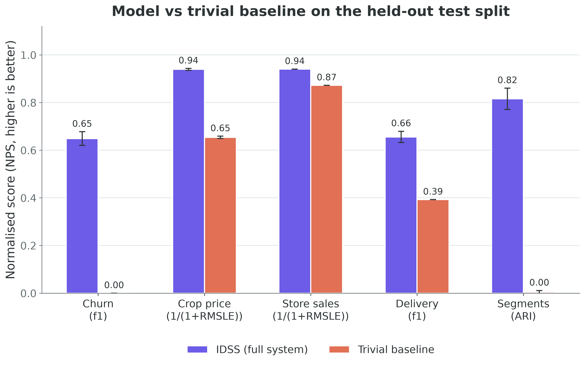
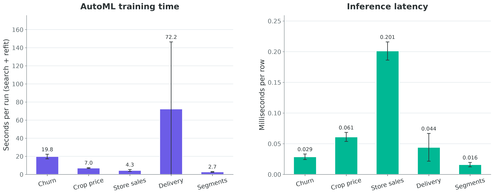
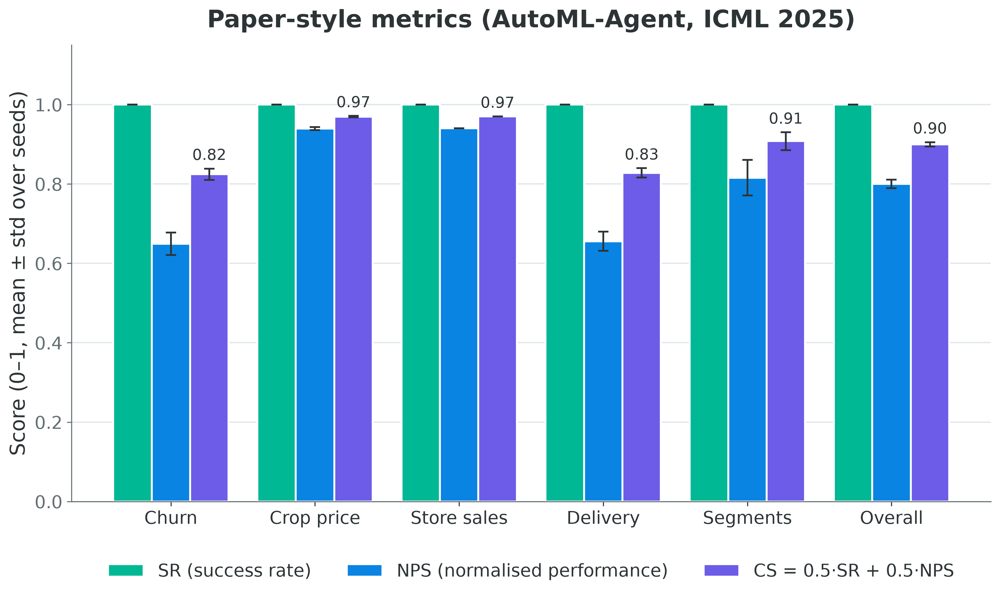
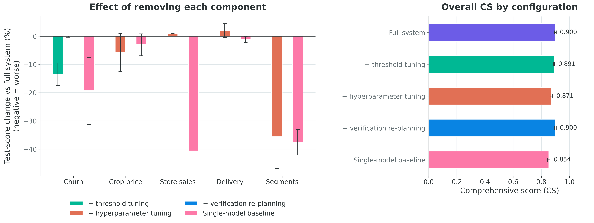
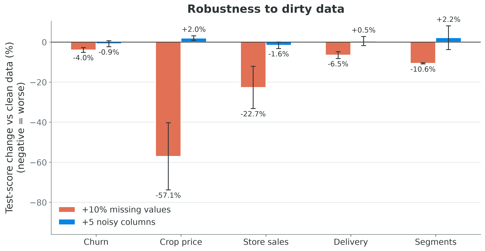

# IDSS evaluation (Step 8)

- Generated: 2026-10-06 01:14 by `scripts/evaluate.py` (offline: no LLM, no web search).
- Re-run on 2026-10-06 01:45: Segments only, same seeds — clustering primary metric changed from the Rand index to the chance-corrected adjusted Rand index (ARI). The other datasets keep their original runs; the replaced runs are kept under `superseded` in `evaluation.json`.
- Re-run on 2026-10-06 01:47: Segments only, same seeds — Gaussian mixture now uses several EM initialisations (a single start made the final refit unreliable); ARI primary. The other datasets keep their original runs; the replaced runs are kept under `superseded` in `evaluation.json`.
- Seeds: 42, 43, 44. Every number is the mean ± sample standard deviation over seeds; the seed controls the train/valid/test split (time series: chronological, so only model randomness), Optuna's sampler, the models and the data perturbations.
- Budget: **fast** — up to 3 candidate models × 15 Optuna trials, 60s per model, 180s in total; a re-plan after a failed verification uses the full budget once.
- Pipeline: the real Orchestrator (Requirement → Data → Plan → Train → Verify → Explain → Insight → Report). Requirements come from the data profile, as in an offline run; the segments dataset is given an explicit clustering requirement whose `segment` column is ground truth for scoring only (never a feature).
- Splits 70/20/10: models are selected on the validation split; the test split is read once.
- Environment: Python 3.12.0, Windows 11, 16 CPUs; scikit-learn 1.9.1, xgboost 3.4.1, lightgbm 4.7.0, optuna 5.0.0, shap 0.52.0, pandas 3.0.6, numpy 2.5.3.
- Reproduce: `.venv\Scripts\python.exe scripts\evaluate.py` (rebuild this file and the charts from `evaluation.json` with `--from-json`).

Datasets (all synthetic, generated by `scripts/make_samples.py` with fixed seeds):

| Dataset | File | Rows | Task | Target |
|---|---|---:|---|---|
| Churn | `customer_churn.csv` | 3,000 | binary classification | `churn` |
| Crop price | `crop_price.csv` | 2,000 | regression | `price` |
| Store sales | `store_sales.csv` | 730 | time-series forecasting | `sales` |
| Delivery | `delivery_status.csv` | 2,500 | 3-class classification | `delivery_status` |
| Segments | `customer_segments.csv` | 1,600 | clustering | `segment` (ground truth) |

## 1. Main benchmark (full system, clean data)

| Dataset | Task | Rows | Best model | Primary metric | Test score | Baseline | Improvement | RI (paper metric) | Train time (s) | Inference (ms/row) | Verification passed |
|---|---|---:|---|---|---:|---:|---:|---:|---:|---:|---:|
| Churn | binary classification | 3,000 | logistic_regression (3/3) | f1 ↑ | 0.649 ± 0.028 | 0.000 ± 0.000 (majority_class) | n/a¹ | – | 19.8 ± 2.5 | 0.0286 ± 0.0045 | 3/3 |
| Crop price | regression | 2,000 | lightgbm (3/3) | rmse ↓ | 356.9 ± 26.81 | 2,392.8 ± 45.77 (mean) | +85.1% ± 0.8 | – | 7.0 ± 0.5 | 0.0610 ± 0.0073 | 3/3 |
| Store sales | time-series forecasting | 730 | ridge (3/3) | rmse ↓ | 923.6 ± 0.000 | 2,340.7 ± 0.000 (seasonal_naive) | +60.5% ± 0.0 | – | 4.3 ± 1.1 | 0.2011 ± 0.0148 | 3/3 |
| Delivery | 3-class classification | 2,500 | logistic_regression (2/3) | f1 ↑ | 0.656 ± 0.024 | 0.393 ± 0.000 (majority_class) | +67.0% ± 6.1 | – | 72.2 ± 74.2 | 0.0440 ± 0.0226 | 2/3 |
| Segments | clustering | 1,600 | gaussian_mixture (3/3) | ARI ↑ | 0.816 ± 0.045 | 0.004 ± 0.007 (random_assignment) | n/a¹ | 0.930 ± 0.017 (baseline 0.625) | 2.7 ± 0.4 | 0.0159 ± 0.0036 | 3/3 |

↑ higher is better, ↓ lower is better. *Best model* is the most frequent choice over the seeds. *Improvement* is the relative gain over the baseline on the primary metric. *Train time* is the whole AutoML search plus the final refit (summed over attempts when verification triggered a re-plan); *inference* is the median time of the fitted pipeline (preprocessing included) on up to 500 test rows.

¹ Chance-level baseline (|baseline| < 0.05), so a relative improvement is undefined and the absolute gain equals the model's score: the majority-class baseline never predicts the minority (churn) class, so its F1 is 0; a random cluster assignment has an ARI of about 0 by construction.

### Why ARI rather than the Rand index for clustering

AutoML-Agent scores clustering with the Rand index (RI). RI counts the share of row pairs on which the clustering and the ground truth agree, and pairs placed in *different* clusters agree whenever the truth also separates them — which is most pairs once there are several groups. RI therefore rewards splitting the data into more clusters than exist and is not corrected for chance: a random assignment into four groups already scores about 0.62 here. In a first run with RI as the primary metric, an untuned k-means with its default of 8 clusters scored a higher RI than the tuned 4-cluster model. The **adjusted Rand index (ARI)** subtracts the agreement expected by chance (random labels score ≈ 0, a perfect match 1) and penalises over-splitting, so IDSS now uses ARI as the primary clustering metric whenever ground truth exists — for model selection, the baseline comparison and the overfitting check in verification, NPS, the ablation and the robustness study. RI is still computed and reported for comparison with the paper.

The same investigation exposed an engine bug: the Gaussian mixture ran a single EM initialisation, which on this data stops in a poor local optimum for some seeds (ARI ≈ 0.53 instead of 0.84). The configuration that won the search was then refitted into a worse model, which made adding noise columns look like an *improvement*. The mixture now uses several initialisations (like k-means). The Segments runs below were re-run after both changes; the two earlier sets are kept under `superseded` in `evaluation.json`.

| Configuration | Model chosen (per seed) | ARI ↑ | RI ↑ |
|---|---|---:|---:|
| Segments: Full system | gaussian_mixture, gaussian_mixture, gaussian_mixture | 0.816 ± 0.045 | 0.930 ± 0.017 |
| Segments: − hyperparameter tuning | agglomerative, agglomerative, kmeans | 0.523 ± 0.078 | 0.804 ± 0.046 |
| Segments: − verification re-planning | gaussian_mixture, gaussian_mixture, gaussian_mixture | 0.816 ± 0.045 | 0.930 ± 0.017 |
| Segments: Single-model baseline | kmeans, kmeans, kmeans | 0.508 ± 0.012 | 0.841 ± 0.006 |
| Segments: Full system, +10% missing values | agglomerative, gaussian_mixture, gaussian_mixture | 0.729 ± 0.042 | 0.896 ± 0.014 |
| Segments: Full system, +5 noisy columns | gaussian_mixture, gaussian_mixture, gaussian_mixture | 0.833 ± 0.053 | 0.936 ± 0.019 |

## 2. Paper-style metrics (SR, NPS, CS)

Following AutoML-Agent (Trirat et al., ICML 2025):

- **SR (success rate)** — share of runs that complete the whole pipeline (trained, tested, verified, explained and reported as a PDF).
- **NPS (normalised performance score)** — the test score mapped to [0, 1]: the score itself for 0–1 metrics where higher is better (F1; ARI, clipped at 0 because it can be slightly negative); `NPS = 1 / (1 + error)` for error metrics. For regression and forecasting the error is the **RMSLE** of the selected model, a scale-free error (as used for these tasks in the paper's benchmark): `1 / (1 + RMSE)` would depend on the target's units and be ≈ 0 for prices in rupees or daily sales. A failed run scores NPS = 0.
- **CS (comprehensive score)** — `CS = 0.5 · SR + 0.5 · NPS`.

Overall = mean over datasets for each seed, then mean ± std over seeds.

| Dataset | NPS from | SR | NPS | CS |
|---|---|---:|---:|---:|
| Churn | f1 | 1.000 ± 0.000 | 0.649 ± 0.028 | 0.825 ± 0.014 |
| Crop price | 1/(1+RMSLE) | 1.000 ± 0.000 | 0.939 ± 0.004 | 0.970 ± 0.002 |
| Store sales | 1/(1+RMSLE) | 1.000 ± 0.000 | 0.941 ± 0.000 | 0.970 ± 0.000 |
| Delivery | f1 | 1.000 ± 0.000 | 0.656 ± 0.024 | 0.828 ± 0.012 |
| Segments | ARI | 1.000 ± 0.000 | 0.816 ± 0.045 | 0.908 ± 0.022 |
| **Overall** | mean over datasets | 1.000 ± 0.000 | 0.800 ± 0.011 | **0.900 ± 0.005** |

## 3. Ablation study

Same datasets and seeds; one component removed at a time:

- **Full system** — model search over the planned candidates, Optuna tuning, decision-threshold tuning, verification with one re-plan.
- **− threshold tuning** — binary classifiers keep the 0.5 probability cut-off.
- **− hyperparameter tuning** — every candidate is fitted once with its library defaults.
- **− verification re-planning** — the first attempt is final even when verification fails.
- **Single-model baseline** — one LightGBM (k-means for clustering) with library defaults: no model search, no tuning, no threshold tuning, no re-planning.

Cells: test score (mean ± std) and, in brackets, the mean change against the full system on the same seed (positive = better). Ablation runs stop after verification, so SR here counts runs that trained, tested and verified a model.

| Variant | Churn (f1) | Crop price (rmse) | Store sales (rmse) | Delivery (f1) | Segments (ARI) | SR | NPS | CS | Train time (s) |
|---|---:|---:|---:|---:|---:|---:|---:|---:|---:|
| **Full system** | 0.649 ± 0.028 | 356.9 ± 26.81 | 923.6 ± 0.000 | 0.656 ± 0.024 | 0.816 ± 0.045 | 1.000 ± 0.000 | 0.800 ± 0.011 | **0.900 ± 0.005** | 21.2 ± 39.0 |
| − threshold tuning | 0.561 ± 0.006 (-13.4%) | 356.9 ± 26.81 (+0.0%)² | 923.6 ± 0.000 (+0.0%)² | 0.656 ± 0.024 (+0.0%)² | 0.816 ± 0.045 (+0.0%)² | 1.000 ± 0.000 | 0.782 ± 0.005 | 0.891 ± 0.003 | 26.3 ± 43.5 |
| − hyperparameter tuning | 0.648 ± 0.027 (-0.1%) | 378.5 ± 52.63 (-5.7%) | 915.7 ± 0.000 (+0.9%) | 0.669 ± 0.021 (+2.0%) | 0.523 ± 0.078 (-35.6%) | 1.000 ± 0.000 | 0.743 ± 0.018 | 0.871 ± 0.009 | 1.9 ± 1.5 |
| − verification re-planning | 0.649 ± 0.028 (+0.0%) | 356.9 ± 26.81 (+0.0%) | 923.6 ± 0.000 (+0.0%) | 0.656 ± 0.024 (+0.0%) | 0.816 ± 0.045 (+0.0%) | 1.000 ± 0.000 | 0.800 ± 0.011 | 0.900 ± 0.005 | 12.8 ± 11.0 |
| Single-model baseline | 0.521 ± 0.057 (-19.3%) | 368.4 ± 41.67 (-3.0%) | 1,298.8 ± 0.000 (-40.6%) | 0.648 ± 0.020 (-1.1%) | 0.508 ± 0.012 (-37.6%) | 1.000 ± 0.000 | 0.707 ± 0.016 | 0.854 ± 0.008 | 0.7 ± 0.4 |

² Threshold tuning exists only for binary classification; on the other datasets the configuration is identical to the full system, so its runs are reused. Likewise, *− verification re-planning* is the full system's first attempt, so it differs only where re-planning was triggered.

## 4. Robustness

The full system is re-run on corrupted copies of each dataset: **+10% missing values** (extra cells blanked completely at random in every column except the target / ground truth, identifiers and the time index) and **+5 noisy columns** (pure-noise columns: three numeric, one integer, one categorical). Change = relative change of the test score against the clean run on the same seed (negative = worse).

| Dataset | Metric | Clean | +10% missing values | Change | +5 noisy columns | Change | Verified (missing / noise) |
|---|---|---:|---:|---:|---:|---:|---:|
| Churn | f1 ↑ | 0.649 ± 0.028 | 0.623 ± 0.029 | -4.0% ± 1.2 | 0.644 ± 0.036 | -0.9% ± 1.5 | 3/3 / 3/3 |
| Crop price | rmse ↓ | 356.9 ± 26.81 | 562.9 ± 95.98 | -57.1% ± 16.8 | 349.5 ± 22.56 | +2.0% ± 1.1 | 3/3 / 3/3 |
| Store sales | rmse ↓ | 923.6 ± 0.000 | 1,132.9 ± 97.31 | -22.7% ± 10.5 | 938.5 ± 15.17 | -1.6% ± 1.6 | 3/3 / 3/3 |
| Delivery | f1 ↑ | 0.656 ± 0.024 | 0.613 ± 0.011 | -6.5% ± 1.7 | 0.659 ± 0.024 | +0.5% ± 2.3 | 2/3 / 3/3 |
| Segments | ARI ↑ | 0.816 ± 0.045 | 0.729 ± 0.042 | -10.6% ± 0.3 | 0.833 ± 0.053 | +2.2% ± 5.9 | 3/3 / 3/3 |

## 5. Interpretation

- **Baselines.** The full system beats the trivial baseline on 5 of 5 datasets (majority class, mean, seasonal naive or random cluster assignment, scored on the same test split). Verification passed in 14 of 15 runs.
- **Paper-style scores.** SR = 1.00, NPS = 0.800 and CS = 0.900 (mean over datasets and seeds). Because the engine runs fixed, tested code instead of LLM-written scripts, every run that starts also finishes, so SR measures robustness rather than code quality here; NPS carries the differences.
- **Threshold tuning** matters only for binary classification: on churn, keeping the 0.5 cut-off changes F1 by -13.4% against the full system (the tuned cut-off trades precision for recall).
- **Hyperparameter tuning.** With library defaults the CS falls from 0.900 to 0.871; per dataset the test score changes from -35.6% (Segments) to +2.0% (Delivery). Where defaults score higher, tuning still chose the best model on the validation split; the test difference is within selection noise on these near-linear synthetic datasets. Search time drops from 21.2s to 1.9s per run on average.
- **Verification re-planning** was triggered in 1 of 15 full-system runs on clean data (CS without it: 0.900, with it: 0.900). Across all configurations it ran 3 time(s) — Churn (− threshold tuning) ×1, Delivery (+10% missing values) ×1, Delivery (Full system) ×1 — and the second attempt passed verification in 0 of them; a failure that persists is reported as 'not verified' instead of being hidden.
- **Single model.** One LightGBM (k-means for clustering) with default settings reaches CS = 0.854 against 0.900 for the full system, and passes verification in 6 of 15 runs (full system: 14 of 15); model search, tuning and threshold tuning together account for the difference.
- **Robustness.** 6 of 10 perturbed settings stay within 5% of the clean score. The largest loss is Crop price with 10% missing values (-57.1%).

## 6. Threats to validity

- All five datasets are synthetic with known generating processes; real data is noisier and may contain problems (drift, label noise, leakage) these datasets do not have.
- Fast mode only, on one machine: timings depend on the CPU and on other load, and a larger budget can change the selected model.
- 3 seeds give an indication of variance, not tight confidence intervals.
- The LLM agents are not exercised (offline evaluation): requirement parsing, the knowledge brief, the LLM review in verification and the written insights use their deterministic fallbacks. Model choice is deterministic as well, so these results measure the engine and the pipeline, not the LLM.
- SR, NPS and CS follow the AutoML-Agent definitions, but the numbers are not comparable with the paper's tables: the datasets, budgets and success criteria differ.
