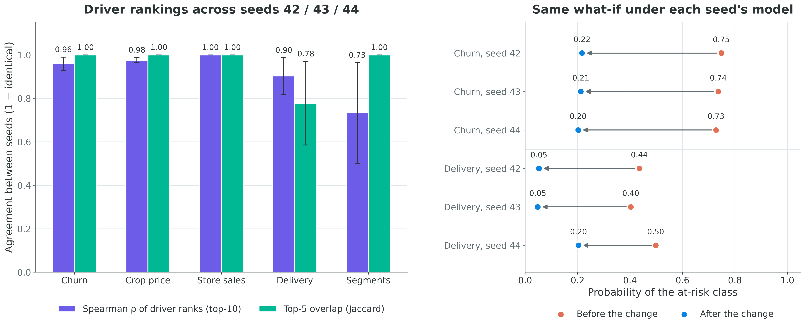

# Explanation stability

Generated by `scripts/evaluate_stability.py` on 2026-11-27 13:16 (5.6 min). Seeds 42, 43, 44; fast budget (3 models × 15 trials); Python 3.12.0 on Windows 11; scikit-learn 1.9.1, xgboost 3.4.1, lightgbm 4.7.0, optuna 5.0.0, shap 0.52.0, pandas 3.0.6, numpy 2.5.3. The datasets are the synthetic, seeded samples in `data/samples/`. The Step 8 results in `evaluation.md` are not changed by this script.

**Question.** If the same analysis is run again, do the explanations stay the same? Each seed changes the train/valid/test split, the hyper-parameter search and the models' random state, as two real runs would.

## How it was measured

- The real Orchestrator runs offline (no LLM, as in `evaluate.py`) until the EXPLAIN stage has finished.
- **Drivers**: the global explanation of the selected model, summed back to the original columns (SHAP, or permutation importance; for clustering, how strongly each column separates the clusters). The top 10 per seed are saved in `stability.json`.
- **Spearman ρ (top-10)**: rank correlation between two seeds over the union of their top-10 drivers, each ranked by its position in that seed's full list (1 = same order, 0 = unrelated).
- **Top-5 Jaccard**: shared drivers ÷ all drivers in the two top-5 sets (1 = same five, 0.667 = four shared).
- Both are the mean ± standard deviation over the three seed pairs (42–43, 42–44, 43–44).
- **What-if** (classification): the same change on the same base row under each seed's model. The base row is the typical record of the at-risk class (median / most common value / latest date), so it does not depend on any one model. Output = probability of the at-risk class (churn: the positive class; delivery: the least frequent class).
- Verdict: *stable* when mean ρ ≥ 0.8 and Jaccard ≥ 0.8; *unstable* when ρ < 0.5 and Jaccard < 0.6; otherwise *moderately stable*.

## Driver ranking stability

| Dataset | Task | Drivers | Best model per seed | Spearman ρ (top-10) | Top-5 Jaccard | Top driver per seed | Verdict |
|---|---|---:|---|---:|---:|---|---|
| Churn | binary classification | 10 | logistic_regression, logistic_regression, logistic_regression | 0.960 ± 0.031 | 1.000 ± 0.000 | contract_type, contract_type, contract_type | stable |
| Crop price | regression | 10 | lightgbm, lightgbm, lightgbm | 0.976 ± 0.012 | 1.000 ± 0.000 | yield_t_per_ha, crop, yield_t_per_ha | stable |
| Store sales | time-series forecasting | 6 | ridge, ridge, ridge | 1.000 ± 0.000 | 1.000 ± 0.000 | date, date, date | stable |
| Delivery | 3-class classification | 10 | logistic_regression, logistic_regression, lightgbm | 0.903 ± 0.084 | 0.778 ± 0.192 | shipping_mode, shipping_mode, shipping_mode | moderately stable |
| Segments | clustering | 6 | gaussian_mixture, gaussian_mixture, gaussian_mixture | 0.733 ± 0.231 | 1.000 ± 0.000 | online_share_pct, online_share_pct, online_share_pct | moderately stable |

## What-if stability

| Dataset | Output | Change | Before | After | Change in probability | Same direction |
|---|---|---|---:|---:|---:|---:|
| Churn | P(Yes) | contract_type → 'Two year' | 0.737 ± 0.010 | 0.211 ± 0.008 | -0.527 ± 0.004 | yes |
| Delivery | P(Very late) | shipping_mode → 'Express' | 0.445 ± 0.048 | 0.101 ± 0.089 | -0.344 ± 0.045 | yes |

- **Churn** (typical 'Yes' record): signup_date = 2024-12-28, region = West, contract_type = Month-to-month, internet_service = Fiber optic, payment_method = Electronic check, senior_citizen = 0, tenure_months = 25, monthly_charges = 73.43, total_charges = 1521.565, support_calls = 1.
- **Delivery** (typical 'Very late' record): order_date = 2024-12-31, warehouse = Mumbai, carrier = Carrier B, shipping_mode = Standard, distance_km = 1048.5, package_weight_kg = 6.95, items_count = 3, dispatch_delay_hours = 15.2, peak_season = 0, weather_alert = 0.

## Interpretation

- **Overall.** Driver rankings are stable (mean Spearman ρ ≥ 0.8 and top-5 Jaccard ≥ 0.8) on 3 of 5 datasets (Churn, Crop price, Store sales). The top driver is the same under all seeds on 4 of 5 datasets (Churn, Store sales, Delivery, Segments).
- **Delivery** is moderately stable: ρ = 0.903 ± 0.084, top-5 Jaccard = 0.778 ± 0.192. The top driver is shipping_mode under every seed. The selected model differs between seeds (logistic_regression (shap_linear), logistic_regression (shap_linear), lightgbm (shap_tree)), so the explanations describe different models; this is the main source of the change. Not in every top 5: order_date (seed 44); peak_season (seeds 42, 43). In the synthetic data peak_season is defined by the order month (October to December), so a model can credit the same seasonal signal to either column.
- **Segments** is moderately stable: ρ = 0.733 ± 0.231, top-5 Jaccard = 1.000 ± 0.000. The top driver is online_share_pct under every seed. The same model (gaussian_mixture) was selected under every seed. The top-5 drivers have nearly equal importance shares (15.2%–19.0%), so small differences between the fitted models reorder them while the set stays the same.
- **Small feature sets.** Store sales (6 drivers), Segments (6 drivers) have at most 6 drivers, so their top-5 sets overlap almost by construction; the Spearman correlation is the more informative number there.
- **What-if, Churn** (contract_type → 'Two year' on the typical 'Yes' record): the probability moves from 0.737 ± 0.010 to 0.211 ± 0.008, a change of -0.527 ± 0.004; all seeds agree on the direction of the effect. The starting probability varies by 0.020 between seeds, so a single run's exact probability should be read with that margin.
- **What-if, Delivery** (shipping_mode → 'Express' on the typical 'Very late' record): the probability moves from 0.445 ± 0.048 to 0.101 ± 0.089, a change of -0.344 ± 0.045; all seeds agree on the direction of the effect. The starting probability varies by 0.095 between seeds, so a single run's exact probability should be read with that margin. Under seed 44 a different model was selected (lightgbm): 0.498 → 0.204, against 0.436 → 0.053, 0.403 → 0.048 under the other seeds.

## Per-seed detail

| Dataset | Seed | Model | Method | Top-5 drivers (share of total importance) |
|---|---:|---|---|---|
| Churn | 42 | logistic_regression | shap_linear | contract_type (33.8%), tenure_months (19.8%), payment_method (12.6%), monthly_charges (8.9%), support_calls (8.7%) |
| Churn | 43 | logistic_regression | shap_linear | contract_type (33.0%), tenure_months (18.4%), payment_method (11.9%), monthly_charges (10.8%), support_calls (8.5%) |
| Churn | 44 | logistic_regression | shap_linear | contract_type (33.3%), tenure_months (17.2%), payment_method (11.7%), monthly_charges (10.6%), support_calls (8.6%) |
| Crop price | 42 | lightgbm | shap_tree | yield_t_per_ha (38.7%), crop (21.6%), year (15.3%), season (11.9%), state (4.3%) |
| Crop price | 43 | lightgbm | shap_tree | crop (37.8%), yield_t_per_ha (26.9%), year (15.7%), season (8.3%), state (5.1%) |
| Crop price | 44 | lightgbm | shap_tree | yield_t_per_ha (32.6%), crop (27.5%), year (15.7%), season (12.4%), state (4.6%) |
| Store sales | 42 | ridge | shap_linear | date (86.8%), day_of_week (3.9%), is_promo (3.6%), temperature_c (2.8%), sales (history) (2.4%) |
| Store sales | 43 | ridge | shap_linear | date (86.8%), day_of_week (3.9%), is_promo (3.6%), temperature_c (2.8%), sales (history) (2.4%) |
| Store sales | 44 | ridge | shap_linear | date (86.8%), day_of_week (3.9%), is_promo (3.6%), temperature_c (2.8%), sales (history) (2.4%) |
| Delivery | 42 | logistic_regression | shap_linear | shipping_mode (27.6%), distance_km (18.1%), carrier (17.1%), dispatch_delay_hours (15.0%), peak_season (8.7%) |
| Delivery | 43 | logistic_regression | shap_linear | shipping_mode (27.5%), distance_km (18.4%), carrier (17.7%), dispatch_delay_hours (15.3%), peak_season (9.2%) |
| Delivery | 44 | lightgbm | shap_tree | shipping_mode (27.2%), distance_km (19.9%), dispatch_delay_hours (17.4%), carrier (12.8%), order_date (6.5%) |
| Segments | 42 | gaussian_mixture | cluster_profile | online_share_pct (19.0%), discount_usage_pct (17.6%), annual_spend (17.1%), avg_basket_value (16.7%), visits_per_month (15.2%) |
| Segments | 43 | gaussian_mixture | cluster_profile | online_share_pct (18.9%), discount_usage_pct (17.6%), annual_spend (17.1%), avg_basket_value (16.7%), visits_per_month (15.2%) |
| Segments | 44 | gaussian_mixture | cluster_profile | online_share_pct (19.0%), annual_spend (17.7%), visits_per_month (17.4%), avg_basket_value (16.8%), discount_usage_pct (15.4%) |

| Dataset | Seed | Model | Before | After | Change |
|---|---:|---|---:|---:|---:|
| Churn | 42 | logistic_regression | 0.748 | 0.217 | -0.531 |
| Churn | 43 | logistic_regression | 0.737 | 0.212 | -0.524 |
| Churn | 44 | logistic_regression | 0.728 | 0.202 | -0.526 |
| Delivery | 42 | logistic_regression | 0.436 | 0.053 | -0.383 |
| Delivery | 43 | logistic_regression | 0.403 | 0.048 | -0.355 |
| Delivery | 44 | lightgbm | 0.498 | 0.204 | -0.294 |

## Limitations

- Three seeds give three pairs per dataset: an indication of variability, not a confidence interval.
- SHAP values for boosted trees are on the log-odds scale and for linear models on the model's own scale, so importance *shares* are compared between seeds only through ranks, never as raw values across model types.
- The datasets are synthetic with a known signal; real data with correlated features usually gives less stable rankings (correlated columns can swap places).
- One what-if scenario per classification dataset; other rows or larger changes can vary more.
